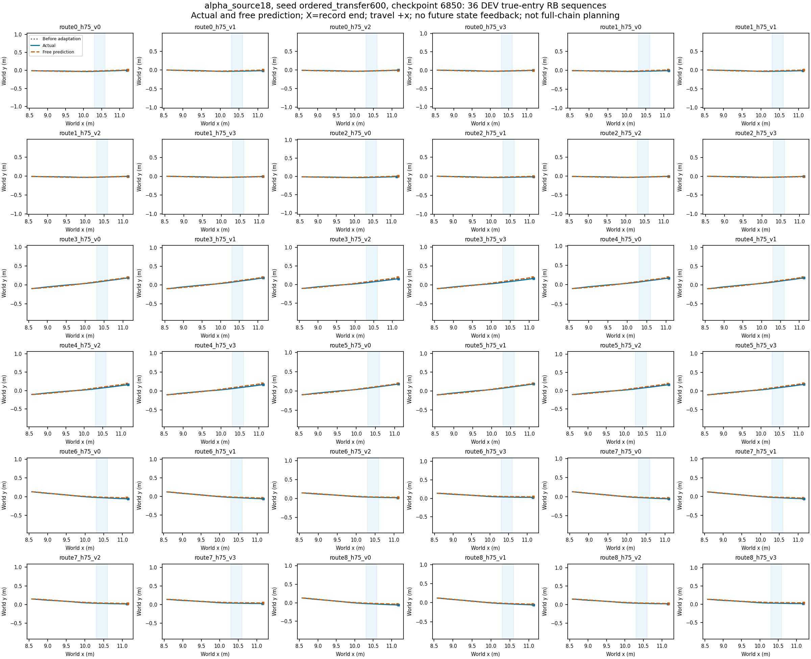
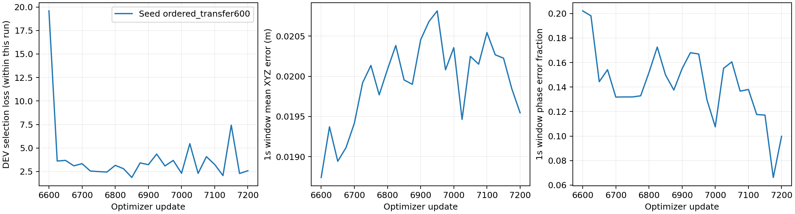

# P5 条件阶段模型迁移

[全部648例、18页同图对照](/media/qy/6A7E3DB07E3D75C3/STTW_runs/chapter3_playground_sttw_rb_sttw/taskbook_20261115_p5_alpha_models/conditional_jump/ordered_transfer600/report/README.md)；原始坐标在对应full_segment/predictions.npz，逐例指标见cases.csv。

从旧有序阶段模型6600恢复模型/Adam，使用全部α TRAIN适配600次、学习率3e-5，保留原TRAIN归一化与阶段图，未改控制技能或物理。每25次存档，固定DEV完整段loss最优6850；最后7200有反弹，不称收敛。墙钟100.14秒，Bark sent/HTTP200。

|共同评测口径|适配前|适配后|
|---|---:|---:|
|648例完整段平均最大XYZ m|0.05419|0.05534|
|记录时长内预测交回|357/648|535/648|
|统一2.5s查询预测交回|648/648|648/648|
|交回时间平均绝对误差 s|0.03738|0.02934|
|交回位置平均误差 m|0.07349|0.05849|
|交回位置最坏误差 m|0.41905|0.43099|
|碰撞体AABB角点平均最大误差 m|0.09767|0.07326|

记录窗口内新增181、保留354、丢失3、仍未出现110；这是事件时刻变化，不是物理能力新增。统一查询均有事件，事件均值改善而最坏位置退步，全部保留。几何差异不构成安全保证，预测phase2也不证明执行关节锁定门槛通过。

|α|例数|前/后记录内交回|前/后平均最大XYZ m|
|---|---:|---:|---:|
|0|216|131/165|0.04373/0.04613|
|0.5|216|113/173|0.05236/0.05292|
|1|216|113/197|0.06648/0.06699|

已知DEV、单训练seed；旧模型非零α只是分布外迁移对照。本轮已覆盖条件TRAIN，但不代表独立泛化或P5规划收益通过。随后检验从初始真实状态出发的整段串联，不能把真实跳跃入口诊断替代完整交接。
