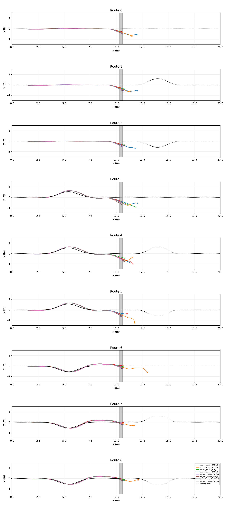

# P5 原跳跃与完整 RecoveryBridge：首次同条件物理比较

map00 TRAIN，9路线×2速度（1.8/1.9m/s）×2初态，各36条。冻结H75、地面α0、地图、接触和交回条件一致；无适配权重覆盖，无本轮控制训练。不是独立TEST。

|策略|远岸接触|交回STTW|最终任务|终止|
|---|---:|---:|---:|---|
|原source|22/36|1/36|0/36|34物理失败、2跟踪域退出|
|完整RB rb_run1|30/36|0/36|0/36|36物理失败|

远岸接触不是稳定落地或成功跨沟。完整RB在本地物理下尚未完成交接，不能据此宣称RB提升整程能力；也不能将本地迁移失败推翻其原任务结果。shared225来自PPO-only分支，未混入此对照。

|配对事件|新增|保留|丢失|双方未达|
|---|---:|---:|---:|---:|
|far_contact|11|19|3|3|
|handoff_s|0|0|1|35|
|goal|0|0|0|36|

逐例身份及终点见[cases.json](cases.json)，物理声明见[declaration.json](declaration.json)。原始轨迹目录：`/media/qy/6A7E3DB07E3D75C3/STTW_runs/chapter3_playground_sttw_rb_sttw/taskbook_20261115_p5_source_full_rb/map00/evaluation`。完成72条，物理评测约294.46秒。

原source及完整RB actor/critic/normalizer已导出；16输入的动作最大差分别2.09e-7与2.68e-7，仅为导出一致性，不是控制能力验证。

下一步：先保留冻结策略负结果。若进行同预算本地适配，两策略须分别保留原身份、匹配预测器与独立评价；不能把共同PPO适配效果直接归因RecoveryBridge。参考既有4096环境×24步的200更新耗时4469秒，150更新每策略约56分钟，超出用户30分钟等待阈值；当前不启动。P5未完成，P6尚未执行。
