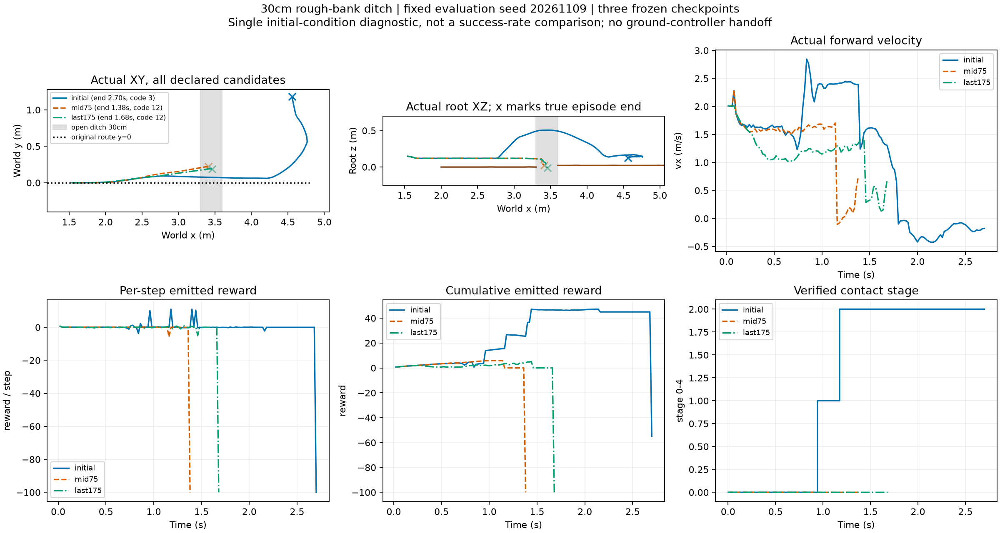
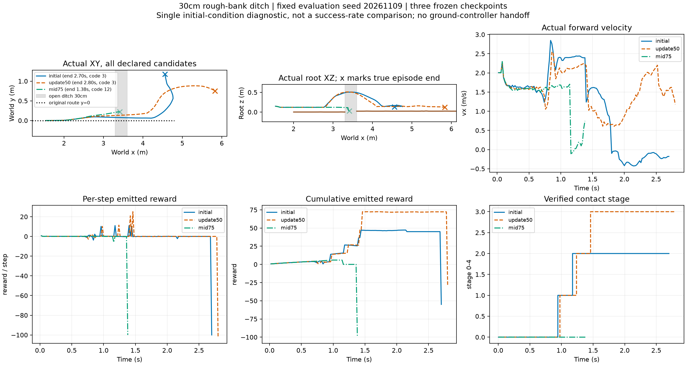

# 高岸随机地形训练：再次丢失主动跳跃

已按用户报告中止训练，实际177轮，保存至175轮。当前不是旧接触过滤失效的137轮训练；有效近岸支撑始终正常。停止后不自动重训，保留所有checkpoint与原始轨迹。

## 第50轮补评：仍会跳，落地捕获优于初始

新增1条第50轮物理回放，初始/75轮复用已保存轨迹；已核对map26、地形seed、车辆随机化属性、评测seed一致。50轮最高root z=0.510m，0.975s进入阶段1、1.2375s清沟、1.460s达到落地捕获stage3；继续执行至2.80s、x=5.829m后侧倾约35.60°超限。回报−30，完整阶段4仍未通过。

同工况已检查候选中，50轮比初始(stage2/−55)、75/175轮(stage0/−100)推进更远，是后续保留起跳能力与落地适配的候选参考。不能称全程best或已合格技能；仅一个初态。此前“训练退化”应明确为后期退化，该工况50轮仍有落地捕获能力，75轮已无明显主动起跳；不把整轮训练描述为从一开始就无效。未自动恢复训练。

[50轮原始摘要](update50_summary.json)与[事件时刻](update50_events.json)；完整新增轨迹在运行目录`eval50`，三模型合并图及实测轨迹示意动画在`comparison_initial50_75`。

## 同一初态与地图的物理回放

三模型使用相同seed20261109、map26（地形seed951730916）、右岸高2.1916cm、1–4mm碎石、30cm真开口沟，mean actor，无地面控制器接管。单初态DEV，不是总体成功率。

|模型|最高root z|终点x|时长|阶段|回报|行为|
|---|---:|---:|---:|---:|---:|---|
|初始|0.506m|4.559m|2.70s|2|−55|明显起跳清沟，落地后侧倾超限|
|75轮|0.148m|3.410m|1.38s|0|−100|无明显主动抬升，驶入沟中触发地形/接触失败code12|
|175轮|0.148m|3.460m|1.68s|0|−100|同样驶入沟中，未清沟，code12|

三者均无完整恢复。近岸支撑和原始接触点存在，初始阶段奖励正常；本次不能归因为前次漏记接触，也不是低岸使直接冲过成为有利方案。已训练模型回报更差，因此不能简单宣称“奖励把不跳评得更高”。更准确的结论是：当前端到端PPO适配没有保留已有起跳能力。

## 训练趋势

首20与末20个episode汇总日志点：阶段1为99.61%→1.54%，清沟阶段2为89.82%→0.74%，捕获阶段3为37.11%→0.11%；完整阶段4始终0。回报均值−52.44→−99.65；旧0.5m apex指标53.43%→0.29%。这些是日志均值，不是按全部回合精确汇总的独立成功率。

physical_flight_fraction=1只记录曾双轮无载且净空>15mm，包含短暂卸载或驶入沟中，不能叫主动跳跃成功率。verified_near_support_fraction首末均1，支持接触接线正常。需结合高度时序及阶段判断。

## 原因边界与下一步

观察已证明策略退化，尚未证明某一个优化参数是唯一原因。实现仍整体更新actor与critic，载入旧任务critic/normalizer，短rollout24步(0.48s)、GAE lambda0.95、固定学习率5e−5；缺少对原有跳跃行为的保持约束。这些是下一轮需要分辨的机制，不把其存在直接当作因果证明。

不再仅修改地形或增加训练轮数。后续应先检查新奖励下价值估计与优势是否正确，再以保留原起跳为前提适配落地恢复；通过短预算配对回放确认没有丢失起跳后，才扩大训练。本轮没有修改奖励、物理或再启动训练。

[原始摘要](summary.json)、[训练统计](diagnostic_training_summary.json)、[冻结评测配置](diagnostic_config.json)。原始NPZ、动作和接触：`/media/qy/6A7E3DB07E3D75C3/STTW_runs/chapter3_ditch_random_contactfix450/diagnostic_eval`。绘图工具已适配随机地图真实高度，并完整保留超出旧±0.6m显示范围的初始模型轨迹。
