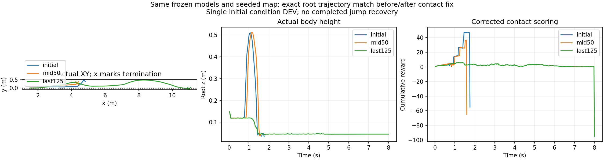

# 随机地形训练介入：多地图接触过滤失效

用户报告策略不再跳跃，已停止原计划450轮训练，实际完成137轮、保留至125轮检查点。初20个回合日志apex_fraction均值0.600，末20点0.00153，回合回报约−99.33；该apex是旧0.5m高度标签，不是跨沟成功。

## 原因与配对验证

多地图场景的单个通配过滤列没有获取所选地图的轮地接触点；实际总接触力非零，原始过滤patch_count始终0，near/armed/attempt均false，真实起跳及清沟没有阶段分。修复为每个地图各自的显式过滤列。物理模型、奖励权重、成功与终止标准均不变。

固定同一seed、随机地图池和模型，修复前后三条root轨迹逐值相同：

|模型|最高root z|修复前回报|修复后回报|修复后阶段|行为|
|---|---:|---:|---:|---|---|
|初始|0.510m|−100|−55|2|主动抬升清沟，落地后侧倾超限|
|50轮|0.512m|−100|−65|2|主动抬升清沟，落地后侧倾超限|
|125轮|0.148m|−95|−95|0|无明显主动抬升，运行8秒后超时|

修复后接触峰值分别206/210、208/205、205/216，均低于256容量。错误评分下，不跳至超时的−95优于能跳但落地失败的−100，构成错误学习诱因；这不是仅凭奖励曲线推断的高度奖励问题。不能由一次固定初态回放断言全部随机地图均同样退化。三条均无严格跨沟恢复成功。

本次缺陷是多地图过滤，不是之前单地图64/256容量错误。旧随机训练不能用于评价新奖励或随机地形训练的有效性，不采用125轮模型。

## 修复与后续运行

增加真实near-support、物理腾空和四阶段达成日志。首个训练更新要求有效near-support比例至少0.5，低于该值立即停止（接线检查，不放宽物理成功标准）。64环境×24步×2更新检查已完成，支撑覆盖率1.0；不能当作技能成功证据。记录评测实际terrain_id/spec，避免多地图回放丢失地图身份。

保持landing_focus奖励和1–4mm/±10cm随机地图池，从原初始checkpoint、全新优化器重训450轮；不使用退化的125轮权重。预算4096×24×450，任何运行异常停止，结束后另行物理回放。运行目录：`/media/qy/6A7E3DB07E3D75C3/STTW_runs/chapter3_ditch_random_contactfix450`。

日志语义更正：上游`Policy/mean_noise_std=4.46`误读了观测归一化std，不能解释为动作噪声；本项目`Policy/latent_action_std`才是动作分布标准差，末点约0.434。此次没有改动网络/采样噪声。

原始配对数据保存在`/media/qy/6A7E3DB07E3D75C3/STTW_runs/chapter3_ditch_random_height450/intervention_eval{,_fixed}`；[逐模型数值与逐值比较](comparison.json)、[训练统计](intervention_training_summary.json)。不将修复后的重新评分说成重新训练改善。
