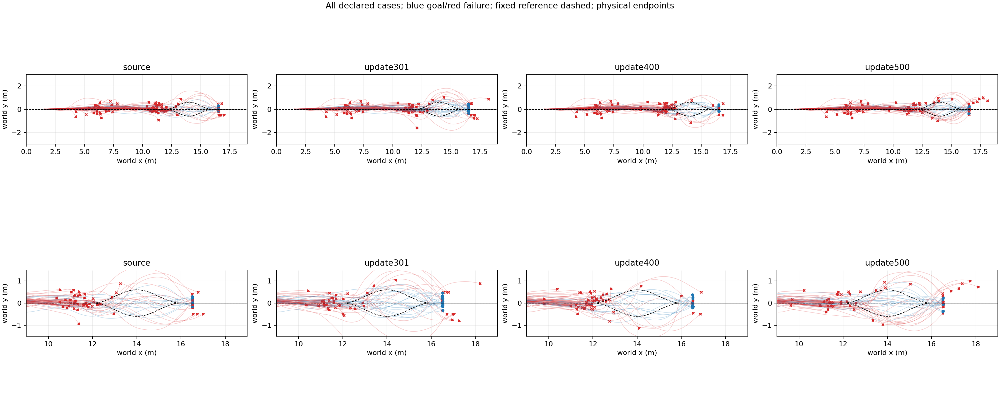
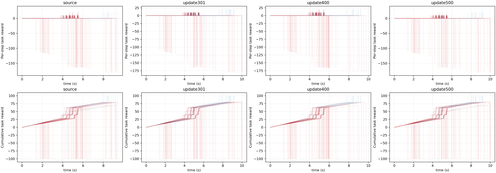

# RB candidate handoff screening

Source and three saved RB actors; 30 previously inspected roots x3 continuation roads/model, 360 episodes. The three roads are distinct tasks, not independent repetitions. Same frozen H75 and physical criteria; 15 approach commands assigned before execution; no model-based upstream selection or retraining.

|Actor|Goals/90|Gain/loss vs Source|Valid handoffs|Road violations|Straight/left/right goals (each30)|Exact entry pairs|
|---|---:|---:|---:|---:|---|---:|
|source|11|0/0|60|21|[7, 1, 3]|67/67|
|update301|19|13/5|63|20|[11, 4, 4]|60/67|
|update400|13|12/10|63|16|[3, 4, 6]|60/67|
|update500|16|11/6|62|21|[10, 4, 2]|60/67|

Actual 1411200 physics lane steps, 341.22s summed simulation; zero training.

Whole-task goals are primary; valid-handoff dynamics are conditional and selection-biased. Matched recorded entry descriptors do not serialize hidden contact solver state. Cross-batch outcomes may vary. This is development screening, not independent TEST or proof of full RecoveryBridge transfer. No candidate is automatically adopted and no checkpoints are discarded. Raw identity/config/trajectory records remain in each model subdirectory.
