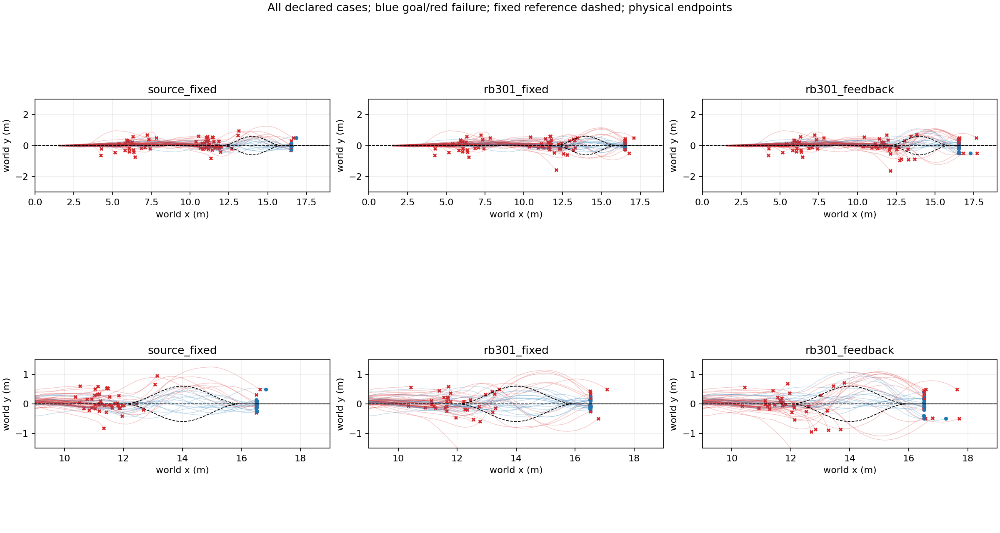
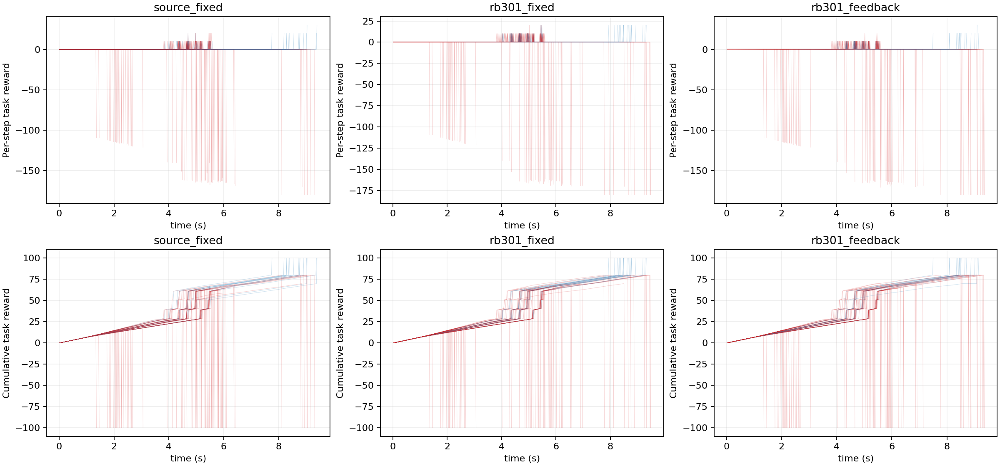

# RB301 with measured-state downstream feedback

30 previously inspected roots x3 simulation slots per method,270 episodes. Source-fixed and RB301-fixed retain the straight road; RB301-feedback queries the frozen source-trained Frenet model at measured handoff. All15approach pairs are preassigned, H75/physics/10s horizon unchanged. No refitting, policy training, or calibrated RB capability claim.

|Actor|Goals/90|Gain/loss vs Source|Valid handoffs|Road violations|Straight/left/right goals (each30)|Exact entry pairs|
|---|---:|---:|---:|---:|---|---:|
|source_fixed|15|0/0|60|18|[15, 0, 0]|67/67|
|rb301_fixed|20|17/12|63|20|[20, 0, 0]|60/67|
|rb301_feedback|16|10/9|63|23|[16, 0, 0]|60/67|

Actual 1016640 physics lane steps, 245.68s summed simulation; zero training.

Whole-task goals are primary; valid-handoff dynamics are conditional and selection-biased. Matched recorded entry descriptors do not serialize hidden contact solver state. Cross-batch outcomes may vary. This is development screening, not independent TEST or proof of full RecoveryBridge transfer. No candidate is automatically adopted and no checkpoints are discarded. Raw identity/config/trajectory records remain in each model subdirectory.

Feedback paired comparisons (root-clustered bootstrap): [{'comparator': 'source_fixed', 'gains': 10, 'losses': 9, 'root_mean_difference': 0.011111111111111106, 'root_bootstrap95': [-0.08888888888888888, 0.1111111111111111]}, {'comparator': 'rb301_fixed', 'gains': 8, 'losses': 12, 'root_mean_difference': -0.044444444444444446, 'root_bootstrap95': [-0.15555555555555556, 0.06666666666666667]}]

All 64 recorded publications match actual route and declared latency.

Published routes and query cost: [{'model': 'source_fixed', 'published_routes': {'60': 0, '61': 0, '62': 0}, 'mean_query_ms': 0.0}, {'model': 'rb301_fixed', 'published_routes': {'60': 0, '61': 0, '62': 0}, 'mean_query_ms': 0.0}, {'model': 'rb301_feedback', 'published_routes': {'60': 48, '61': 9, '62': 7}, 'mean_query_ms': 1.1799103458542959}]

Route-goal columns above group by the initially assigned road (straight), not the final selected road. Slot replicates are grouped under the30roots, not counted as independent conditions.
