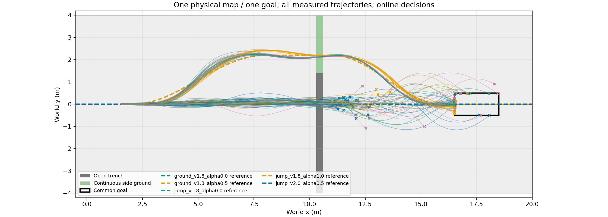
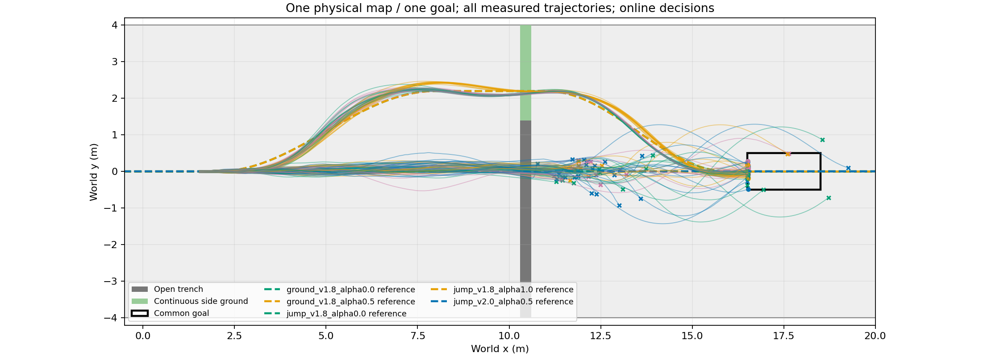
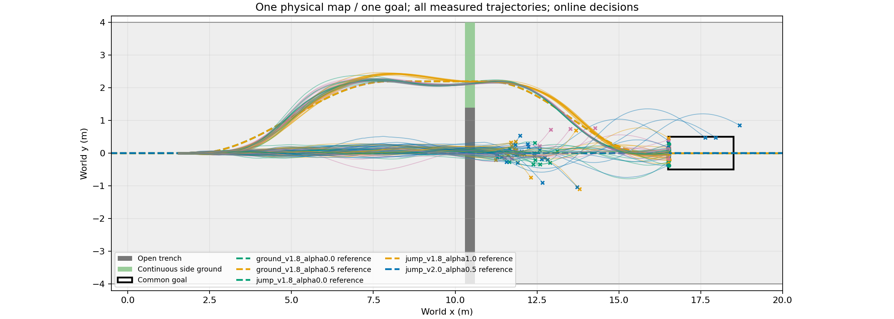

# RB跳跃候选接入持续前进规划流程

冻结既有16来车初态×早晚两处决策×4方法，各跳跃策略128条，总计384条Isaac整程评测。仅换跳跃网络；地图、原始道路、STTW、原事件与直接预测器、目标不变。策略为heading125、RB400、RB500。固定DEV转接诊断，不是未见地图或独立TEST。

|决策位置/m|规划方法|原策略/16|RB400/16|RB500/16|
|---|---|---:|---:|---:|
|1.8|default_jump|6|1|2|
|1.8|direct_success|16|16|16|
|1.8|event_model|16|16|16|
|1.8|state_rule|16|16|16|
|6.0|default_jump|2|5|1|
|6.0|direct_success|3|3|7|
|6.0|event_model|4|4|5|
|6.0|state_rule|4|7|4|

|跳跃网络|整程完成/128|相对source新增/丢失|同条件改选数量|实际执行耗时/s|
|---|---:|---:|---:|---:|
|source|67|0/0|0|86.62|
|rb400|68|15/14|0|85.19|
|rb500|67|13/13|0|87.71|

16个初态重复用于不同条件，不把128当作128个独立初态；同批道路违规、终止码与选择结果全部保留。不同进程的克隆物理差异仍可能影响结果，特别应观察未调用跳跃技能的绕行控制组。冻结的事件模型未使用RB技能数据重训，不能把替换技能解释为已实现技能条件化世界模型。

任务：中心30cm沟x10.3–10.6m，侧面连续道路绕行，同目标x16.5–18.5m；跳跃后首次远岸接触交回STTW（H75+ECBC/ESO，zero_lower=true），不要求静止支撑。模型预测和实际执行均保持连续前进。

- [source全部逐根结果、每步/累计奖励和速度](/media/qy/6A7E3DB07E3D75C3/STTW_runs/chapter3_jump_or_detour/rb_integration/source/RESULTS.md)
- [rb400全部逐根结果、每步/累计奖励和速度](/media/qy/6A7E3DB07E3D75C3/STTW_runs/chapter3_jump_or_detour/rb_integration/rb400/RESULTS.md)
- [rb500全部逐根结果、每步/累计奖励和速度](/media/qy/6A7E3DB07E3D75C3/STTW_runs/chapter3_jump_or_detour/rb_integration/rb500/RESULTS.md)

原始数据与冻结配置：`/media/qy/6A7E3DB07E3D75C3/STTW_runs/chapter3_jump_or_detour/rb_integration`。无新增PPO或世界模型训练。
