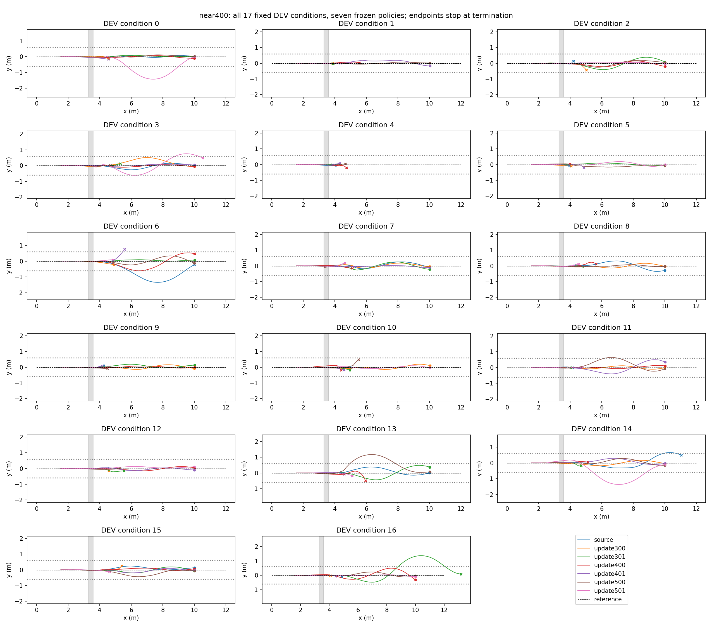

# 第400轮附近已保存模型的补测

同一固定DEV、相同名义物理及脉冲条件，source与300/301/400/401/500/501次更新模型，共119条Isaac轨迹。本次按完整任务完成数排名，同时保留新增与丢失；不再用零丢失一票否决。不是独立TEST，未重新训练。

|模型|完成/17|相对本批source新增|丢失|
|---|---:|---:|---:|
|source|6|0|0|
|update300|7|4|3|
|update301|8|4|2|
|update400|8|5|3|
|update401|7|4|3|
|update500|9|6|3|
|update501|5|5|6|

本批选择 **update500**，完成 **9/17**；实际采样保存耗时 61.77s。source及300/400/500模型同时重跑，避免直接混用不同批次物理结果。

没有保存350/375/425/450轮模型。Go2原runner在零基索引it更新后保存model_it.pt，因此model_300/400/500.pt分别对应301/401/501次更新；model_update文件记录实际完成次数。没有通过插值或重新训练冒充历史中间权重。

[每步奖励](near400_reward.png) · [累计奖励](near400_cumulative_reward.png) · [真实世界前向速度](near400_speed.png) · [每条件实际终点与终止码](near400_cases.json)。图均在真实终止处截止，全部模型失败保留。

冻结模型路径、协议和原始轨迹：`/media/qy/6A7E3DB07E3D75C3/STTW_runs/chapter3_rb_jump_scheduled/near400`。按开发集完成数挑选候选不等于能力无损提升或未见工况优势；后续使用应区分选模结果与独立验证。

**批次差异限制：** 此前source/300/400/500为8/9/10/6，本批为6/7/8/9。共同模型结果变化，故本批500轮最高不能直接称稳定优于400轮。301较同批300多1例，401较400少1例，501较500少4例；目前没有找到可靠优于400轮的邻近checkpoint。将400和500保留为开发候选，不将此前与本批的分母合并成独立测试样本。
