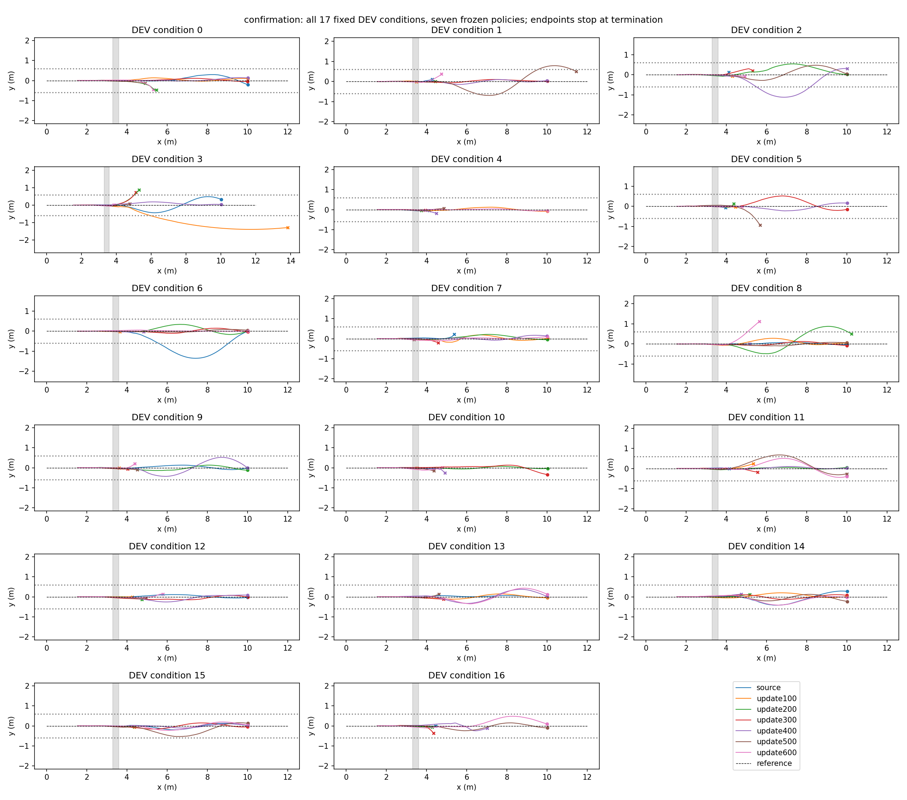

# RB 跳跃学生训练与固定开发集复测

同一 17 条固定 DEV 条件，两次均批量执行 source 与 100–600 轮六个 checkpoint，共 238 条实际轨迹。复测不是独立 TEST，也不将两次重复计为 34 个独立条件。圆点为任务完成，叉为失败终点；灰带为沟，虚线为原始直线参考。

|模型|首评完成/17|新增/丢失|复测完成/17|新增/丢失|
|---|---:|---:|---:|---:|
|source|8|0/0|8|0/0|
|update100|6|2/4|6|2/4|
|update200|6|5/7|6|5/7|
|update300|9|4/3|9|4/3|
|update400|10|4/2|10|4/2|
|update500|6|3/5|6|3/5|
|update600|8|5/5|8|5/5|

首评选择 source，复测选择 source。规则为先保留该次 source 完成的所有 DEV 条件，再最大化完成数；不是按训练 reward 选最优。单次差异不能证明稳定能力增益。

训练：4096 环境×24 步×600 更新，58,982,400 策略转移，471,859,200 物理环境步；10193.74 秒（约 2.83 小时）。32 个 TRAIN 脉冲条件中，4 组通过 source 三次失败/teacher 两次成功审查。采用 PPO + 成功动作示教 + 原策略保持；固定脉冲提案，不是完整 learned-explorer RB 复现。

任务为 x=3.3–3.6m 的 30cm 沟、同高岸、跳跃区平整、其余毫米级粗糙面。首次远岸接触后交回 H75+ECBC/ESO（zero_lower=true），原始 y=0 参考不重定位；目标 x=10–12m、|y|≤0.5m、vx≥0.5m/s，整程道路半宽0.6m。训练包含冻结配置的 Go2 随机化；本评估使用固定 nominal_environment 和相同脉冲条件，不冒称随机训练成功率或未见地形泛化。

首评耗时 59.73s，复测 63.26s（采样及保存计时，不含 Isaac 启动）。复测首次启动缺 PYTHONPATH，修复启动环境后重跑；未改变模型/物理/任务。

[首评全部 XY](pipeline_xy.png) · [首评每步奖励](pipeline_reward.png) · [复测每步奖励](confirmation_reward.png) · [全部条件终点、交接和原始终止码](cases.json)。终止码保持原值，未凭代码名称推断实际摔倒原因。

原始轨迹、配置和 checkpoint：`/media/qy/6A7E3DB07E3D75C3/STTW_runs/chapter3_rb_jump_scheduled`；`pipeline/train/training/model_update_00xxx.pt`。全部模型身份路径见两次 `selected_model.json`，未重新训练或以结果追调参数。

复测 119 条成败标签与首评逐条一致；这验证了该固定 DEV 协议的复现性，不是新独立样本。第400轮新增4、丢失2，净增2；第600轮新增5、丢失5，净增0。暂保留原策略，第400轮仅作为能力取舍候选，不自动进入主线。

后续按完成数排名的[400轮附近补测](NEAR400.md)：本批500轮9/17最高，400和301轮8/17；共同source仅6/17，存在批次差异，尚无稳定最优的新结论。
