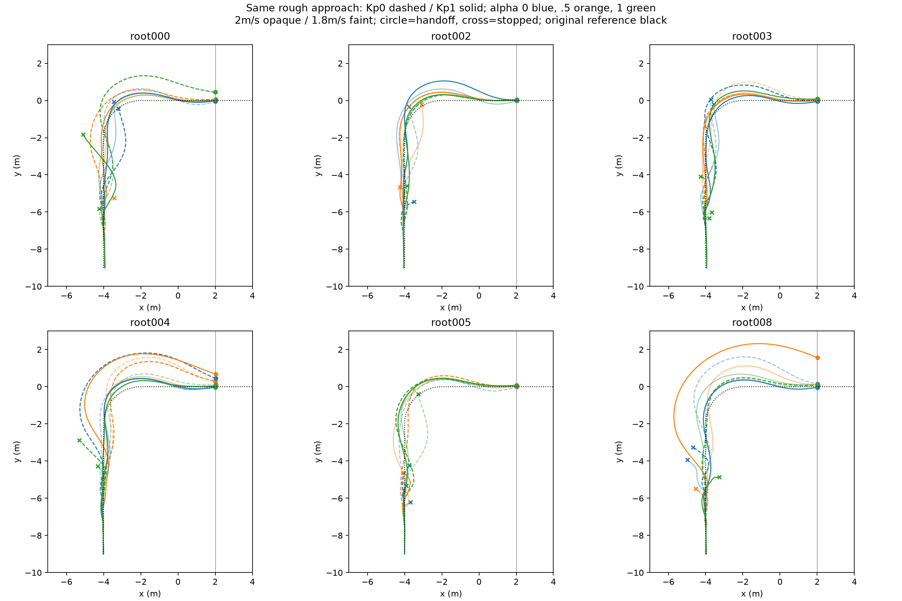
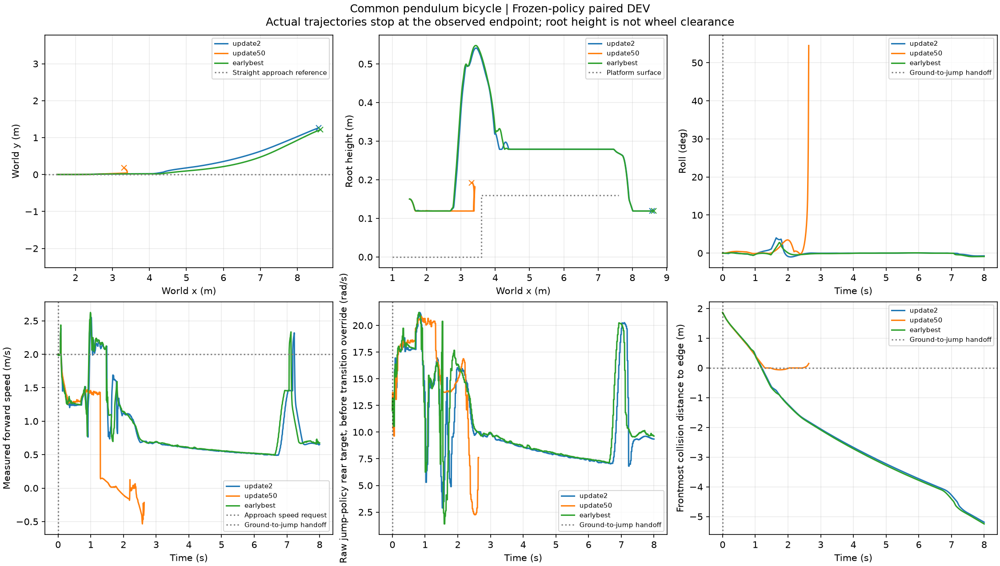
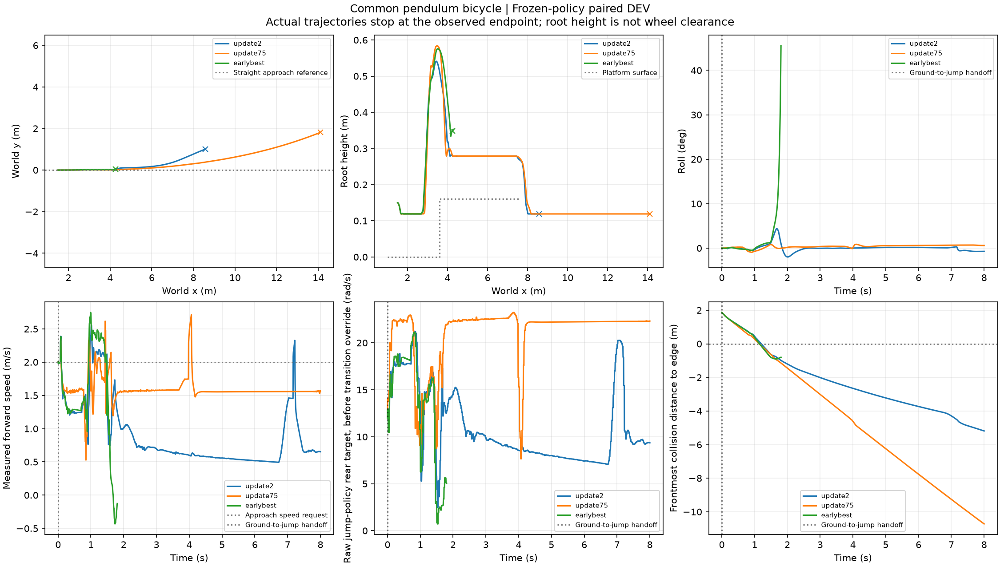
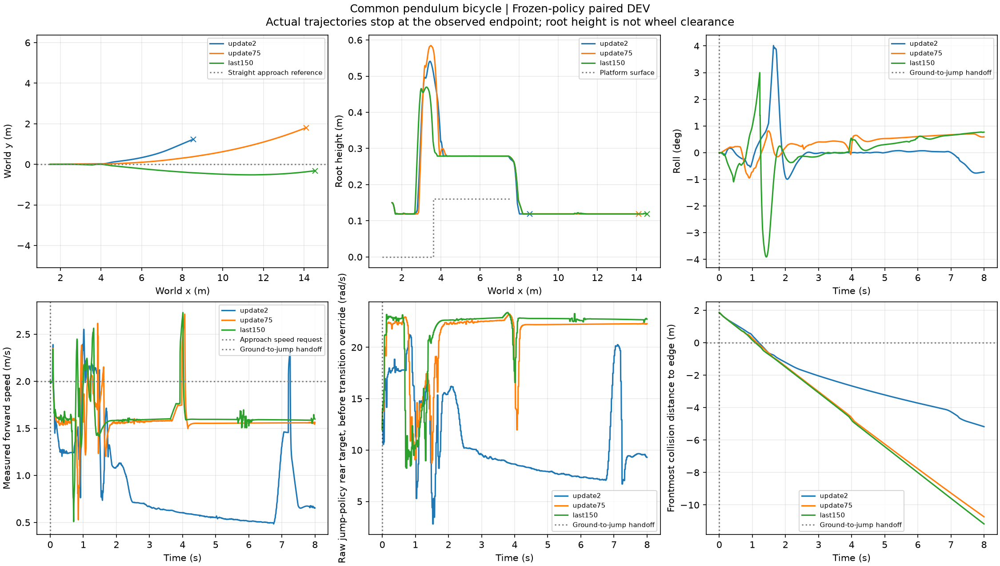
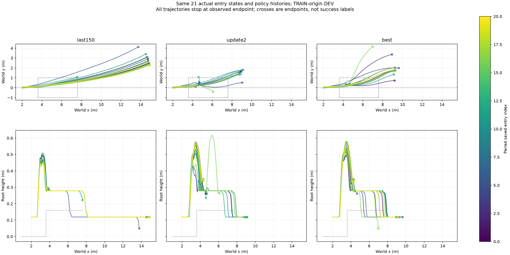
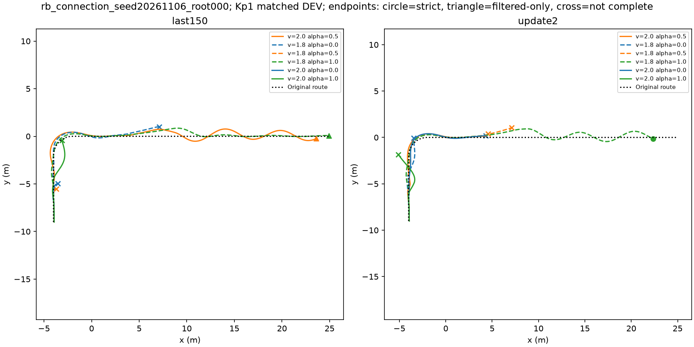

# 后轮补偿后的连续任务前半段

原起伏地形、右转路线、H75、零残差、六来源×六连接候选保持一致。Kp0与Kp1同批共72条，起跳入口x≥2且存活即停止；没有执行跳跃。原路廊半宽1m。

|指标|Kp0|Kp1|
|---|---:|---:|
|到达起跳区|19/36|25/36|
|全程路廊内到达|14/36|21/36|

Kp1到达新增14、丢失8；路廊内到达新增13、丢失6。存在净改善及反例，不称全面解决。旧单lane18/36与本轮Kp0 19/36有批量差异，不合并解释为补偿效果。

物理400Hz、地面/传感200Hz、H75与跳跃50Hz。当前RB底座，圆柱切片轮半径0.07m、宽0.05m、21切片；锁摆。后轮指令=(请求速度+Kp×(请求速度-真实车体前向速度))/轮半径，保持±60rad/s；部署需要独立速度估计。测试名义物理，非随机化鲁棒性证明。

原始证据：`/media/qy/6A7E3DB07E3D75C3/STTW_runs/chapter3_rear_comp_approach`。逐case指标见comparison.json，真实失败终点保留。21条Kp1路廊内入口供后续适配，六训练来源，不是独立TEST，不是完整PhysX快照。

跳跃下一阶段：`learning/configs/isaac_rb_jump_current150.json`；从原update2的Actor/Critic/normalizer初始化、fresh Adam、固定学习率1e-4，原网络与Go2随机化，4096×24×150。50%实际入口/42%原reset/8%原airborne RSI。沿用缺速/前进/减速traversal奖励。冻结原update2、采样奖励best、last150，各36完整任务配对，原落地/链路标准不变。尚不能宣称跳跃提升或完成RB。

## Go2源码核对与奖励阶段准备（历史状态，后续执行见下文）

参考本机`My_unitree_go2_gym/legged_gym/envs/Go2_Flip/Go2_Spring_Jump`的实际配置/源码，而不是推测Go2使用最佳模型。其奖励按腾空/落地分阶段：起跳z速度、飞行高度、飞行水平速度、落点、碰撞与接触冲击；落地后水平速度罚适用于停稳任务，本车需要继续行驶所以不照搬。Go2 runner每100更新保存，默认checkpoint=-1取last，无自动best选择。本项目新增的训练采样best仅用于候选提名，不能替代固定任务合格判断。

`isaac_phase_u_task_platform.json`准备了可选落地塑形：复用当前在线交接支撑谓词，先观察到腾空，平台上双轮支撑/姿态小且非轮接触力≤1N，支撑奖励8并偏好1.5m/s继续行驶，首次连续1秒保持奖励40。旧配置不开启则不变化。在线支撑代理与最终几何接触判定有区别；正式成功仍由原离线分析和完整任务判断。该配置尚未训练，当前150保持traversal奖励，结果不能跨奖励直接排名。

验证：`learning/tests/test_phase_u_reward.py`五项通过，包括原奖励兼容、无支撑不得奖、落地继续运动优于停住。物理集成/效果待后续阶段验证。判断收敛须结合后期曲线与固定工况，不把150更新或低成功平台视为收敛；仍进步则分段续训，低成功平台优先调奖励，退化回到经固定测试较好的候选。RB等待基础结果，不称本轮PPO已经完成RB。

## 中期真实行为与采用决定

名义同初态短对照：原update2与earlybest1均通过平台连续支撑1s；update50没有有效起跳，最高root0.194m，在2.635s侧倾54.52°失败。update50的knee目标保持2.5，hip目标仅-1.266至-1.201；原模型动作显著更大。它没有在起跳区前停下，而是到台前没有起跳；因此停在区外只是奖励漏洞，不是本例已观察到的根因。

原起跳动作0.5–1.5s旧能耗罚平均-3.96、峰值-33.94，退化策略平均-.014。奖励压制起跳动作是待修正验证的解释，不是单因素消融结论。前59轮apex比例和物理失败同时下降，不构成任务收敛。

旧150预算提前停止，实际更新数见interrupted_training_status.json，108完整任务评测尚未执行。新`isaac_rb_jump_platform150.json`从原update2重新开始150更新，保留网络、物理、DR和入口数据；采用平台奖励、接近阶段速度约束，并将能耗系数2降至0.1。旧弱化跳跃的模型不部署，不从退化last继续。新结果待训练与固定比较，不预称提升。

## 平台奖励update75名义结果及接触诊断

update75恢复跳跃，峰root0.585m、最大侧倾0.948°，落地后约1.5m/s，8秒未摔。严格连续支撑仅0.695s未过，不能改称原标准成功。source通过，采样reward-best1反而摔倒，说明必须固定测试选模型。

平台中段姿态/非轮接触合格且轮底贴近台面，前轮接触力却频繁5–15ms低于1N。Go2源码使用current contact OR previous contact。附加20ms逐轮接触保持诊断（原几何、姿态和非轮条件不变）得到update75最长1.86s；这只是接触判读差异，不是能力提升。`platform75_landing.json`同时保留原strict和filtered结果。当前训练还未启用新增可选接触过滤，正式完整链仍按原标准计算。

## 平台奖励150更新完成，固定任务评测进行中

本阶段实际完成150更新、14,745,600策略转移，训练耗时1697.68秒；从原update2权重开始，fresh Adam，非退化update50续训。最后25更新相对之前25更新：采样每步reward1.07081vs1.07008、回合reward1413.46vs1308.99、物理失败.40481vs.50035、apex.65641vs.72188。不同指标有分歧，尚不判为成功收敛。训练奖励best仍为update1，已观察到其名义测试失败；用户要求优先测试最新update150，已加入同初态source/update75/update150三lane8秒诊断，完整108条配对DEV仍在运行。

源码日志注意：上游Go2 runner的Policy/mean_noise_std读取actor.std，而Phase U适配器该字段是冻结观测归一化参数，当前常数4.644不能解释为探索噪声。后续进程增加Policy/latent_action_std记录实际策略分布；当前训练不受此显示问题影响。六项奖励行为测试通过。20ms过滤落地只作为附加诊断汇总，不替代strict或完整链成功标准。

## 最新update150优先测试（已完成）

同初态3lane×8秒、9600physicslane步，实际77.30秒。update150最高root0.470m，最大侧倾3.906°，8秒未摔，上台后继续约1.6m/s并下台，末端y=-0.314m；update75末端y=1.809m、source=1.235m（行驶距离不同，不能仅按末端y作统一跟踪评分）。最新模型比名义已摔的训练reward-best1更值得作为候选。

原严格平台连续支撑source=2.215s通过、update75=.615s未过、update150=.995s未过；附加20ms过滤支撑分别4.990/1.120/1.235s。严格标签不因差5ms改写。该例仅是名义跳跃与继续行驶，未接回H75，不是完整起伏-转弯链路或成功率证明。完整108条DEV仍运行。最新模型可以跳跃且速度/横向趋势改善，但不能以单工况宣称收敛。原始数据final_probe；首次导出路径缺PYTHONPATH导致初始化失败，修复并归档失败初始化目录后本次实际完成。

## 真实入口配对与交接修正

实际保存的21个入口及三帧历史供三个模型复用，63lane×8秒实际145.98秒。首Actor观测逐值一致、首XY与bank最大差3.8e-6m。不是完整PhysX求解器快照，也不是独立TEST；这些入口来自6个TRAIN上游根。跳跃单独执行，不回到H75，所以末段偏移不能代替整链跟踪结论。

|冻结模型|严格1秒落地|20ms附加接触落地|8秒不终止|
|---|---:|---:|---:|
|最新update150|2/21|21/21|19/21|
|原update2|9/21|9/21|9/21|
|训练采样best1|12/21|12/21|13/21|

最新的实际起跳/落地趋势改善，但原接触判据经常阻断交回。不能将21/21改称原严格成功率，也不能把8秒不终止当完整任务完成。

工程候选协议仅在在线交接中保留每轮最近20ms接触；平台几何、姿态、持续1秒、交回速度与原路廊不变。同root000两模型各6连接：latest到达3、交回3，新接触协议完整2/6；source到达4、交回2，新协议完整1/6。原严格完整标签仍为0/6、1/6。由于重复上游回放存在交接前差异，这不是纯网络因果比较。原strict与contact_filtered_protocol分别记录，完成目标仍须在相应落地时间之后。

已启动6根×2模型×6候选72条协议扩展，首12条复用，新增60条。原108条旧协议继续独立完成。最新150作为工程候选，RB和进一步PPO尚未启动；先把已定位的交接问题处理完，不盲目用训练修接口。原Go2风格随机化与网络不变。

实现：evaluate_phase_u_candidates按来源合批，多模型各自分组推理；首12lane203.94秒，对比原6lane212.30秒，约2.08倍吞吐（负载不同，不是保证值）。实际21入口评测首次启动后发现首步会重复推进历史，已停止并保留初始化目录，修正后重启；上述63条来自修正后完成运行。
