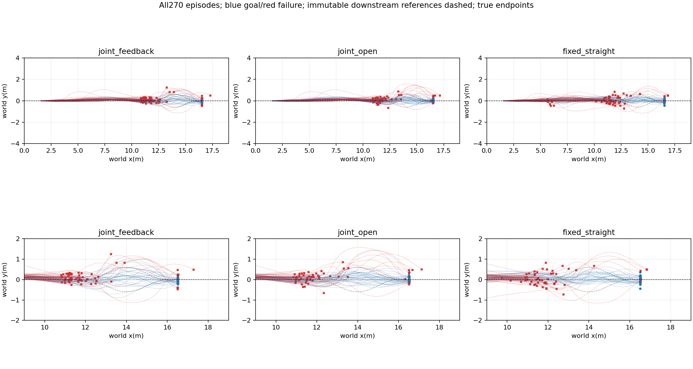
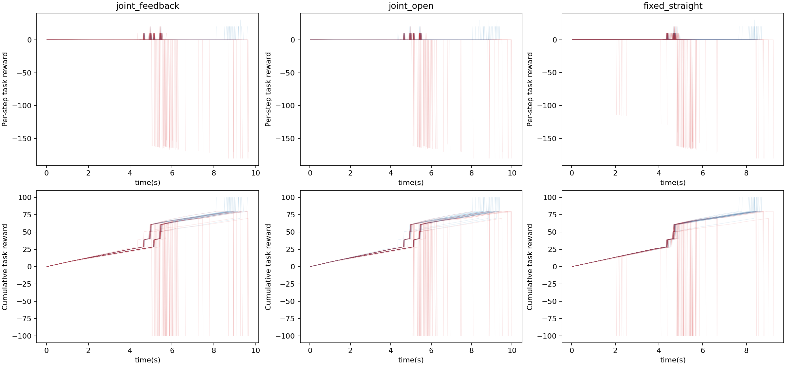
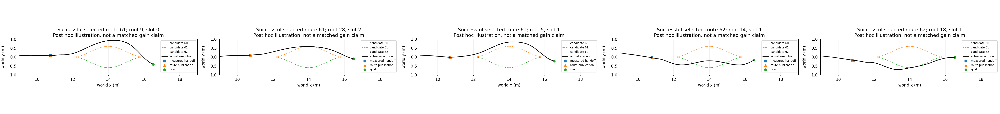

# Measured-state downstream route selection

Development retest of the same 30 previously inspected roots; three methods and three crossed-slot repetitions, 90 episodes/method. All upstream failures remain in the denominator. Models and conditions frozen before execution.

|Method|Goal/N|Handoffs|Valid handoffs|Published|Road violations|Mean query ms|
|---|---:|---:|---:|---:|---:|---:|
|joint_feedback|26/90|90|88|90|15|1.011|
|joint_open|30/90|90|88|90|17|0.817|
|fixed_straight|27/90|81|77|81|15|0.790|

|Comparator|Mean root difference|Root bootstrap95%|Gains/losses|Equal query descriptors/both queried|
|---|---:|---|---:|---:|
|joint_open|-0.0444|[-0.18888888888888886, 0.1]|13/17|0/90|
|fixed_straight|-0.0111|[-0.16666666666666669, 0.14444444444444446]|22/23|0/81|

Task-conditioned selected-route outcomes: [{'route': 60, 'selected': 48, 'goals': 21}, {'route': 61, 'selected': 37, 'goals': 3}, {'route': 62, 'selected': 5, 'goals': 2}]. These conditional counts are selection-biased, not route rankings. All 261 publications match the logged route and declared delay.

Actual 1078560 physical lane steps; summed simulation wall267.10s; 0 training.

Full query/publication records,model scores,actual contexts and endpoints remain in repeat0/1/2 and results.json. All failures and unpublished decisions are retained.

|Method|Approach choices|Planned downstream|Handoff revisions|Successful revised|Mean upstream query ms|
|---|---|---|---:|---:|---:|
|joint_feedback|{5: 38, 2: 50, 8: 1, 0: 1}|{60: 78, 61: 12}|41|7|61.463|
|joint_open|{5: 38, 2: 50, 8: 1, 0: 1}|{60: 78, 61: 12}|0|0|61.583|
|fixed_straight|{7: 90}|{60: 90}|0|0|0.812|

Joint panel: at x=3 m, frozen upstream predictions score 15 approach speed/preference pairs and three downstream routes. Joint-open retains its planned downstream route; joint-feedback queries again at measured handoff. Fixed uses 2 m/s, alpha .5 and straight continuation. The planned road runs during handoff inference delay. Route publication does not reset physical/controller state. This extension excludes upstream S/90-degree/bypass candidates; earlier broader panels remain separate.

No certified margin, independent-map generalization, superiority or equivalence claim. Query descriptors differ and hidden solver state is not serialized. All failures remain in the primary denominator.
