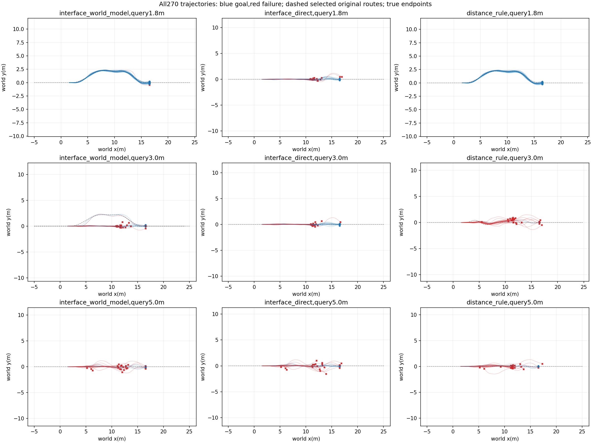
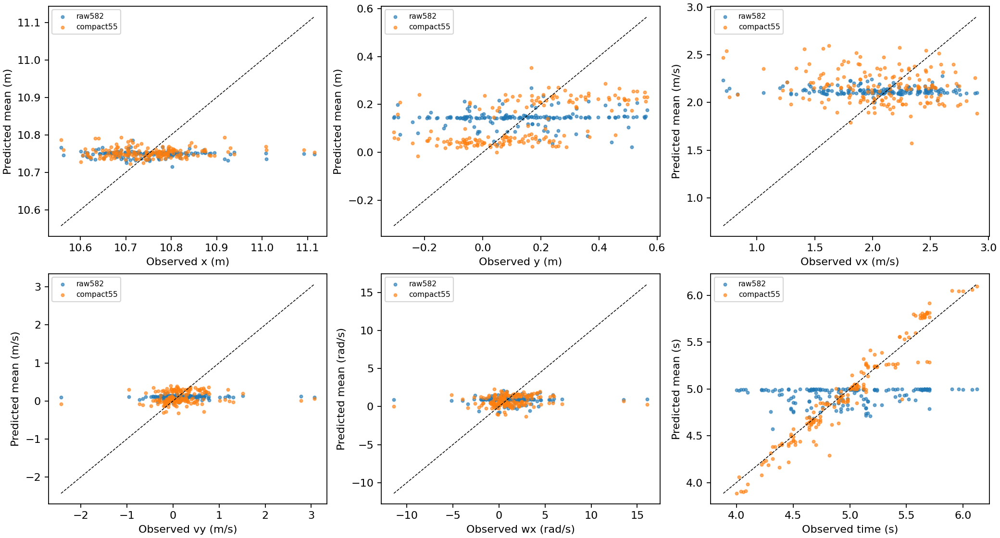
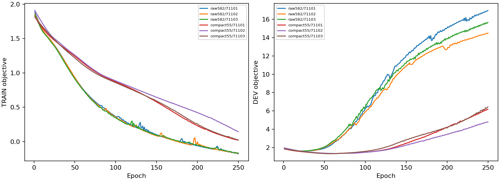
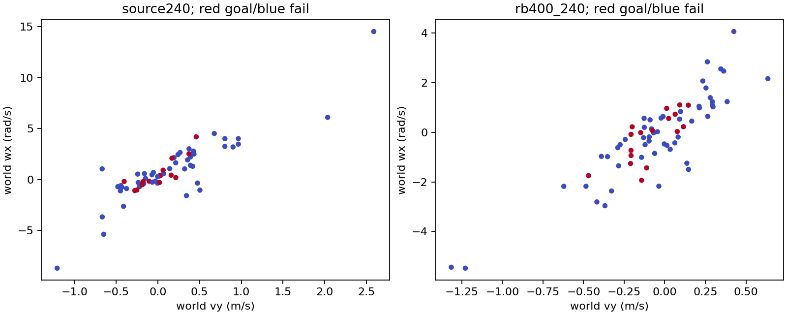

# 四项审稿建议的实施与实测结果

同一批已看过的初态用于开发复测，不能称新的独立测试。物理、技能、H75、走廊及10秒期限不变。

|建议|已实施|实际结果|
|---|---|---|
|剩余路线时间筛选|三方法共用路线余长/请求速度规则，仅地面候选；查询与发布均检查|接口43/90，直接35/90，距离36/90；早查询接口29/30。请求速度不是物理速度上界，此规则不是不可行性证明|
|压缩历史、突出动作、物理残差|TRAIN-only PCA16；582→55输入；8维动作跳连；速度与时间基线；同1379TRAIN/540DEV|168有效DEV：时间RMSE .462→.128s，y .209→.172m；vx .450→.511m/s变差。不是所有状态预测都改善|
|相对道路动态特征|19维Frenet位置、航向、切法向速度、0.4s投影余量、预览曲率；模型重训|DEV Brier .10827→.10650，仍差于仅状态.10290；来源7仍未选左，不强改排序|
|RB交接分布|复用Source/RB400历史240条，检查合法入口及状态分布|71完全匹配入口10新增10丢失；有效交接65/70，横向速度与滚转速率减小，但平均固定续行评分.313→.271，并未向高分区集中|

原始与残差模型的目标归一化不同，NLL曲线只解释各自优化，不直接比较数值高低。DEV选择epoch，图不代表独立TEST。

## 联合物理闭环复测

[全部270条XY与结果](../chapter3_repaired_joint_fast/RESULTS.md)：修订联合反馈26/90，保持计划30/90，固定27/90；41次交接改选，7次之后到达。接近选择1.5/1.8/2.0m/s，89/90选择α1，另1次α0；仍高度偏向端点。13新增17丢失对保持计划，22新增23丢失对固定；均无优势证据。

相对道路全量投影初版耗时较大，另一次270条为23/25/34，保留于[延迟诊断](../chapter3_repaired_joint/RESULTS.md)。采用精确空间候选裁剪后，180次既有查询向量完全一致；加速版上游均值约61ms，下游约1ms，实际延迟继续推进物理。不同批次的固定基线34→27，也说明不能把版本间总数差完全归因于改动。

附件中45/90、Brier低于.095、来源7已触及左边界和RB必然集中高分区均不是已有实证。本轮完成四项有效修改，没有放松物理判据或把预期数字写成结果。代码及完整原始记录在同名STTW_runs目录；新增RB候补测试单独记录。
