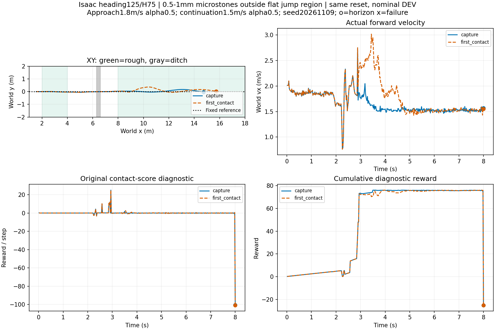
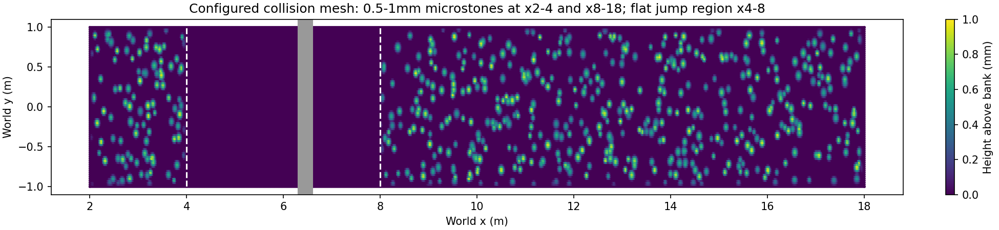

# 碎石接近/续行与直接触地交接

固定微凸石面高0.5～1mm，仅x2～4m和8～18m；起跳/落地x4～8m平坦。同高30cm沟6.3～6.6m，直道共同起点x1.5/vx2，无快照。heading125/H75，名义条件，0训练。地面前进请求1.8m/s、α.5，回交后1.5m/s、α.5。两条DEV，原物理终止限制保留。

|交接判据|实际交接时间(s)|实际阶段|终止时间(s)|终止码|续行至8s|终点y(m)|
|---|---:|---:|---:|---:|---|---:|
|capture|2.94|3|8.00|9|True|-0.027|
|first_contact|2.88|2|8.00|9|True|0.031|

首次远岸触地使用原已确认腾空尝试的远岸轮地接触，在下一个20ms策略边界切回STTW，不等待双轮捕获或1秒支撑；不声称物理采样瞬间零延迟切换。绿色区域为碎石，灰色为开口沟；圆点为观察窗结束，叉号为真实失败。全部曲线无平滑、累计自首实际转移求和、真实终点截断。原接触评分仍是诊断，不替代后续任务结果。没有独立ECBC基线或泛化测试。

控制器历史与执行命令批次时间/phase逐值核验；记录包含ESO、过滤状态和观测历史，尚不包含PhysX求解器缓存。数据盘原始轨迹：`/media/qy/6A7E3DB07E3D75C3/STTW_runs/chapter3_rough_direct_handoff`。脚本、摘要及绘图原数组随报告保留。

结论：两条均交回并续行至8秒；首次触地交接在2.88s（stage2），比捕获交接2.94s早60ms。切换前144个策略步根状态逐值一致。直接触地后接管已走通，但不是更优证明：

- capture：回交后最大绝对y=0.171m，峰值前向速度=2.048m/s。
- first_contact：回交后最大绝对y=0.366m，峰值前向速度=3.019m/s。

不将终点偏差小掩盖中途横摆；当前采用为工程候选，两种切换均保留。原支撑成功评分均false、回报约−25，不作为本阶段否决条件。接近/续行上的凸起是固定碰撞网格微凸面，不是可滚动独立石块，不代表厘米级碎石泛化。

两条记录正常完成，控制器历史分别347/350个地面策略步、30个字段，时间和phase与实际命令逐值对应。运行日志未检出Traceback/CUDA error/PhysX error，服务退出码0。
