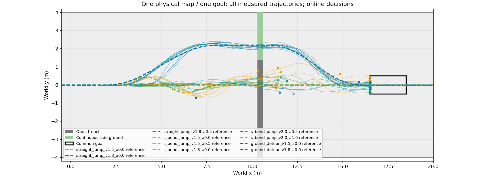
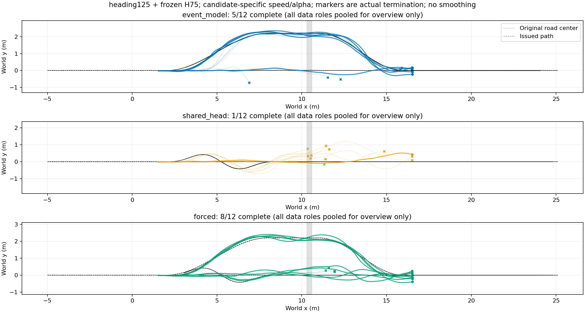

# 途中规划方法实际执行结果

|查询x/m|方法|完成|越廊|绕行/跳跃|平均查询ms|
|---|---|---:|---:|---:|---:|
|1.8|event_model|4/4|0/4|4/0|63.047|
|1.8|forced|4/4|0/4|4/0|3.570|
|1.8|shared_head|0/4|2/4|0/4|58.561|
|3.0|event_model|0/4|4/4|4/0|49.806|
|3.0|forced|2/4|0/4|0/4|2.599|
|3.0|shared_head|1/4|1/4|0/4|48.640|
|5.0|event_model|1/4|1/4|0/4|49.118|
|5.0|forced|2/4|0/4|0/4|2.601|
|5.0|shared_head|0/4|3/4|0/4|47.901|

仿真墙钟83.73秒，144000物理环境步；0策略训练。每个初态重复多个查询位置，不能视作独立初态样本。方法共享原道路和物理失败判据；克隆环境同方案结果差异仍存在。

[逐初态XY、每步与累计奖励、速度](plots/README.md)；[完整分组与逐条结果](results.json)。

## Interpretation and identity

This is a new 36-trajectory Isaac execution on four previously inspected root conditions, with three decision positions and frozen three-head/shared-head/distance-rule methods. Total completion is 5/12, 1/12, 8/12. Relative to shared-head, three-head gains five and loses one paired root-position condition. Both models remain below the TRAIN-frozen distance rule. The earlier 5/12, 5/12, 6/12 event/direct/rule panel is a separate run and is not overwritten.

Three-head and shared-head have 35,770 and 27,710 parameters; this is not a capacity-matched architecture isolation. Their actual measured query delays are physically executed, rather than artificially equalized. Cloned environments share declared initial conditions but are not guaranteed identical numerical/contact states. Four roots, not twelve independent roots, underlie each total. This supports a descriptive online architecture comparison, not a significance claim, new-map generalization, or superiority over ordinary planning.

All 36 actual/reference XY trajectories, rewards and speeds are retained in the plot index. Raw data: `/media/qy/6A7E3DB07E3D75C3/STTW_runs/chapter3_shared_head_online/evaluation/trajectories.npz`. Frozen hashes and budget are in `declaration.json`; exact executed configuration and lane mapping are included. No training or model selection occurred.
