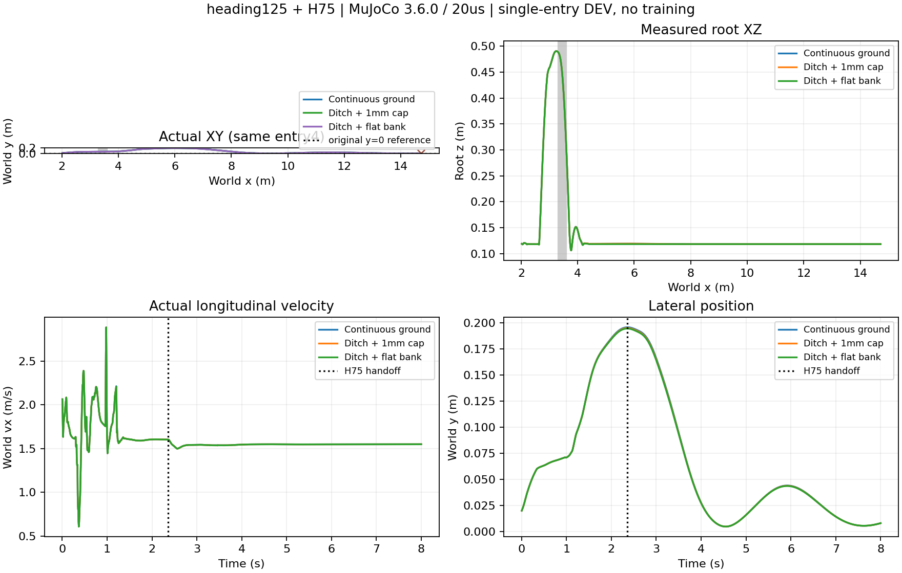

# 精简包复现与30cm开口沟：单初态续行实例

用户提供精简包，59文件SHA256校验通过；两网络各8条保存观测推理误差为0及1.19e-7。独立Python3.12.13环境，MuJoCo3.6.0、NumPy2.5.4、SciPy1.17.0、Torch2.9.0 CPU；与包内Python3.12.14有补丁版本差异。未修改原包，未训练。

|条件|H75交接|交接后时长|终点x/y(m)|8秒物理失败|地面域退出/数值故障|
|---|---:|---:|---|---|---|
|原连续地面，1mm缓凸面|2.36s|5.64s|14.72169 / 0.007824|无|均无|
|真实开口沟x=3.3～3.6m|2.36s|5.64s|14.72138 / 0.007868|无|均无|

补充平面远岸回放：仅将凸面正高程归零，同一30cm开口沟，仍2.36s交回、续行5.64s，总计8秒无物理失败或地面域/数值故障，原1秒落地保持通过。[平面原始摘要](ditch30_flat.json)。三条均完成原1秒落地保持。沟版本仅把近岸box右边界从3.6改到3.3m（左边界仍−5m），远岸凸面从3.6m开始，沟内没有新增支撑面。机器人从x≈2.019推进至14.72m。每条400000物理步，20μs，CPU运行，无PPO更新；同entry4、同权重、同执行器/接触/交接判据。包内归档轨迹逐位比较未运行，不声称前缀完全一致。

heading125负责跳跃和落地恢复；满足交接条件后H75+ECBC/ESO接管，底层学习残差为零。髋膝使用原有限力矩位置伺服，不硬锁关节、不重置物理状态。膝关节交接时实际约2.50915rad，指令按原上限截至2.5rad；原柔顺限位保留，不能宣称关节绝不越限。

**采用范围：** 保留为普通地面/1mm缓凸面上的跨沟续行开发实例，支持继续研究接近准备。不是多初态成功率、随机厘米级碎石/高岸能力、完整共同终点任务验收或实机结论。MuJoCo、heading125、延后交接与有限伺服均不同于此前Isaac update50回放；不能归因于单一修改，也不撤回旧失败。下一阶段先测实际可用触发/接近范围及绕行机会，不直接启动世界模型大规模采集。

## 复现与证据

- [原包身份](source.json)、[连续地面原始摘要](physics20.json)、[开口沟摘要](ditch30.json)、[预声明协议](protocol.json)。
- [沟测试入口](run_ditch.py)依赖本机解压原包；此精简报告不是自包含代码模型分发包。
- 原始轨迹、逐物理步记录及实际XML：`/media/qy/6A7E3DB07E3D75C3/STTW_runs/chapter3_slim_reproduction/{physics20,ditch30}/handoff_20us/`。
- 原包根目录运行：`.venv/bin/python reproduce.py --mode physics --dt-us 20 --out <新目录>`；沟测试入口固定本次路径，重跑须指定新输出目录，不覆盖。
- [图源](plot.py)、[精简坐标数据](plot_data.npz)。本轮执行器无训练奖励日志，图提供真实XY/速度/横偏，不伪造训练奖励曲线。

用户后续明确：正式训练仅用Isaac；本节MuJoCo仅作附件运行与技能参考，不是Isaac训练结果。高岸暂停，下一阶段同高平面或1mm地面。包内成功案例0PPO更新，精简包不提供完整训练复现输入。
