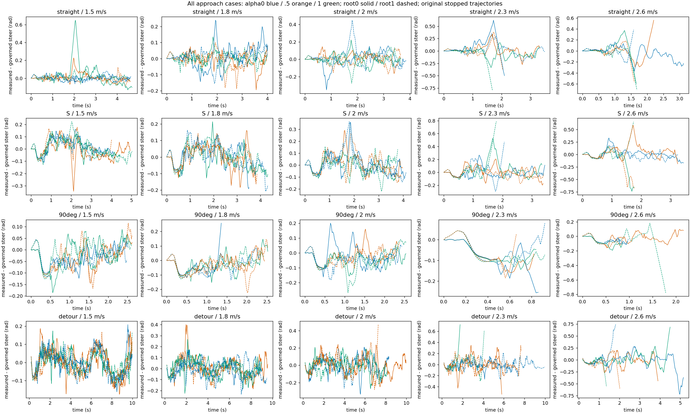

# 越野弯道转向时序离线诊断

[原始全部实际/参考XY](../chapter3_offroad_task_map_gentle/xy.png)

复用原120条轨迹，未重跑物理。controller_history为352维，最后16维为历史mask，之前320维为16×20帧；取最新帧。字段2为实测转角，9为名义转角，11为名义转角变化速率，13为H75修正后的参考。记录位于策略步之前，图时间采用该步结束时间减20ms。只统计跳跃前或纯地面阶段；不将接触后的冻结历史当成实时转向。

|路线|有效帧|达到0.3rad/s上限比例|参考-实测转角RMSE/rad|
|---|---:|---:|---:|
|straight|5124|0.6635|0.0903|
|S|5361|0.9036|0.0965|
|90deg|2839|0.6911|0.0752|
|detour|10672|0.8947|0.0912|

这是观察长度加权诊断，不是独立样本成功率；失败截断全部保留。名义参考大量限速提示时序瓶颈，但不证明提高限速能改善。120条逐条件记录见cases.json，原始逐步信号仍在源NPZ；下一步0.6rad/s条件单独执行，不改变物理执行器上限。
