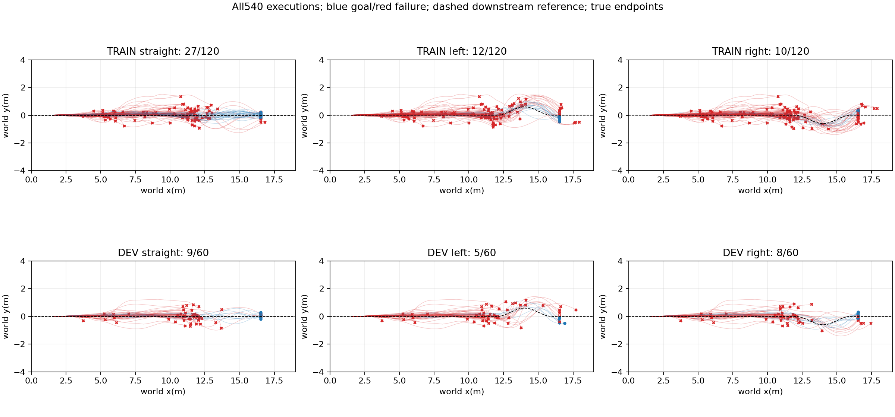
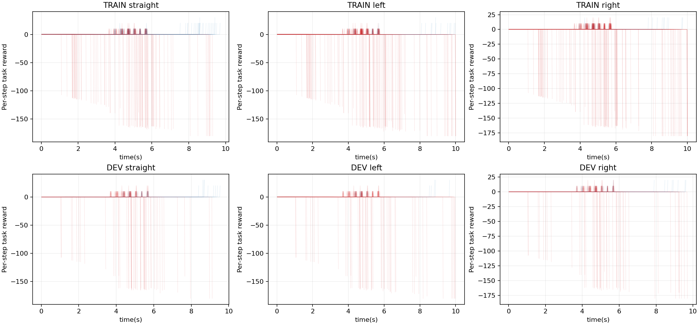
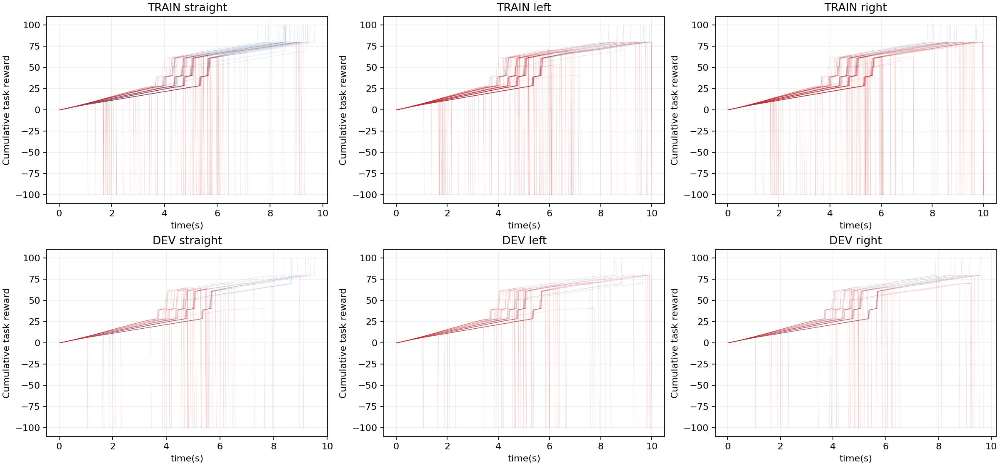
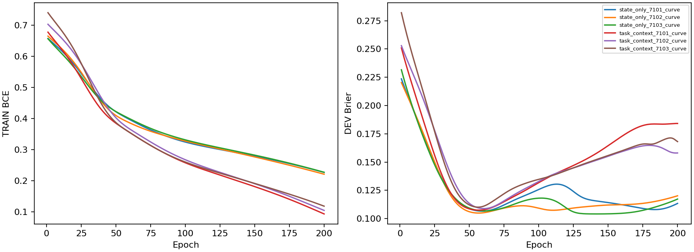

# Task-conditioned handoff model

540 newly executed full prefixes: original12roots x15straight-jump candidates x3downstream tasks. Original8TRAIN/4DEV roots retained. Each task switches at actual handoff; none of the jumping or H75 policies is trained. Whole-task failures stay in the coverage table; the downstream fit is conditional on valid handoff.

|Task|Goals/180|Valid handoffs|Prior-road handoffs|
|---|---:|---:|---:|
|straight|36/180|122|10|
|left|17/180|122|10|
|right|18/180|122|10|

|Role/task|N|Goals|State-only Brier|Task-context Brier|Constant|Task prior|
|---|---:|---:|---:|---:|---:|---:|
|TRAIN/None|234|49|0.11323|0.11812|0.16555|0.15609|
|TRAIN/straight|78|27|0.16188|0.18031|0.24503|0.22633|
|TRAIN/left|78|12|0.09164|0.09273|0.13326|0.13018|
|TRAIN/right|78|10|0.08617|0.08132|0.11836|0.11177|
|DEV/None|132|22|0.10290|0.10827|0.14072|0.14558|
|DEV/straight|44|9|0.10071|0.09745|0.16273|0.18276|
|DEV/left|44|5|0.09336|0.09247|0.10989|0.10234|
|DEV/right|44|8|0.11465|0.13488|0.14952|0.15163|

Inputs:39 measured root/latest frame/time plus19 geometric features:6world-x lookahead points,each with lateral offset,heading error,curvature,and shared road half-width. No scene-ID input. Width is fixed in these data,so width generalization is not evaluated. World-x-monotone downstream paths only.

Both learned comparators use64/32SiLU,3seeds,200epochs,BCE/Adam and original grouped DEV checkpoint selection. Input widths and parameter counts differ. TRAIN-only normalization. Task prior is learned onTRAIN labels only. No untouched TEST or changed physical-map generalization.

Task-conditioned DEV Brier is slightly worse overall,especially on right tasks; no prediction superiority claim. Functional task conditioning must still be evaluated in actual online selection. Do not infer planning improvement from the existence of nonidentical task inputs.

Actual physics lane steps 2138400; summed simulation wall 285.71s. Fitting/data-load wall 40.00s;0PPO. Initial data reader repeatedly decompressed arrays; source now caches per-variant arrays without changing labels. Executed source snapshot retained in raw run. Reload parity maximum1.49e-08 on366descriptors.

Raw collection: `/media/qy/6A7E3DB07E3D75C3/STTW_runs/chapter3_task_condition_collection`; weights/curves: `/media/qy/6A7E3DB07E3D75C3/STTW_runs/chapter3_task_condition_model`.

## Historical same-state task diagnostic

The four previously inspected matched sources from the route-intervention experiment are a historical diagnostic,not a new test. Task-conditioned predictions now differ across straight/left/right references. However,the model ranks straight first for all four:source7 is scored .107/.076/.044,missing its observed left-only completion. Task input is connected but useful task selection is not established. Exact scores/outcomes remain in historical_task_predictions.json; no refitting follows this diagnostic.
