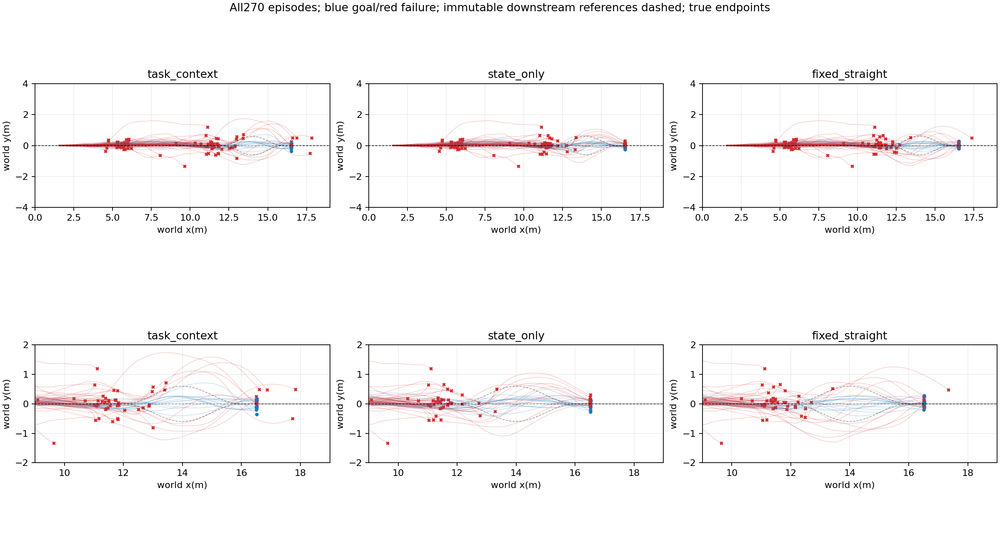
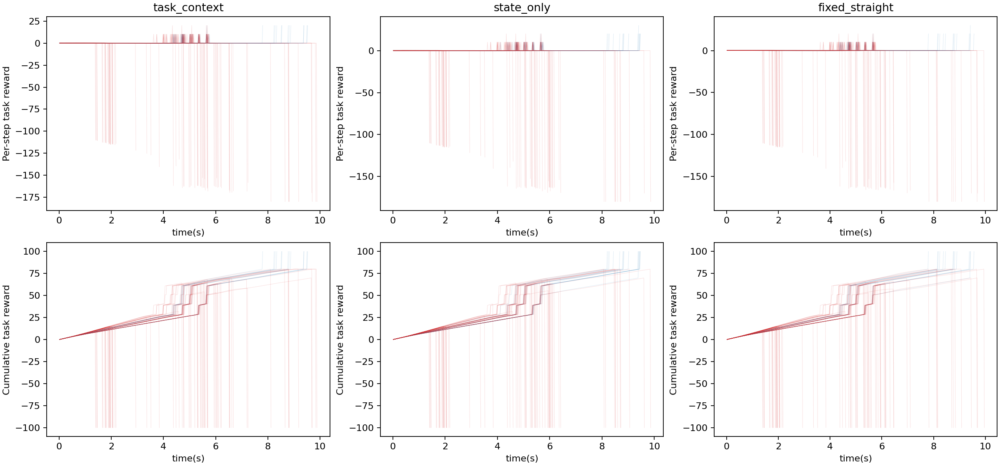
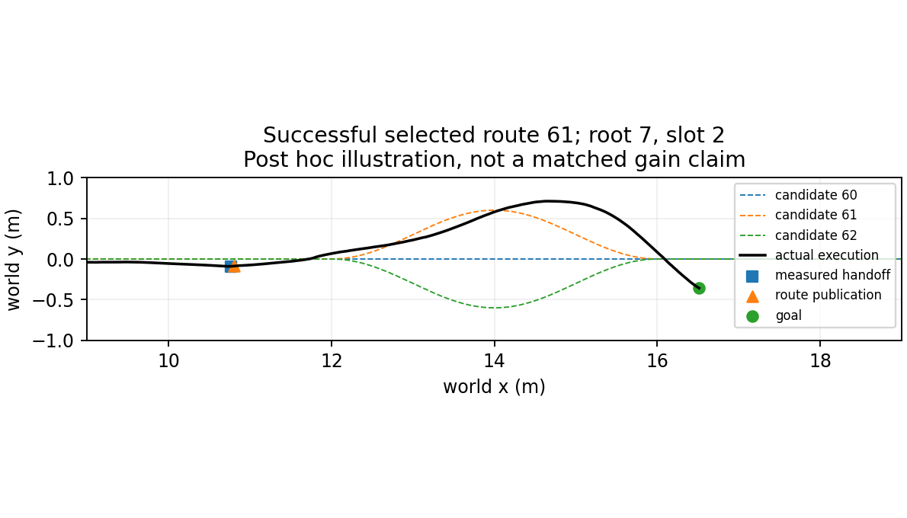

# Measured-state downstream route selection

30 new independent roots,15 predeclared straight approach speed/alpha pairs each used twice. Three methods and three crossed-slot repetitions;90 episodes/method are not 90 independent roots. All upstream failures remain in main denominator. Models/conditions frozen before execution.

|Method|Goal/N|Handoffs|Valid handoffs|Published|Road violations|Mean query ms|
|---|---:|---:|---:|---:|---:|---:|
|task_context|13/90|60|56|60|17|0.532|
|state_only|15/90|60|56|60|17|0.515|
|fixed_straight|14/90|60|56|60|18|0.306|

|Comparator|Mean root difference|Root bootstrap95%|Gains/losses|Equal query descriptors/both queried|
|---|---:|---|---:|---:|
|state_only|-0.0222|[-0.08888888888888888, 0.05555555555555555]|3/5|5/60|
|fixed_straight|-0.0111|[-0.05555555555555555, 0.02222222222222222]|1/2|6/60|

Task-conditioned selected-route outcomes: [{'route': 60, 'selected': 34, 'goals': 12}, {'route': 61, 'selected': 19, 'goals': 1}, {'route': 62, 'selected': 7, 'goals': 0}]. These conditional counts are selection-biased, not route rankings. All 180 publications match the logged route and declared delay.

Actual 1069200 physical lane steps; summed simulation wall262.95s; 0 training.

At first measured handoff the frozen model scores 3 known downstream roads. Straight H75 continues during rounded-up measured inference delay; publication changes the route index only and does not reset physical/controller state. Existing physical/corridor/goal predicates are retained. Candidate-route selection is downstream only; approach pairs are preassigned,not jointly optimized by this extension.

No independent-map or certified recovery-margin claim. Differences in recorded query states are explicitly counted; even exact descriptors do not serialize hidden solver state. Causal gain attribution requires matched incoming states and repeated evidence. State-only scores share the same input across the3roads and ties choose the first (straight).

Full query/publication records,model scores,actual contexts and endpoints remain in repeat0/1/2 and results.json. All failures and unpublished decisions are retained.

Raw run: `/media/qy/6A7E3DB07E3D75C3/STTW_runs/chapter3_task_handoff_online`. Reproduce analysis with `PYTHONPATH=learning/src python learning/cli/analyze_task_handoff_online.py --run <raw-run>`.

Logging convention: `reference_route_id` is captured before `task.step`, while `time` labels the end of that step. A route change inside `task.step` appears in the following pre-step snapshot (two tick labels after its publication time). The publication audit accounts for this existing convention; no timestamps or raw trajectories were rewritten. Model inference is per lane; these timings are not an end-to-end serial batch latency guarantee.
