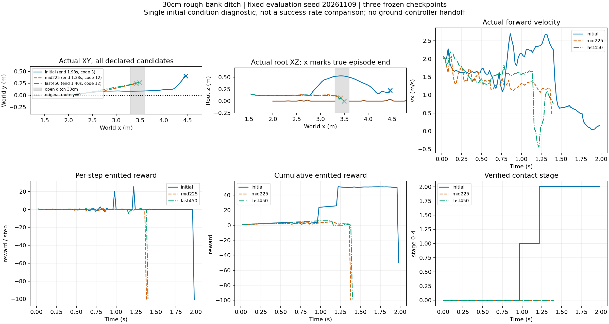
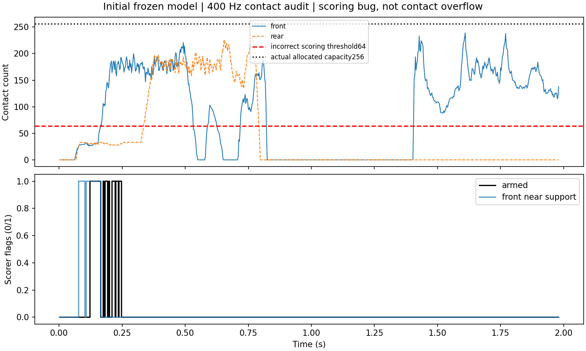
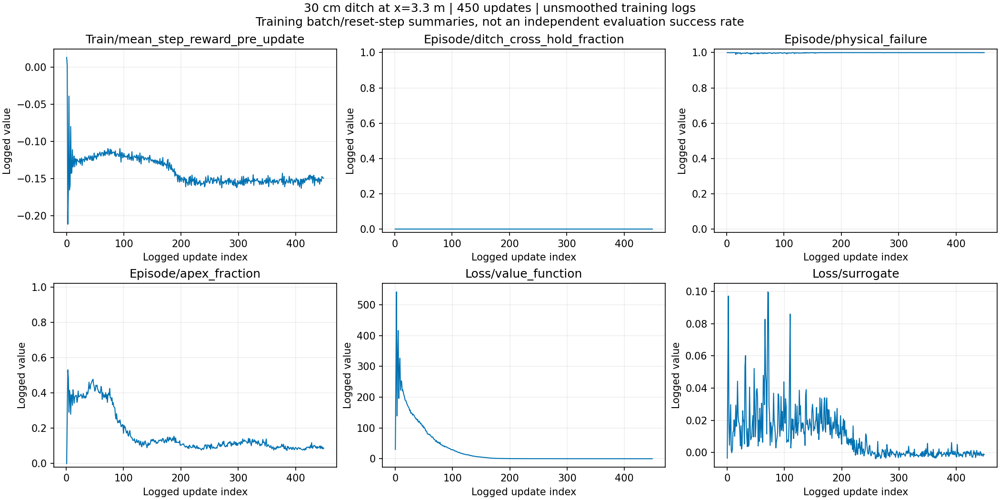

# 附件奖励450轮：训练结果与接触判定缺陷

**结论：450轮优化结束，但评分器使用了错误的接触容量阈值，本轮不作为奖励方法有效性的证据，最终模型不采用。** 已修复接入并做同轨迹对照，修复后重训已按用户要求启动，尚无新训练完成结果。

## 执行与结果

使用用户附件 `STTW_Offroad_Jump_Reward_20261109.zip` 的奖励内核、rough支撑模式、gamma=1，沟口3.3m/沟宽30cm、中心1–4cm碎石、Go2随机化。4096×24×450，共44236800策略转移/353894400物理步，耗时7708.35s（2小时8分）。初始CUDA失败尝试完成0轮，独立保留；重启后的450轮无日志报错或非有限值，但这不保证任务评分正确。

449个有效episode日志点：恢复保持指标均0，回合奖励几乎固定−100；末25点physical_failure日志均值0.999945。它们是训练汇总，不是独立测试成功率。Value loss从30.26降到0.015，不能解释为技能收敛：网络可能主要拟合了几乎常数的失败回报。训练采样best仍为update0，短批次单步选模的阶段偏差仍存在。

同一个固定种子20261109、相同抽样物理参数、均值Actor回放：

|模型|时长|最高根部z|最终x|真实终止|错误评分→修复评分|修复后阶段|
|---|---:|---:|---:|---|---|---|
|初始|1.98s|0.530m|4.457m|侧倾超限|−100→−50|2，清沟但未恢复|
|中期225|1.38s|0.144m|3.423m|地形失败code12|−100→−100|0|
|最终450|1.40s|0.143m|3.491m|地形失败code12|−100→−100|0|

全部未完成稳定续行。初始有明显腾空；中期与最终基本冲入沟中。code12是沟底/横向地形边界/车体接触并集，不能仅凭该码指定唯一原因。新旧评分下三个模型的完整root轨迹均逐值一致；新评分未使车辆物理行为改善。无STTW回交，仅单初态DEV，不外推总体成功率。

## 为什么没有形成有效阶段反馈

上次修复CUDA越界时，原始接触存储扩为每轮256点，但评分器还把64当作容量上限，`count>=64`即拒绝承载认证。分片轮胎在碎石上实际可产生更多合法接触点：初始模型前/后轮峰值239/232；792个2.5ms采样中分别434/183个达到64。此次审计没有原始缓冲越界。

明确实例：t=0.165s，前轮66个接触点且有实际载荷，评分器却将近岸支撑置false并取消armed资格。在原评分下，初始模型也始终stage0、attempt=false，未得到本来应有的起跳/清沟阶段增量。

**这是接入错误：容量上限是存储完整性检查，不是允许接触多少颗碎石的物理门槛。** 修复后使用实际分配的256；达到实际上限、索引无效、跨岸/出目标带等拒绝条件保留，未修改附件奖励核、地形、模型参数或成功标准。

修复后同轨迹初始模型stage2、−50；其余两条仍stage0、−100，表明区别确实来自接触资格与评分。不能将“没有运行异常”当作评分正确，也不能由这次受缺陷影响的训练否定附件设计。

## 采用决定

- 不采用最终450，不原样追加训练；失败配置与回放证据保留。
- 修复已通过容量回归测试及三模型物理对照。下一轮应从保留起跳能力的初始权重开始，并先核查起跳/清沟阶段的非零覆盖，再解释训练曲线。
- 本次新增7条短回放（原评分3、详细接触审计1、修复评分3），0训练。用户随后授权删除旧训练过程并重新训练：旧checkpoint及TensorBoard事件目录已删除，保留配置、日志摘要及回放证据，删除清单见原运行目录deletion_manifest.json。重训使用原始初始化权重、450轮，不续用最终450模型。

来源：[原/新评分摘要](before_fix_summary.json)、[新评分摘要](after_fix_summary.json)、[接触统计](contact_capacity_audit.json)、[身份与本地原始数据路径](provenance.json)。本地NPZ含实际坐标、奖励和400Hz评分内部状态；模型、大型轨迹不入Git。
