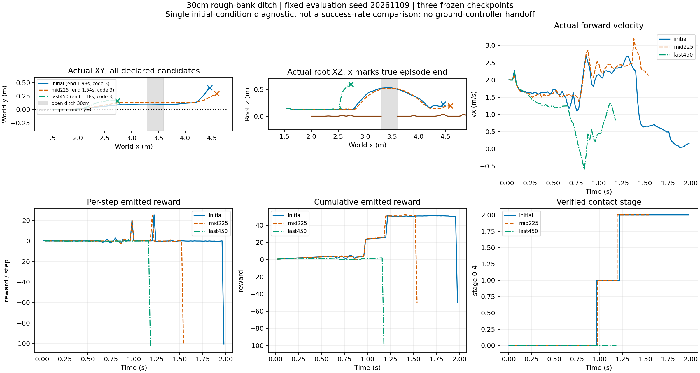
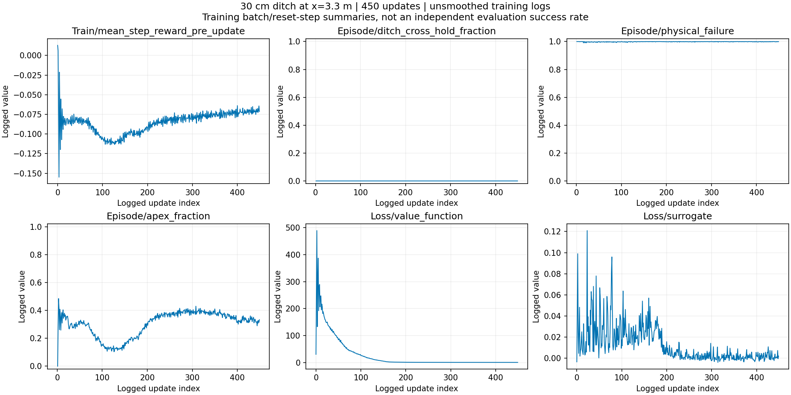

# 修复接触判定后的450轮跨沟重训结果

沟口3.3m、沟宽30cm、两岸碎石1–4cm；保持附件事件奖励及物理终止条件。代码版本2d3c9b59，实际接触容量256用于评分。450轮、4096环境×24步，共44,236,800策略转移，耗时1小时43分33秒。训练完成，当前日志未检出接触溢出或非有限值。

## 固定初态物理回放

三个冻结模型，固定seed20261109、相同采样物理属性与噪声、mean actor，每个模型一条。属于单初态DEV诊断，无地面控制器接管，不能当作泛化成功率。

|模型|终止时长（策略步边界）|最高root z|终点x|接触阶段|累计回报|实际行为|
|---|---:|---:|---:|---|---:|---|
|初始|1.98s|0.530m|4.457m|2：清沟|-50|前轮接触远岸，未形成双轮目标支撑，侧倾超限|
|225轮|1.54s|0.520m|4.590m|2：清沟|-50|前轮接触远岸，未形成双轮目标支撑，侧倾超限|
|450轮|1.18s|0.595m|2.737m|0|-100|沟前明显抬升，但未完成合格接近起跳里程碑，侧倾超限|

均触发35°侧倾阈值，不是航向/轨迹跟踪终止，也不等同于已观测实际摔倒。首次物理失败分别1.9700/1.5225/1.1700s；图与表保留最后策略步边界。最终模型确实有抬升，stage0不能解释为完全不跳。三条都未进入稳定落地stage3或恢复stage4。

接触峰值分别239/232、211/224、234/221，均低于实际256容量；原始接触索引越界计数均0。本次回放没有重现旧64/256容量错误。详见[轮接触图](wheel_contacts.png)及[逐模型诊断](replay_diagnostics.json)。

## 训练趋势与解释

Episode/reward首25个日志点均值−67.35，末25点−55.24，末点−54.09；完整跨沟保持指标449个日志点均0，physical_failure末25点均值0.9991。这些是训练日志汇总均值，不是独立测试或准确汇总的回合失败率。阶段2后失败对应−50，阶段0失败对应−100；回报改善可以来自更频繁获取清沟阶段分，不能代替落地续行。

训练随机采样与上述固定初态mean actor回放协议不同，因此不能用一个回放反推出整个训练分布；但当前证据不支持最终模型能力提升。最终450在该初态退化，中期225也未新增完整成功。采样best仍为update0，依据短批次平均单步奖励，存在首批阶段构成偏差；不是任务最优或合格模型。

结论：修复后的训练已跑通，但跨沟落地恢复尚未学会；不采用最终450为已验证技能，不自动追加轮数。下一步应优先诊断清沟到双轮支撑之间的侧倾与落地动作，并用完整回合任务阶段与固定配对回放选择候选，不能只凭训练reward或最后一轮选模型。

## 证据入口

完整原始轨迹、400Hz接触、评分诊断及checkpoint保存在本机：
`/media/qy/6A7E3DB07E3D75C3/STTW_runs/chapter3_verified_ditch450_retry_20261109`

本目录保留[评测配置](evaluation_config.json)、[评测摘要](summary.json)、[训练统计](training_summary.json)和诊断脚本。原始训练配置、权重与大体积轨迹未提交Git；此目录不是独立可重跑的模型包。
