# 全部12工况实际/参考XY及奖励

原H75＋Local300，DEV；每图包含九种计划、固定.5重复及Zero。逐条结果见[数据](analysis_summary.json)。

## dense_corridor_v2.3_seed101

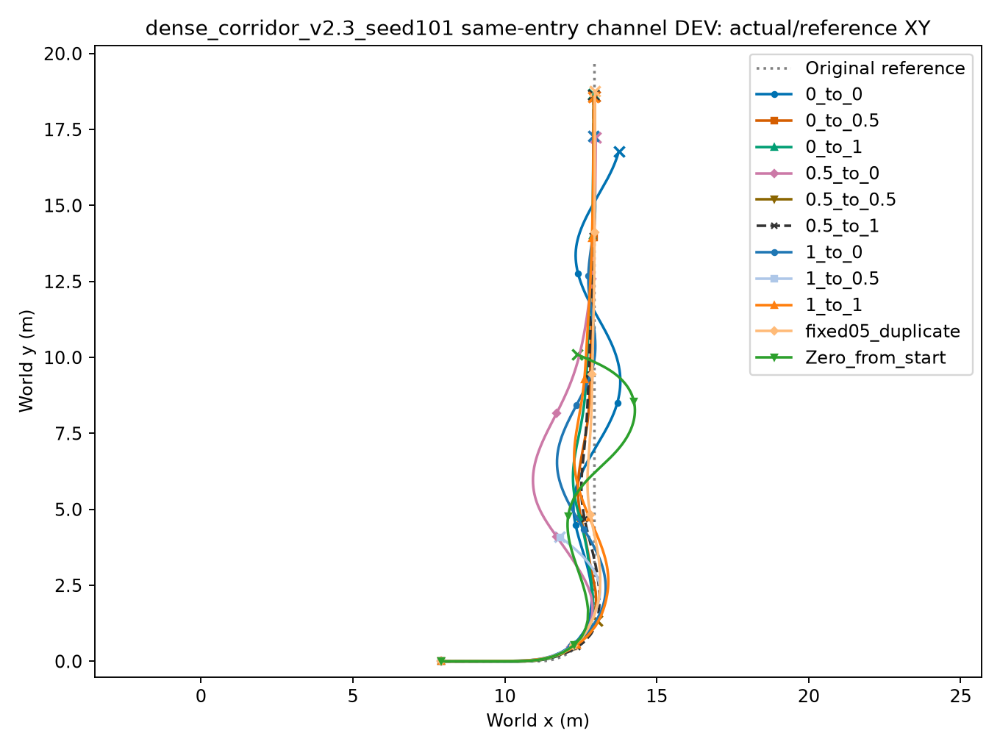

[每步/累计奖励与误差](dense_corridor_v2.3_seed101/overview.png) · [指标](dense_corridor_v2.3_seed101/condition_metrics.json) · [运行身份](dense_corridor_v2.3_seed101/contract.json)

## dense_corridor_v2.3_seed102

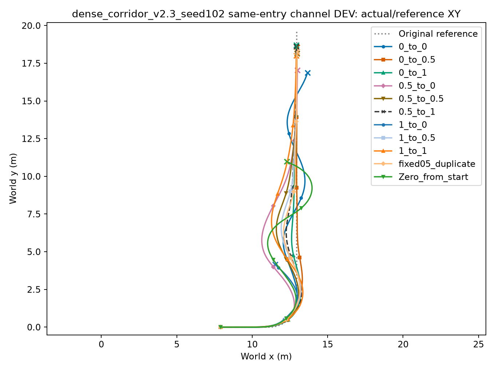

[每步/累计奖励与误差](dense_corridor_v2.3_seed102/overview.png) · [指标](dense_corridor_v2.3_seed102/condition_metrics.json) · [运行身份](dense_corridor_v2.3_seed102/contract.json)

## dense_corridor_v2.3_seed103

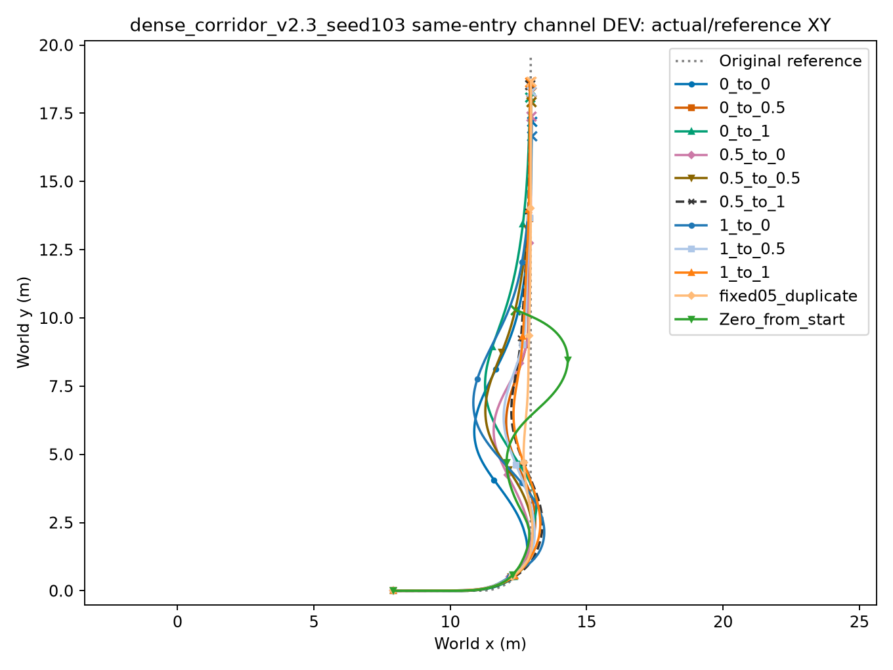

[每步/累计奖励与误差](dense_corridor_v2.3_seed103/overview.png) · [指标](dense_corridor_v2.3_seed103/condition_metrics.json) · [运行身份](dense_corridor_v2.3_seed103/contract.json)

## dense_corridor_v2.6_seed101

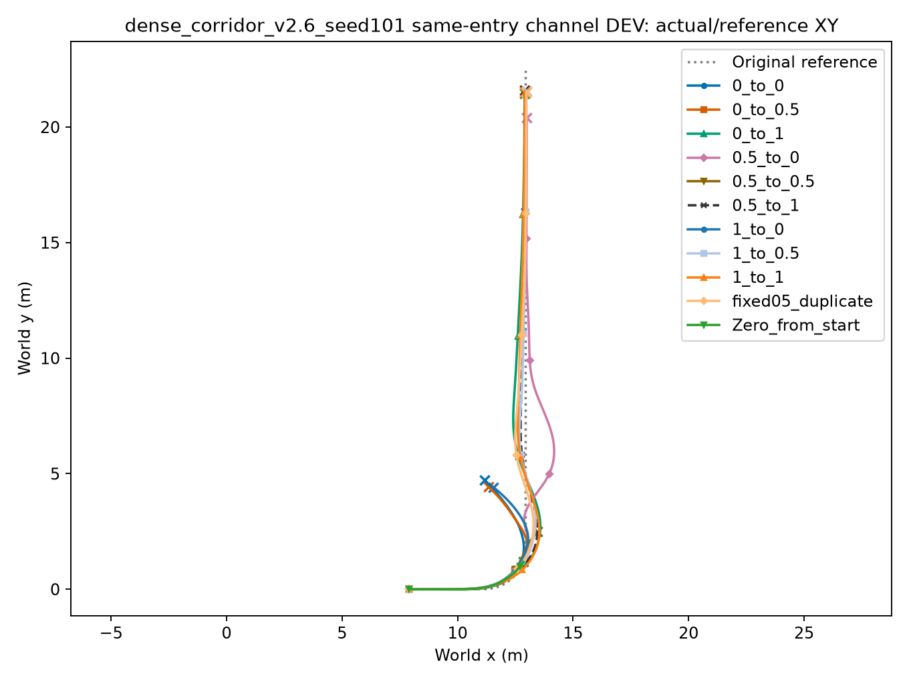

[每步/累计奖励与误差](dense_corridor_v2.6_seed101/overview.png) · [指标](dense_corridor_v2.6_seed101/condition_metrics.json) · [运行身份](dense_corridor_v2.6_seed101/contract.json)

## dense_corridor_v2.6_seed102

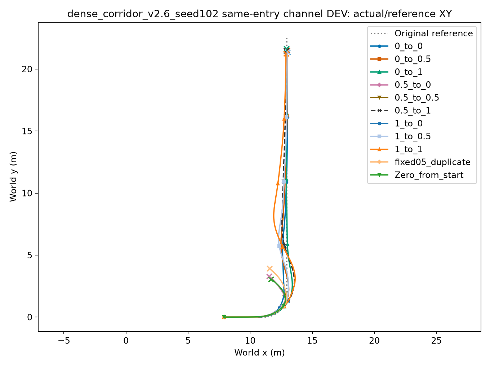

[每步/累计奖励与误差](dense_corridor_v2.6_seed102/overview.png) · [指标](dense_corridor_v2.6_seed102/condition_metrics.json) · [运行身份](dense_corridor_v2.6_seed102/contract.json)

## dense_corridor_v2.6_seed103

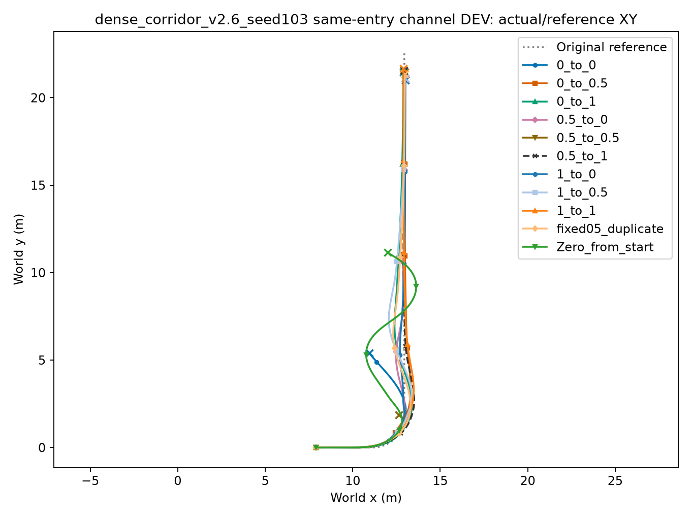

[每步/累计奖励与误差](dense_corridor_v2.6_seed103/overview.png) · [指标](dense_corridor_v2.6_seed103/condition_metrics.json) · [运行身份](dense_corridor_v2.6_seed103/contract.json)

## single_10cm_v2.3_seed101

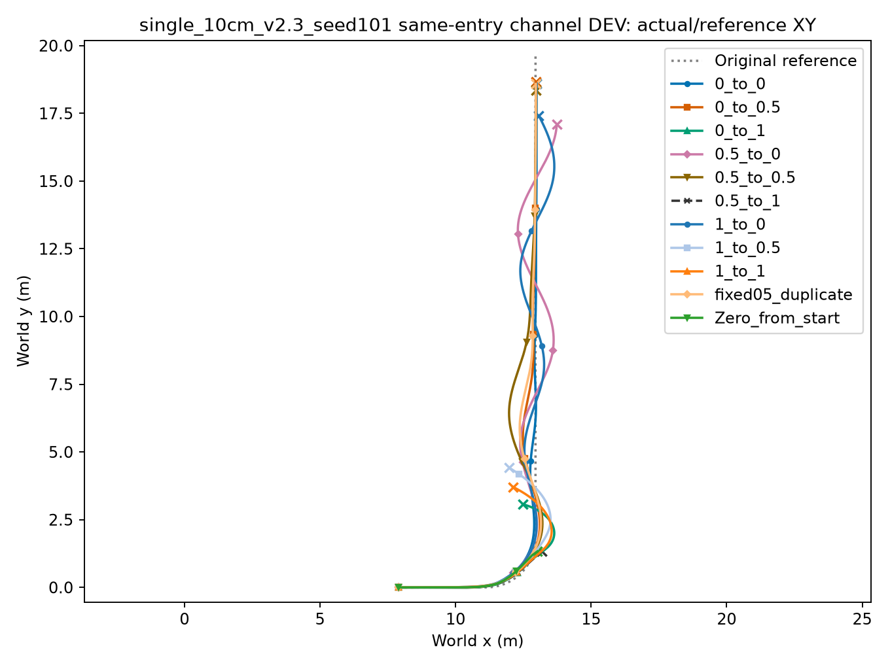

[每步/累计奖励与误差](single_10cm_v2.3_seed101/overview.png) · [指标](single_10cm_v2.3_seed101/condition_metrics.json) · [运行身份](single_10cm_v2.3_seed101/contract.json)

## single_10cm_v2.3_seed102

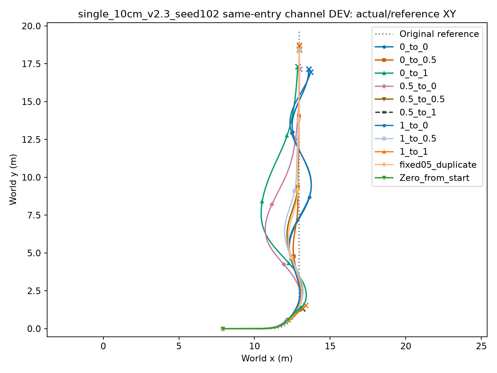

[每步/累计奖励与误差](single_10cm_v2.3_seed102/overview.png) · [指标](single_10cm_v2.3_seed102/condition_metrics.json) · [运行身份](single_10cm_v2.3_seed102/contract.json)

## single_10cm_v2.3_seed103

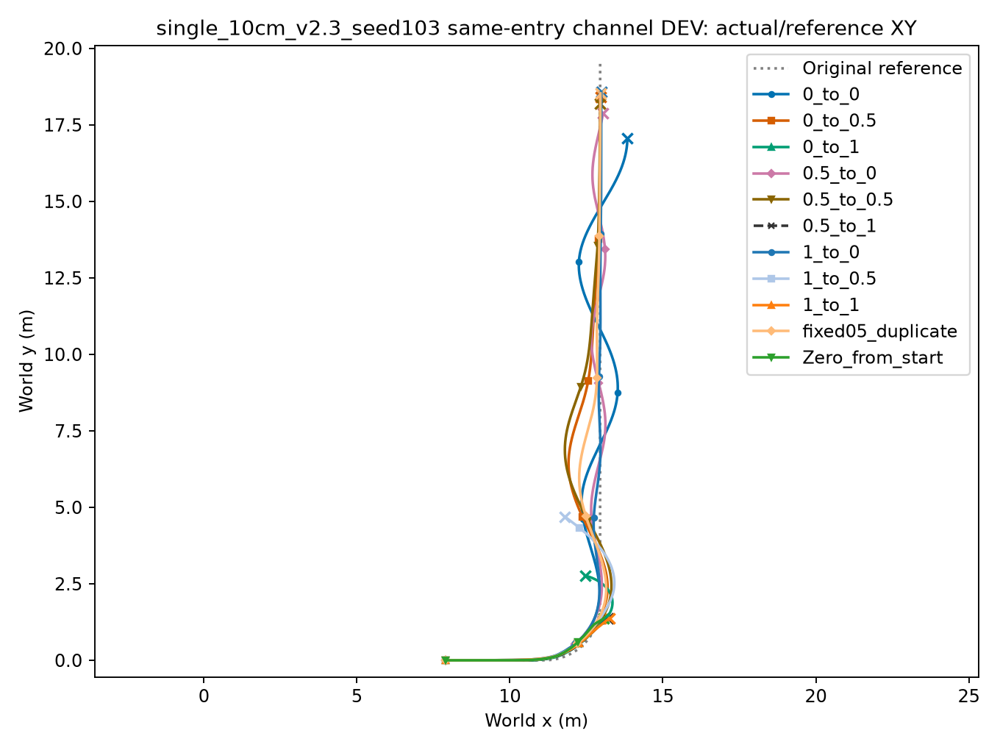

[每步/累计奖励与误差](single_10cm_v2.3_seed103/overview.png) · [指标](single_10cm_v2.3_seed103/condition_metrics.json) · [运行身份](single_10cm_v2.3_seed103/contract.json)

## single_10cm_v2.6_seed101

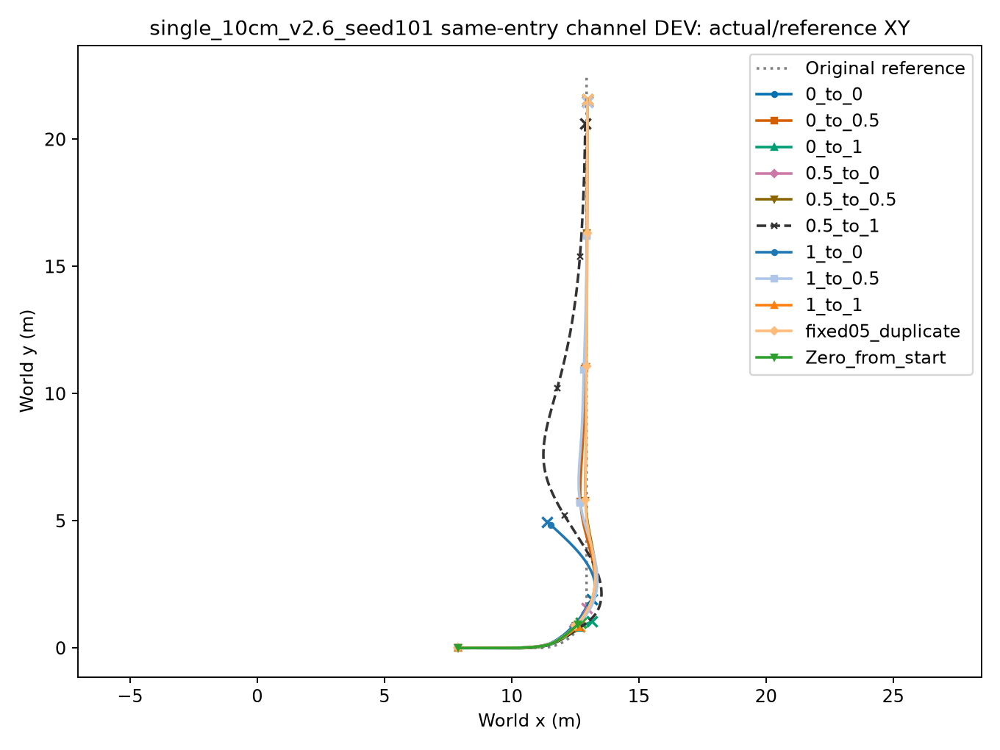

[每步/累计奖励与误差](single_10cm_v2.6_seed101/overview.png) · [指标](single_10cm_v2.6_seed101/condition_metrics.json) · [运行身份](single_10cm_v2.6_seed101/contract.json)

## single_10cm_v2.6_seed102

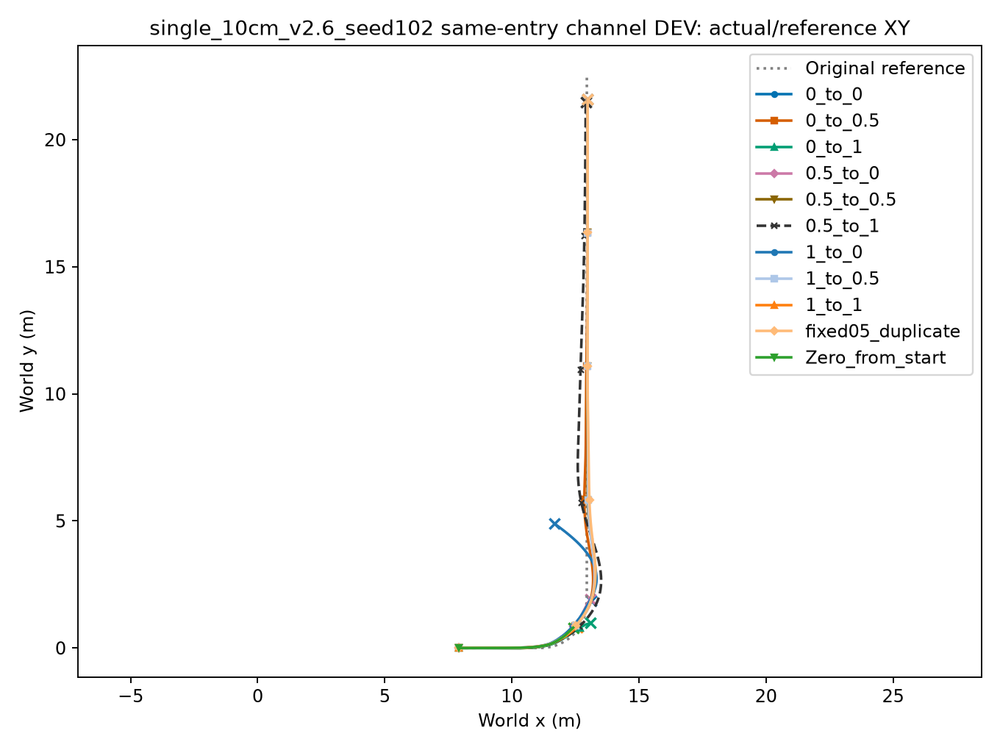

[每步/累计奖励与误差](single_10cm_v2.6_seed102/overview.png) · [指标](single_10cm_v2.6_seed102/condition_metrics.json) · [运行身份](single_10cm_v2.6_seed102/contract.json)

## single_10cm_v2.6_seed103

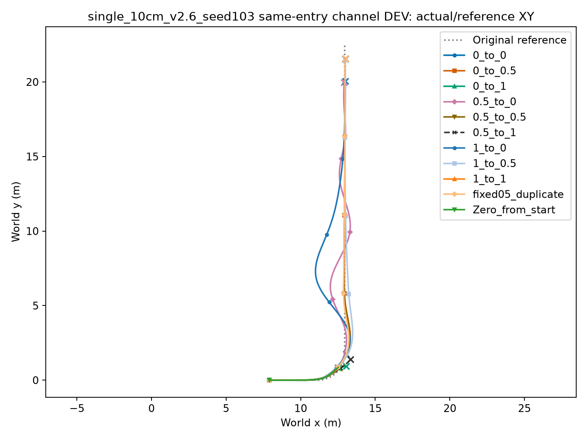

[每步/累计奖励与误差](single_10cm_v2.6_seed103/overview.png) · [指标](single_10cm_v2.6_seed103/condition_metrics.json) · [运行身份](single_10cm_v2.6_seed103/contract.json)
