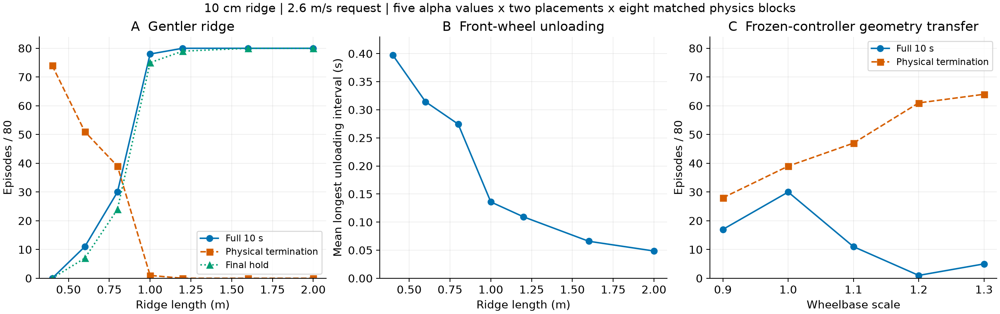
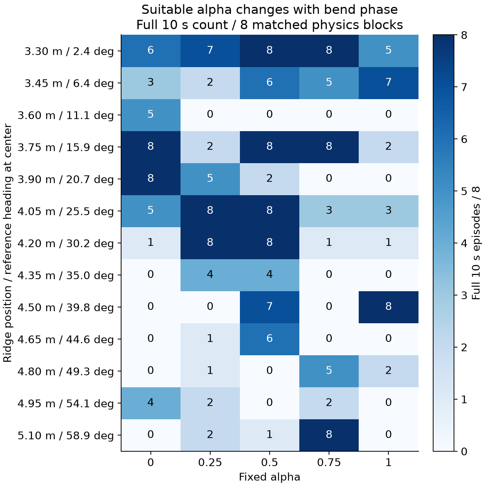

# 接触OAT：设想与结果

先看[全部工况实际/参考XY与逐步奖励索引](/media/qy/6A7E3DB07E3D75C3/STTW_runs/h75_contact_oat/analysis/README.md)，再看本报告。2112/2112条完成；原H75+Local300+ECBC/ESO，固定共同路径起点，五档alpha和Zero，44参数单元、八个配对物理组401–408，0训练。本报告的合并计数只含五档alpha；Zero完整保留在summary.json及episodes.csv，不混入分母。各参数级别是对同一八组的重复测量，不是独立训练种子。

**结论：支持“坡形、接触几何与车辆恢复状态共同决定alpha适用区间”。坡变缓的效应最强；不支持“车越长越好”和“参考航向越大就应选越大alpha”。**

## 1. 坡变缓：物理终止和前轮卸载同时下降

每个坡长：两个固定位置3.9/4.5m×五档alpha×八物理组=80条。脊高统一10cm，请求速度2.6m/s。

|坡长m|完整10s|最终保持|物理终止|最长前轮卸载均值s|
|---|---:|---:|---:|---:|
|0.4|0/80|0/80|74/80|0.397|
|0.6|11/80|7/80|51/80|0.314|
|0.8|30/80|24/80|39/80|0.275|
|1.0|78/80|75/80|1/80|0.136|
|1.2|80/80|79/80|0/80|0.109|
|1.6|80/80|80/80|0/80|0.066|
|2.0|80/80|80/80|0/80|0.049|

这支持先前提出的失稳链：陡坡带来更剧烈的垂向激励，轮胎卸载延长，车辆在缺少前轮地面反力时积累不利侧倾状态，随后需要更大的接触与控制恢复动作。成功回合也会短时卸载，故“发生腾空”不是失败的充分条件；接地前的姿态、侧倾速度、转向与再接触时机共同决定结局。

对固定高度h的sin²脊，纵向最大坡度为πh/ell，最大高度二阶导数为2π²h/ell²。恒速沿剖面运动时，地面高度加速度尺度为v²h''；变速时另有v_dot*h'。坡长0.8→1.2m使该几何激励尺度降至4/9。这解释了变缓为何有效，但地面高度加速度不等于车辆实际侧倾加速度。

卸载定义为200Hz前轮净接触力模<0.1N；统计每条实际存活窗口的最长连续段，再取均值。提前终止之后没有补零或延长；这些是接触统计，不是5kHz冲击峰值或“腾空时间直接决定失败”的拟合公式。物理终止是侧倾阈值或非轮触地，域退出单列。

## 2. 入障阶段改变适合的alpha，排序不是单调移动

同一10cm/0.8m脊，仅改变沿原路径的位置。下表为完整10s，每格8组：

|中心位置/参考航向|alpha0|alpha0.25|alpha0.5|alpha0.75|alpha1|
|---|---:|---:|---:|---:|---:|
|3.9m /20.7°|8|5|2|0|0|
|4.2m /30.2°|1|8|8|1|1|
|4.5m /39.8°|0|0|7|0|8|
|4.65m /44.6°|0|1|6|0|0|
|5.1m /58.9°|0|2|1|8|0|

3.9→4.5m的alpha0/1反转在八组中复现：完整运行8/0→0/8。alpha1在4.5m最终保持为4/8，需与完整运行8/8区分。继续增加航向到44.6°，alpha1又变成0/8，而中档6/8，所以不能用“航向越大选档越大”的单调规则。这里的航向随障碍在弯道中的位置共同变化，是入障阶段的标签，不是独立改变的车辆入射角。

整体场景旋转0/45/90°，alpha0.25和0.5始终各8/8完整且保持；五档合计完整分别19/40、23/40、18/40。临界边缘档有变化，主导中档区间保留。绝对世界航向不应成为选档变量；相对路径、坡面和接触时序才有物理意义。

## 3. 斜交方向：相同高度也可以完全不同

同一中心4.2m与脊长0.8m，改变脊线沿程偏移/横向偏移比β，每级五档×八组=40条。

|β|完整10s|物理终止|最终保持|
|---|---:|---:|---:|
|-0.5|0/40|39/40|0/40|
|-0.25|0/40|39/40|0/40|
|0|6/40|27/40|6/40|
|0.25|19/40|17/40|18/40|
|0.5|22/40|11/40|16/40|

坡面方向改变了车辆实际跨越的剖面及接触过程。高度相同、中心参考航向相同，结果仍大幅变化，这进一步支持相对接触几何的重要性。较高的完整运行不自动等于更高的最终保持。

## 4. 车长：会改变能力，但加长不是现成改进

原轴距约0.402m。轴距倍率0.9/1/1.1/1.2/1.3下，两个脊位置合计完整运行分别17/30/11/1/5（各80）；物理终止28/39/47/61/64。

匹配平地对照：倍率0.9–1.2均40/40完整并保持，1.3仍40/40完整但仅12/40保持。这说明1.1/1.2的越脊恶化不只是平地已失效；1.3还伴随明显平地跟踪问题。

本次仅移动前总成安装位置，局部质量/惯量/执行器不变，但整车质心和惯量自然改变；底层模型与策略保持原参数。因此测到的是冻结控制器对几何变化的适应性。轴距改变前后轮接触间隔L/v，也改变整车动力学，不能把全部差异单独归因于冲击间隔。

## 5. 论文的统一解释

**alpha产生不同的速度—转向协调方式；坡形和相对入障阶段决定接触激励及可用转向反力，二者的匹配决定车辆能否恢复。** 温和坡面下五档都能恢复，临界坡面下出现不同alpha的可行窗口，极陡坡面则本次五档几乎都失败。

物理链条是：坡形/入障状态 → 前后轮接触与卸载 → 侧倾角动量变化 → 可用的地面反力与控制恢复 → 平衡及路径结果。前轮无接触时，其通过地面反力产生的恢复力矩通道消失，但并非所有控制作用都消失。此前同布局配对接触记录给出局部失稳过程，本轮单因素扫描给出跨坡形和几何条件的共同规律。

选档应依赖坡长/坡度、相对入障姿态、车速、转向与当前接触状态，而不是只看地形名称、高度或绝对航向。本轮支持这样的条件化选档问题，尚未测试一个使用这些量的新在线选档器；不把热图中事后最优格冒称在线收益。

复算：learning/cli/plot_contact_oat_findings.py --root <h75_contact_oat>，只读现有summary.json，不重跑仿真。findings.json保存图中汇总值，summary.json和episodes.csv覆盖全部条件（含Zero、失败）。原始轨迹保留外盘各stage/case/trajectory.npz。0新增仿真/训练。
