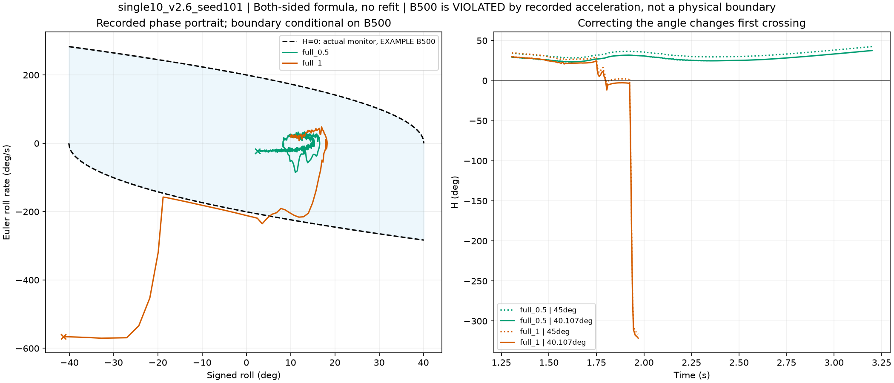
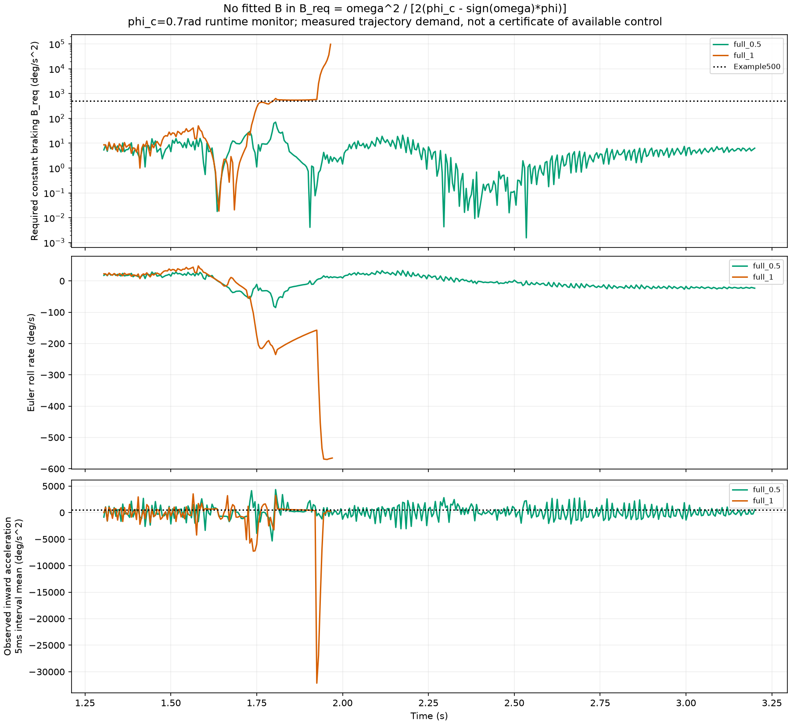
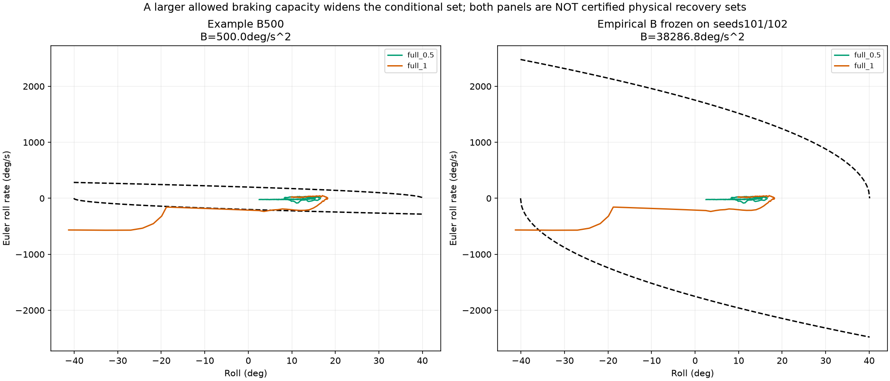

# 双侧制动余量：公式成立，恢复需求比固定示例线更能解释本批结果

先看同工况实际/原参考轨迹：[XY总览](../positive_recovery/POSITIVE_XY.png)。原始全覆盖图与数据：[12工况索引](/media/qy/6A7E3DB07E3D75C3/STTW_runs/h75_channel_scan/roll_contact_analysis/INDEX.md)。

本次复用原H75通道消融12工况216条记录，0新增仿真、0训练。成功主例为单脊10cm、2.6m/s、物理组101的full_0.5；full_1为同工况对照。完整闭环均从原共同起点运行，入障速度和姿态可以不同。本次没有把两条轨迹称为共同入障状态实验。

## 1. 公式与证明

设侧倾角φ、欧拉侧倾导数ω=φ̇，约束|φ|≤φc。正向外倾ω>0时，假设直到停止外倾为止，所有允许控制和接触演化产生的**总角加速度**都满足ω̇≥−B，B>0。由ω(t)≥ω₀−Bt，停止不可能早于ω₀/B，因此停止前至少位移ω₀²/(2B)。负向同理：

$$H^+=\phi_c-\phi-\frac{\max(\omega,0)^2}{2B},\quad H^-=\phi_c+\phi-\frac{\max(-\omega,0)^2}{2B},\quad H=\min(H^+,H^-).$$

**在上述未来制动能力上界成立时，H<0意味着任何允许控制都无法在越过相应角度边界前刹住外倾。** 对理想系统φ̈=u、|u|≤B且可瞬时切换控制，H≥0构成闭区间角度约束的可行域；对真实车辆，它只给出必要条件，不能保证转向实现、接触恢复或路径成功。严格不触及边界应区分H=0。

关键是B的方向：不可能性证明需要“可实现最大总回正加速度的上界”，不是“某控制可保证达到的回正能力”。B须覆盖整个后续制动过程。只用某一时刻的B(v,δ,接触状态)代入常数公式，不能自动得到同一证明。角度、角速度及B必须同用弧度制或角度制。

一个可检查的推论：正向外倾期间Ḣ⁺=−ω(1+ω̇/B)≤0；如果记录在尚未刹住前H反而回升，必须检查B假设和测量，而不能把首次穿线自动称为不可恢复。

## 2. 核验附件和这张图

ZIP是旧U170、24N侧推的**单侧**计算，不是聊天截图中的新H75单脊数据。其三个源NPZ哈希及6个关键点复算全部一致。旧α=0在2.6秒、45°/500示例参数下H=+3.9998°，并未在该时刻被排除。

当前单脊截图数值可以复现：full_1的45°/500双侧H首次负值在1.805s，1.820s回正，末点1.970s为−41.2791°、−565.856°/s。

实际代码`isaac_path_rollout.py`使用|φ|>0.7rad，即40.107°，每5ms检查；这是侧倾终止判据，不是车体几何触地角。换成这一角度后，示例H首次负值为1.800s。末点41.279°是离散检查后的超限样本。

**B=500已被记录直接否定为本批轨迹总回正加速度上界：** full_1在1.805→1.810s由−235.280°/s减至−219.061°/s，区间平均向内加速度3243.89°/s²；成功full_0.5也出现4342.66°/s²。有限差分是5ms平均值，不冒充瞬时接触峰值；平均值已超过500，就足以否定整段瞬时上界500。

## 3. 不挑选B，直接量化恢复需求

在角度约束内部定义

$$B_{req}=\frac{\omega^2}{2[\phi_c-\operatorname{sign}(\omega)\phi]}.$$

它表示理想立即恒定回正时，恰好在边界处停止所需的减速度；是轨迹的制动需求，不是测得的可用执行器能力。ω=0时需求为0；已越过角度约束不再解释有限需求。

|full_1时刻|φ (°)|ω (°/s)|B_req (°/s²)|
|---|---:|---:|---:|
|1.800s|4.727|−219.017|534.96|
|1.805s|3.589|−235.280|633.43|
|1.900s|−14.755|−167.762|555.07|
|1.965s|−38.448|−567.057|96914.89|

**过程并非一直单调恶化。** 1.805→1.900s外倾速度曾减小，但车仍持续向负侧转，消耗剩余角度；随后外倾角速度再次快速增大，制动需求同时受“ω平方增加”和“剩余角度缩小”推动而激增。1.970s触发侧倾终止。full_0.5的外倾速度则被拉回，需求下降，继续通过目标并满足任务C。

## 4. 全批检查与分组验证

先冻结分组：物理组101/102取未超角度边界且非终止区间的最大绝对5ms角加速度，得B_emp=38286.76°/s²；物理组103的72条仅验证，不按结局调B。这是**本批已存在数据的留组经验检查**，不是未见地形的独立泛化试验，更不是覆盖所有控制动作的物理上界。

|组103结果类别|条数|40.107°/B500提前穿线|40.107°/B_emp提前穿线|
|---|---:|---:|---:|
|侧倾终止|13|13|9|
|完整10s|31|1|0|
|运行域越界|26|12|0|
|原标签未解析|2|1|0|

两条未解析记录保持原类别，不并入摔倒。提前指仍在|φ|<0.7时穿线；各类别独立列出。13条侧倾终止中，B500报警至终止中位数150ms；经验包络报警的9条中，中位数仅5ms。组103观察加速度没有超过B_emp，但这只验证保存的5ms平均量。

全216条中，存在5条B500穿线后外倾速度反转且完整运行10s的记录（见CSV）；其中是否最终保持另列，不能把跑满称为任务成功。说明小B可作敏感状态告警，大统一包络又过松，**固定常数B的二维线目前不适合当车辆不可恢复边界**。

## 5. 能讲通的论文故事

**α改变速度与转向协调 → 改变入障状态和后续侧倾角速度 → 决定需要消耗多少角度才能刹住外倾 → 恢复后还必须回到原路径并完成任务。**

单脊正例full_0.5最大侧倾16.56°，完整运行10s、4.09s越过目标截面并通过任务C；full_1在1.970s侧倾终止。相同单脊任务的full_0.5在2.6m/s三个物理组均通过C。不能把这一条件扩大为所有α/地形的最优性。

同工况steer_only_0.5也跑满并最终保持，但最大路径偏差1.143m，未通过A/B/C；因此制动余量解释平衡阶段，路径偏差和速度条件解释任务阶段。碎石正例full_0.75可通过A/B/C，但steer_only_0.75也能通过，证据支持地形相关协调，不支持双通道在所有地形必然更优。

这批数据能证明：恢复需求具有可计算的角度—角速度结构；不同α的真实轨迹在该需求和最终任务表现上有明显差异。接触导致角速度突变的具体力矩贡献仍需结合已有接触图及动力学重建，不从一次穿线倒推出因果，也不声称数学已经证明α=1当时任何控制都救不回。

下一步最有价值的是：用已保存的接触/转向日志对齐1.90s附近的加速段，分离转向作用和接触作用；若要给出不可恢复证书，再对声明状态范围建立包含接触与执行器的总回正能力上界。有限动作试验只能得到可实现能力样本，不能单靠取最大值证明全局上界。

## 复算入口

- 脚本：`learning/cli/analyze_roll_braking_boundary.py`。
- 数据：`all216.csv`、`ridge_pairs.csv`、`outcome_table.csv`、`focus_curves.npz`、`protocol.json`和`summary.json`。
- 外置完整输出：`/media/qy/6A7E3DB07E3D75C3/STTW_runs/h75_H_boundary_review`。
- 原始数据：`/media/qy/6A7E3DB07E3D75C3/STTW_runs/h75_channel_scan/roll_contact_analysis`。
- 运行：`python learning/cli/analyze_roll_braking_boundary.py --run /media/qy/6A7E3DB07E3D75C3/STTW_runs/h75_channel_scan --attachment imports/h_boundary_review --output /media/qy/6A7E3DB07E3D75C3/STTW_runs/h75_H_boundary_review`。

本次只增加离线分析，不修改模型、物理、判据、成功标签或原始记录。
