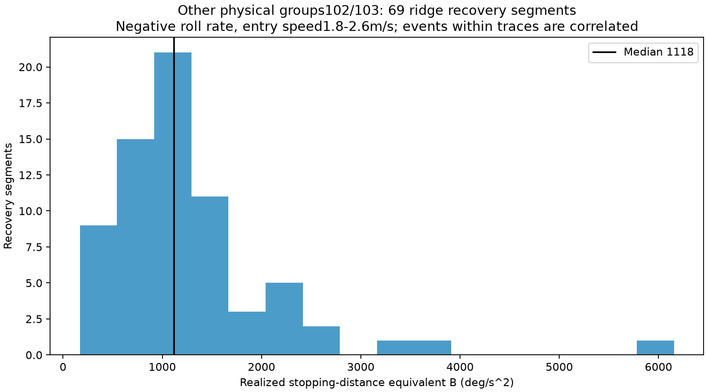
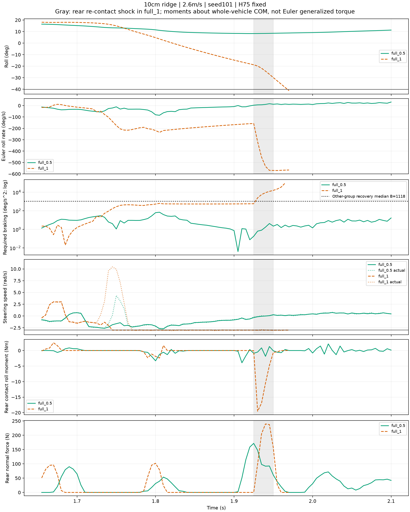

# 从数据估计持续回正能力，并定位单脊失败链

先看[实际/原参考XY](../../positive_recovery/POSITIVE_XY.png)，再看本次[失败链同轴图](FAILURE_CHAIN.png)。原H75冻结；复用通道消融216条，无新增训练/仿真。分析主例single10_v2.6_seed101，full_0.5与full_1，共同起点自然行驶，并非同一入障状态。

## B怎么算：整段刹住的能力，而非5ms尖峰

选每段同方向角速度的绝对峰值，直到角速度第一次过零；线性插值过零时的侧倾角。以实测停止位移定义：

B_eff = omega_start² / (2 × sign(omega_start) × (phi_stop − phi_start))。

它恰好等于能产生同一停止位移的恒定回正减速度；把B_eff代回去恢复原停止位移是定义，不算独立预测验证。实际峰值角速度≥30°/s，停止历时20–500ms，全段|phi|<0.7rad；排除标记duplicate的重复车道，未刹住的段不能形成这个估计，保留在原全216结果中。本次只用其他物理组102/103、同为10cm单脊、负向侧倾角速度、起始速度1.8–2.6m/s的片段作为目标101的经验参照。没有声称姿态、转角和接触状态完全匹配。

共69段，来自53条轨迹（段间相关，不是69个独立回合）。B_eff中位数 **1118.31°/s²**，四分位范围 **782.22–1512.12°/s²**，10%–90%为485.43–2258.34，最大6156.07。可取 **约1100°/s²作为该类已实现恢复的典型参考B**。这不是最大物理能力：选择的是已刹住的过程，控制未必全力，不包含失败段，接触也参与回正。原始924段全量列表保留，不围绕一条失败调数字。

## 目标失败回合本身，实际持续恢复多快？

full_1在1.83–1.92s，前后轮记录法向力均为0，角速度从约−205°/s回升到−159°/s。对omega(t)做直线拟合得到 **510.27°/s²**，角速度拟合RMSE **0.619°/s**。改用1.82–1.92、1.84–1.92、1.85–1.915s，结果分别522.77、499.13、494.52°/s²。因此这一段实际持续回正约 **500–523°/s²**。这是日志重新算出的局部净回正速率，与旧示例500接近是数据结果；不是复用示例，也不是车辆全局极限。双轮无记录支撑时还存在姿态运动学和车内耦合，不把这510全部归因于转向侧向地面力。

成功full_0.5同一时间段线性斜率279°/s²，但其角速度已经很小，且正在经历不同接触过程；不能以该斜率较小反推它能力较差。

## 为什么会失败：两次作用，中间确实有恢复

1. **越脊时先积累了较大的负向侧倾速度，并出现转向跟随受冲击。** 1.750s，full_1的伺服命令−3rad/s，而实际转向速度+9.94rad/s，电机输出−1Nm，已经到记录的电机幅值边界；前轮法向力5ms均值163.73N。此时侧倾速度−174.69°/s。full_0.5同一时刻实际转向速度+4.33rad/s，侧倾速度仅−10.86°/s。两条是同工况时间对照，不是相同接触状态的因果干预。
2. **随后双轮无记录接触，车仍向负侧转，但在减速。** full_1的速度命令持续−3rad/s，实际关节速度约−3；1.83–1.92s净回正约510°/s²。到1.925s，phi=−18.81°，omega=−157.22°/s，仍未刹住。
3. **后轮重新落地形成大的负向侧倾接触力矩，与外倾速度再度猛增对齐。** 1.930s后轮法向力5ms均值99.36N，绕整车质心的负侧倾轴投影接触力矩−19.54Nm；前轮法向力仍0。1.940s后轮法向力239.51N。同期omega从1.925s的−157.22增至1.940s的−534.13°/s，15ms内多了约377°/s负向速度。这里的力矩是法向与摩擦合计、相对于整车质心的投影，不当作单自由度Euler广义力矩；记录支持后轮再接触为关键冲击环节，但不宣称仅这一项精确解释全部角动量变化。
4. **转向命令已用满，尚未完成的恢复被这次冲击打断。** 冲击时实际转向仍能跟随约−3rad/s，转角只有0.04rad附近，不是转角达到±0.8rad。需要区分早期冲击时电机饱和/转向偏离与后期命令限速，不能把全程笼统说成幅值饱和。
5. **剩余角度缩小、外倾角速度增大，制动需求跃升。** 1.925s为580°/s²；1.930s为2502；1.940s为9024；1.965s为96915。最终1.970s|phi|=41.28°，超过40.107°监视阈值。侧倾超限是记录终止原因，不自动称车体触地。

## 数学与数据怎样连起来

同一真实角度边界phi_c=0.7rad下，B_req=omega²/[2(phi_c−sign(omega)phi)]。例如1.940s，剩余负向角度15.81°，外倾速度534.13°/s。如果仅按其他物理组的典型B=1118估计，停止还需约127.56°，远大于剩余角度；即使使用这些已恢复片段的最大B_eff=6156，恒定制动距离仍约23.17°。这说明失败段已经进入远超已观测常见持续恢复水平的需求区。它是基于经验恢复能力的解释，不把样本最大值称为所有允许控制的理论上界。

full_0.5在1.925s已回到phi=8.29°、omega=+3.40°/s，B_req约0.18°/s²，后续完整运行并通过任务C。因此差异不只是“角度小一些”，而是**到后轮接触阶段，是否已经把外倾速度拉回来，以及接触是否再次注入大的外倾运动**。

能讲的故事：α改变入障及速度—转向过程；full_1在前段积累外倾运动，虽有回正但未停住，后轮再接触冲击进一步加剧倾倒，命令受限的当前闭环未及时刹住；full_0.5较早压低侧倾速度，在后续接触中保持恢复并继续完成原任务。完整因果量分解可进一步做，但这次已能从同步日志指出关键时段、执行状态和恢复需求差距，而非只报告H穿线。

## 文件与复算

- `reference_segments.csv`：69个参考片段；`recovery_segments.csv`：全924段，含起止、速度、方向、双轮无支撑比例。
- `local_braking_fits.csv`：两条主例四种窗口拟合；`timeline.csv`：所有文中关键时刻。
- `curves.npz`：绘图曲线；`summary.json`：阈值、定义、数据角色与分位数。
- 源码：`learning/cli/estimate_roll_braking.py`，`--source .../h75_channel_scan/roll_contact_analysis --output .../h75_H_boundary_review/capacity_estimate`。
- 全量路径：`/media/qy/6A7E3DB07E3D75C3/STTW_runs/h75_H_boundary_review/capacity_estimate`。

图使用原始5ms状态与原始5kHz接触按5ms的均值，不重新滤波；阴影1.925–1.950s为full_1再接触冲击窗口。无效/已超角度边界的B_req不画；真实终点截断。图为科研分析稿，未指定期刊。
