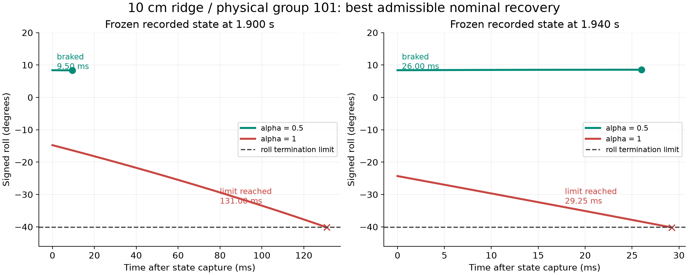

# H75数学验证：最有利恢复控制与真实参考通道

已完成：固定速度名义模型的最小侧倾包络证明、360初态计算、36个独立约束优化核对、73个真实状态的冻结模型计算，以及H75参考通道300次自动微分/差分核对。未新增训练或GPU仿真。

[原始配对XY轨迹](xy.png)先用于核对车辆行为；下图是从真实状态出发的**数学反事实轨迹**，不是重新运行的PhysX轨迹。



论文主线及跨工况对照见[精简结论](../h75_theory_atlas/README.md#当前结论行动模式有适用范围)。

## 1. 可以证明什么

使用原ECBC参数，固定v时：

$$\ddot\phi=a_4\phi+a_2\delta+a_1\dot\delta,\qquad |\delta|\le0.8,\quad |\dot\delta|\le3.$$

本次速度范围内a1<0、a2<0、a4>0，令λ=√a4。对转向速度项分部积分，得到精确解：

$$\phi(T)=\phi_0\cosh(\lambda T)+\frac{\omega_0-a_1\delta_0}{\lambda}\sinh(\lambda T)+\int_0^T\left[a_1\cosh(\lambda(T-t))+\frac{a_2}{\lambda}\sinh(\lambda(T-t))\right]\delta(t)dt.$$

积分核始终为负；所有允许转向都满足δ(t)≤min(δ0+3t,0.8)。因此δ*(t)=min(δ0+3t,0.8)使φ(T)在**每个T**达到最小值。负方向倾倒同时将φ、ω、δ变号，推导相同。

**命题：若这个最小侧倾包络仍越过该方向φc=0.7rad，那么所有允许转向都会在该时刻或之前越限。** 这是对整个允许控制集合的结论，不是只试过一种控制器。

条件：固定速度、无额外接触扰动、线性名义系数、实际转向角速度可以理想执行并受±3rad/s约束。实际PhysX转向角速度曾超过命令限制，接触可增加或减少侧倾加速度，所以此命题不能直接宣称为完整仿真的必败证明。φc是程序侧倾终止阈值，不是几何碰地角。停止外倾只证明这一次刹住，未证明之后维持平衡、另一侧约束或完成路径。

## 2. 独立数值验证

固定初态：v={1.8,2.3,2.6}m/s，φ={−30,−15,0,15,30}°，ω={±50,±100,±200,±400}°/s，δ={−0.4,0,0.4}rad，共360个。

- 170个最优包络越限，因此满足上述名义不可避免越限命题。
- 190个在当前倾倒方向越限前刹住角速度。
- 另用36个线性规划问题独立求解：100段自由控制、每段5ms、全部转角和角速度约束；与离散包络的终点误差最大3.20e−14rad。
- 连续包络采用精确分段解析解，事件搜索间隔0.25ms；报告时间是首次采样越限/停止时间，不冒充连续根的精确时刻。LP验证离散控制集合，连续全局结论来自上面的积分核证明。

全量数据：[360初态](exact_envelope360.csv)、[36个LP](independent_lp36.csv)、[73个真实状态](recorded_states_frozen_model.csv)。没有根据成功失败标签拟合B。

## 3. 单脊101为什么失败

从各自记录状态出发，未来速度冻结、未来接触扰动去掉、转向使用最有利控制：

|起始时刻|α|φ (°)|ω (°/s)|当前δ(rad)|计算结局|
|---|---:|---:|---:|---:|---|
|1.900s|0.5|8.40|−8.48|0.0230|9.50ms后刹住当前方向|
|1.900s|1|−14.75|−167.76|0.1324|131.00ms内仍会负向越限|
|1.940s|0.5|8.40|10.53|0.0078|26.00ms后刹住当前方向|
|1.940s|1|−24.30|−534.13|0.0115|29.25ms内仍会负向越限|

α=1的关键是**已经积累的负向倾倒速度，超过当前转向状态能及时刹住的程度**。转角还未到幅值上限也会失败：转角需要时间改变，而这段时间车辆仍在倾倒。旧常数B忽略了这个转向建立过程，新包络把它显式计入。

真实记录中1.930–1.940s后轮再接触伴随侧倾角速度从约−318变为−534°/s；真实终止为1.970s。模型从1.940s算出的29.25ms与实际剩余30ms接近，是该例的对应证据；单例时间接近不代表模型已在全部接触状态准确。1.900s模型预期131ms才越限，而真实70ms后终止，也显示后续接触不能删掉再当真实预测。

原始时序：`h75_channel_scan/roll_contact_analysis/single10_v2.6_seed101.npz`；状态列含Euler侧倾导数，不把IMU x角速度直接替代它。其余两工况/五alpha/五时刻的73条结果完整保留，没有只保留支持案例。

## 4. 是否证明某个α更好

还没有证明α=0.5普遍优于α=1。此次独立计算原H75 Actor和一次5ms参考滤波/变化率限制的局部导数：12工况×5个保存状态×5alpha=300条。每次仅替换alpha，其余历史和状态相同；以原full_0.5保存观测作共同输入。

- 原网络目标重算与日志最大绝对误差8.47e−8。
- 自动微分与中心差分（步长1e−6）最大误差2.93e−10；检查alpha、最新侧倾输入、最新IMU x输入。
- 222/300条速度参考对alpha即时导数为零；转向参考为1/300。变化率/幅值限制使即时响应与网络目标响应不同。

这支持“α通过有记忆、有速率限制的速度—转向参考改变恢复方式”，也说明不能把α直接换成一个静态阻尼参数。未计算包含车辆、接触、Local300、ESO和历史状态的完整Aα/Gα；不能用这里的导数给出闭环极点、扰动增益或alpha任务排名。

数据：[导数全量表](alpha_reference_derivatives.csv)、[数值核对](alpha_reference_summary.json)。Actor SHA256记录于摘要。参考映射源码为torch_path_policy.py，最新roll_rate输入实际是IMU x。

## 5. 复算与下一步

在sttw-gravel根目录运行（输出目录预先由第一条创建）：

```bash
/home/qy/miniconda3/envs/mjp/bin/python learning/cli/verify_nominal_recovery.py --output /media/qy/6A7E3DB07E3D75C3/STTW_runs/h75_mathematical_verification
/home/qy/miniconda3/envs/env_isaaclab/bin/python learning/cli/verify_alpha_reference.py --output /media/qy/6A7E3DB07E3D75C3/STTW_runs/h75_mathematical_verification
/home/qy/miniconda3/envs/mjp/bin/python learning/cli/plot_nominal_verification.py --output /media/qy/6A7E3DB07E3D75C3/STTW_runs/h75_mathematical_verification
```

下一项必须补全完整闭环和接触输入，才能从共同状态预测alpha的侧倾/路径/速度代价。当前数学结果解释“进入哪些状态后，名义转向能力已赶不上倾倒”；实验轨迹说明不同alpha进入了不同状态。两者已能串成机制解释，但尚未闭合“从alpha提前推导哪档必然更好”的证明。
