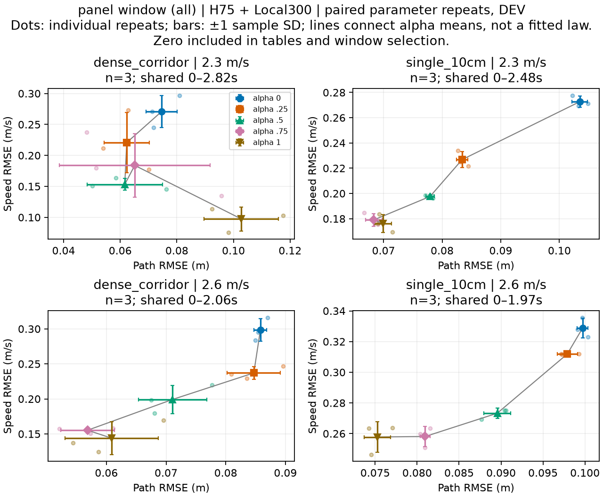
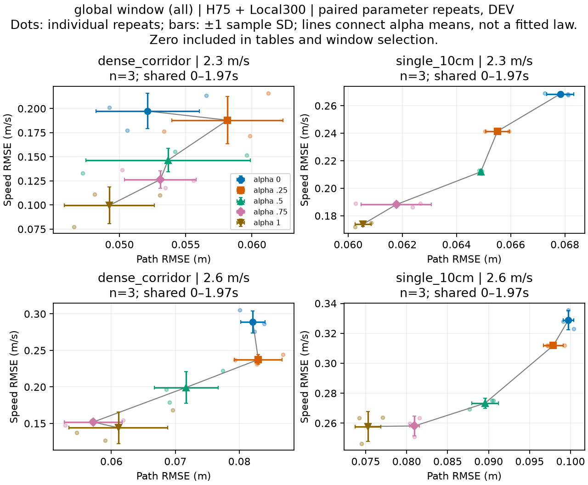

# H75 terrain and requested-speed DEV

All five alphas and matched Zero; same original path. No training or generalization claim.
same full saved 2.3 m/s warm state; 2.6 m/s is a command-change condition, not an equilibrated 2.6 m/s entrance
Dense reference-corridor pebbles and10cm ridge DEV; frozen original H75+Local300; no training

## dense_corridor / 2.3 m/s

batched six-lane case; frozen parameters per seed in shared GPU scene

[Per-step/cumulative rewards](/media/qy/6A7E3DB07E3D75C3/STTW_runs/h75_dense_corridor_ridge10/evaluation/dense_corridor_v2p3_seed101/evaluation/overview.png)

## single_10cm / 2.3 m/s

batched six-lane case; frozen parameters per seed in shared GPU scene

[Per-step/cumulative rewards](/media/qy/6A7E3DB07E3D75C3/STTW_runs/h75_dense_corridor_ridge10/evaluation/single_10cm_v2p3_seed101/evaluation/overview.png)

## dense_corridor / 2.6 m/s

batched six-lane case; frozen parameters per seed in shared GPU scene

[Per-step/cumulative rewards](/media/qy/6A7E3DB07E3D75C3/STTW_runs/h75_dense_corridor_ridge10/evaluation/dense_corridor_v2p6_seed101/evaluation/overview.png)

## single_10cm / 2.6 m/s

batched six-lane case; frozen parameters per seed in shared GPU scene

[Per-step/cumulative rewards](/media/qy/6A7E3DB07E3D75C3/STTW_runs/h75_dense_corridor_ridge10/evaluation/single_10cm_v2p6_seed101/evaluation/overview.png)

## dense_corridor / 2.3 m/s

batched six-lane case; frozen parameters per seed in shared GPU scene

[Per-step/cumulative rewards](/media/qy/6A7E3DB07E3D75C3/STTW_runs/h75_dense_corridor_ridge10/evaluation/dense_corridor_v2p3_seed102/evaluation/overview.png)

## single_10cm / 2.3 m/s

batched six-lane case; frozen parameters per seed in shared GPU scene

[Per-step/cumulative rewards](/media/qy/6A7E3DB07E3D75C3/STTW_runs/h75_dense_corridor_ridge10/evaluation/single_10cm_v2p3_seed102/evaluation/overview.png)

## dense_corridor / 2.6 m/s

batched six-lane case; frozen parameters per seed in shared GPU scene

[Per-step/cumulative rewards](/media/qy/6A7E3DB07E3D75C3/STTW_runs/h75_dense_corridor_ridge10/evaluation/dense_corridor_v2p6_seed102/evaluation/overview.png)

## single_10cm / 2.6 m/s

batched six-lane case; frozen parameters per seed in shared GPU scene

[Per-step/cumulative rewards](/media/qy/6A7E3DB07E3D75C3/STTW_runs/h75_dense_corridor_ridge10/evaluation/single_10cm_v2p6_seed102/evaluation/overview.png)

## dense_corridor / 2.3 m/s

batched six-lane case; frozen parameters per seed in shared GPU scene

[Per-step/cumulative rewards](/media/qy/6A7E3DB07E3D75C3/STTW_runs/h75_dense_corridor_ridge10/evaluation/dense_corridor_v2p3_seed103/evaluation/overview.png)

## single_10cm / 2.3 m/s

batched six-lane case; frozen parameters per seed in shared GPU scene

[Per-step/cumulative rewards](/media/qy/6A7E3DB07E3D75C3/STTW_runs/h75_dense_corridor_ridge10/evaluation/single_10cm_v2p3_seed103/evaluation/overview.png)

## dense_corridor / 2.6 m/s

batched six-lane case; frozen parameters per seed in shared GPU scene

[Per-step/cumulative rewards](/media/qy/6A7E3DB07E3D75C3/STTW_runs/h75_dense_corridor_ridge10/evaluation/dense_corridor_v2p6_seed103/evaluation/overview.png)

## single_10cm / 2.6 m/s

batched six-lane case; frozen parameters per seed in shared GPU scene

[Per-step/cumulative rewards](/media/qy/6A7E3DB07E3D75C3/STTW_runs/h75_dense_corridor_ridge10/evaluation/single_10cm_v2p6_seed103/evaluation/overview.png)

## Paired repeated-parameter summary

Five fixed H75 alpha levels and matched Zero. Each seed changes frozen physical/control parameters; these are not independent policy-training seeds. All runs start from the same saved 2.3 m/s warm state; low-speed requests include the deceleration transient, not equilibrated low-speed starts. No exclusions. Means average individual-run RMSE; error bars are sample SD, not confidence intervals. Failure counts use each full recorded run, while RMSE comparisons use the stated common window.

### Common window within each speed/terrain panel

[All per-seed values and failure endpoints](tradeoff_repeated_raw.csv) · [All six-method means and SD](tradeoff_repeated_summary.json) · [Paired adjacent-alpha changes](tradeoff_marginal_exchange.json)

|Terrain|Speed m/s|n|Window s|Path RMSE alpha0 → 1, m|Speed RMSE alpha0 → 1, m/s|Full-run failure counts 0/.25/.5/.75/1/Zero|
|---|---:|---:|---:|---:|---:|---|
|dense_corridor|2.3|3|2.820|0.0746 → 0.1027|0.2710 → 0.0975|0/1/0/1/0/3|
|single_10cm|2.3|3|2.480|0.1035 → 0.0699|0.2727 → 0.1763|0/1/0/0/3/3|
|dense_corridor|2.6|3|2.055|0.0858 → 0.0609|0.2984 → 0.1438|1/2/1/2/1/3|
|single_10cm|2.6|3|1.970|0.0997 → 0.0753|0.3288 → 0.2578|2/0/0/3/3/3|

3/16 adjacent-alpha mean changes have increasing path error and decreasing speed error. Other edges are retained, including folds and simultaneous improvement/deterioration. This fraction describes these panels; it is not a statistical significance test or a claim of a universal reciprocal law.

### One common window across the whole matrix

[All per-seed values and failure endpoints](tradeoff_repeated_raw_global_window.csv) · [All six-method means and SD](tradeoff_repeated_summary_global_window.json) · [Paired adjacent-alpha changes](tradeoff_marginal_exchange_global_window.json)

|Terrain|Speed m/s|n|Window s|Path RMSE alpha0 → 1, m|Speed RMSE alpha0 → 1, m/s|Full-run failure counts 0/.25/.5/.75/1/Zero|
|---|---:|---:|---:|---:|---:|---|
|dense_corridor|2.3|3|1.970|0.0521 → 0.0492|0.1973 → 0.0996|0/1/0/1/0/3|
|single_10cm|2.3|3|1.970|0.0678 → 0.0605|0.2685 → 0.1739|0/1/0/0/3/3|
|dense_corridor|2.6|3|1.970|0.0821 → 0.0611|0.2891 → 0.1440|1/2/1/2/1/3|
|single_10cm|2.6|3|1.970|0.0997 → 0.0753|0.3288 → 0.2578|2/0/0/3/3/3|

3/16 adjacent-alpha mean changes have increasing path error and decreasing speed error. Other edges are retained, including folds and simultaneous improvement/deterioration. This fraction describes these panels; it is not a statistical significance test or a claim of a universal reciprocal law.

## Gravel task screening

[
  {
    "terrain": "dense_corridor",
    "n": 36,
    "survived": 21,
    "arrived": 24,
    "final_hold": 18,
    "A": 3,
    "B": 5,
    "C": 3
  },
  {
    "terrain": "single_10cm",
    "n": 36,
    "survived": 18,
    "arrived": 18,
    "final_hold": 14,
    "A": 2,
    "B": 0,
    "C": 6
  }
]

Full per-condition data: gravel_task_metrics.json/CSV and gravel_events.json. Task success requires original goal + final hold + declared peak-path/speed limits; early failure never becomes qualified through a shorter error window. Inspect all XY/paired reward figures linked above before expanding the next stage.

## 本轮结果审阅与论文判断

[全部12组XY、每步/累计奖励及72条数据](#h75-terrain-and-requested-speed-dev)。本节从gravel_task_metrics.json重新聚合；未重跑物理，未更新策略。三个seed是物理/控制参数组，非独立训练重复；两种地形各一张布局、同一保存暖态，属于DEV压力测试。

任务A/B/C分别为全窗口峰值路径误差≤0.30/0.60/0.40m、速度RMSE≤0.20/0.10/0.15m/s，同时要求原目标到达、最终保持、无提前失败；三任务可能重叠，不能相加当独立成功数。Zero为Local300+ECBC/ESO、零中层，不是纯ECBC。

|地形|速度|方法|观察满10s /3|A /3|B /3|C /3|
|---|---:|---|---:|---:|---:|---:|
|dense_corridor|2.3|alpha0|3|0|0|0|
|dense_corridor|2.3|alpha025|2|0|0|0|
|dense_corridor|2.3|alpha05|3|1|1|1|
|dense_corridor|2.3|alpha075|2|0|0|0|
|dense_corridor|2.3|alpha1|3|0|1|1|
|dense_corridor|2.3|Zero|0|0|0|0|
|dense_corridor|2.6|alpha0|2|1|0|0|
|dense_corridor|2.6|alpha025|1|0|0|0|
|dense_corridor|2.6|alpha05|2|1|1|1|
|dense_corridor|2.6|alpha075|1|0|0|0|
|dense_corridor|2.6|alpha1|2|0|2|0|
|dense_corridor|2.6|Zero|0|0|0|0|
|single_10cm|2.3|alpha0|3|1|0|1|
|single_10cm|2.3|alpha025|2|0|0|0|
|single_10cm|2.3|alpha05|3|0|0|0|
|single_10cm|2.3|alpha075|3|0|0|0|
|single_10cm|2.3|alpha1|0|0|0|0|
|single_10cm|2.3|Zero|0|0|0|0|
|single_10cm|2.6|alpha0|1|1|0|0|
|single_10cm|2.6|alpha025|3|0|0|2|
|single_10cm|2.6|alpha05|3|0|0|3|
|single_10cm|2.6|alpha075|0|0|0|0|
|single_10cm|2.6|alpha1|0|0|0|0|
|single_10cm|2.6|Zero|0|0|0|0|

实际候选覆盖（事后诊断，不是在线策略成绩）：

|地形|速度|参数seed|A合格候选|B合格候选|C合格候选|
|---|---:|---:|---|---|---|
|dense_corridor|2.3|101|无|alpha1|alpha1|
|dense_corridor|2.3|102|alpha05|alpha05|alpha05|
|dense_corridor|2.3|103|无|无|无|
|dense_corridor|2.6|101|无|alpha1|无|
|dense_corridor|2.6|102|alpha0|alpha1|无|
|dense_corridor|2.6|103|alpha05|alpha05|alpha05|
|single_10cm|2.3|101|alpha0|无|alpha0|
|single_10cm|2.3|102|无|无|无|
|single_10cm|2.3|103|无|无|无|
|single_10cm|2.6|101|无|无|alpha025,alpha05|
|single_10cm|2.6|102|无|无|alpha05|
|single_10cm|2.6|103|alpha0|无|alpha025,alpha05|

解释与决定：

- H75观察满10秒39/60；Zero为0/12。密集石子H75为21/30，10cm单脊18/30。这是本组配对条件的描述性差异，不将五alpha当五份独立基线重复，也不将存活称任务合格。
- 10cm、2.6m/s：alpha.25与.5均3/3完整观察，C分别2/3和3/3；alpha.75与1均0/3。10cm、2.3m/s的alpha1同样0/3。端点不是通用最优。
- 密集石子36/36和单脊36/36均记录前后轮抬高地形接触，密集石子前轮事件10–33段；事件可被短暂分离切碎，不能称撞到10–33颗独立石子。单布局压缩不证明一般密度效应。
- 全方法共同窗口被早停缩短到各面板1.97–2.82秒；仅3/16相邻alpha均值变化同时满足路径误差上升、速度误差下降。短窗口不是完整越障能力，不支持普适单调取舍或Pareto前沿。
- 密集石子B：固定alpha1覆盖3/6，已测固定候选并集5/6；10cm单脊B：所有固定候选均无合格，覆盖0/6。前者有选档余地，后者暴露当前候选能力缺口；后者不证明动态切换绝无可能。

论文判断：已有600条重复评测、P4任务条件选档15/40对最佳所测固定端点11/40，以及本轮压力边界，足以支撑一篇聚焦“冻结分层控制中的任务偏好与越野能力边界”的仿真研究主体。尚不足以宣称普遍越野鲁棒性、接触补偿有效、相位在线选档有效或训练全面收敛；投稿完备性与创新性尚须结合正式稿和文献审查，不能承诺录用。根docs/paper/MANUSCRIPT.md仍标证据截止2026-09-12，其直接残差任务叙述不能代表当前H75中层主线，需与现行证据同步。

建议下一步（尚未启动新实验）：先用已有P3/P4及本轮逐步记录定位切换前失格/动态残余状态与候选覆盖；优先做任务+当前状态的选档，同预算比较固定alpha、Task-only、状态选档、状态+接触信息。冻结独立路线/布局与初态确认集，DEV只作设计；以配对新增/丢失任务合格为主，切换后恢复作为辅助，不修改原全程门槛。只有候选本身不足的部分才进入地形混合H75续训，保留原Go2随机化与底层身份；接触补偿暂不重启。

### 视频工况的门槛解释

密集石子2.3m/s、seed101、alpha.5视频的具体解释更正：完整10s、到达、末1s保持均通过，速度RMSE0.09166m/s；唯一导致A/B/C均不合格的维度是全程峰值路径误差0.64164m（4.495s），超过最宽B门槛0.6m约4.16cm，超0.6累计0.465s。路径RMSE0.21832m。末保持要求路径≤0.1m、航向≤0.05rad、速度误差≤0.1m/s持续1s。应称“完成越障并恢复，但未满足声明的全程走廊约束”，不能简称失败或控制不可用。A/B/C来自旧石子任务配置，不是已证实实车安全界限；用户质疑其适配性，后续拖距机制研究应分开物理失稳、恢复能力和任务约束，旧标签不改。

## 终止与任务超限分开统计

Signals in first failed20ms policy interval; co-occurrence retained, not unique causal attribution. Roll threshold is0.7rad, not proof of ground impact. Unresolved may include contact/numerical failure. Task path duration uses5ms samples. Task nonachievement after early termination is not an independent physical cause.

{'conditions': 72, 'completed_horizon': 39, 'early_terminations': 33, 'nonexclusive_terminal_signals': {'unresolved_from_recorded_flags': 2, 'domain_exit': 15, 'roll_threshold_exceeded': 16}, 'completed_horizon_no_ABC': 26}

|地形|速度|seed|方法|观察秒数|终止信号|未到达|末保持未达|任务A/B/C不合格原因|
|---|---:|---:|---|---:|---|---|---|---|
|dense_corridor|2.3|101|alpha0|10.0000|完整观察|False|True|A:final_hold_not_met,peak_path_limit_exceeded; B:final_hold_not_met,peak_path_limit_exceeded,speed_rmse_limit_exceeded; C:final_hold_not_met,peak_path_limit_exceeded,speed_rmse_limit_exceeded|
|dense_corridor|2.3|101|alpha025|10.0000|完整观察|False|False|A:peak_path_limit_exceeded; B:peak_path_limit_exceeded,speed_rmse_limit_exceeded; C:peak_path_limit_exceeded|
|dense_corridor|2.3|101|alpha05|10.0000|完整观察|False|False|A:peak_path_limit_exceeded; B:peak_path_limit_exceeded; C:peak_path_limit_exceeded|
|dense_corridor|2.3|101|alpha075|2.8164|unresolved_from_recorded_flags|True|True|A:early_termination,goal_not_reached,final_hold_not_met,speed_rmse_limit_exceeded; B:early_termination,goal_not_reached,final_hold_not_met,speed_rmse_limit_exceeded; C:early_termination,goal_not_reached,final_hold_not_met,speed_rmse_limit_exceeded|
|dense_corridor|2.3|101|alpha1|10.0000|完整观察|False|False|A:peak_path_limit_exceeded; B:qualified; C:qualified|
|dense_corridor|2.3|101|Zero|3.8400|domain_exit|True|True|A:early_termination,goal_not_reached,final_hold_not_met,peak_path_limit_exceeded; B:early_termination,goal_not_reached,final_hold_not_met,peak_path_limit_exceeded,speed_rmse_limit_exceeded; C:early_termination,goal_not_reached,final_hold_not_met,peak_path_limit_exceeded,speed_rmse_limit_exceeded|
|single_10cm|2.3|101|alpha0|10.0000|完整观察|False|False|A:qualified; B:speed_rmse_limit_exceeded; C:qualified|
|single_10cm|2.3|101|alpha025|4.8800|domain_exit|True|True|A:early_termination,goal_not_reached,final_hold_not_met,peak_path_limit_exceeded; B:early_termination,goal_not_reached,final_hold_not_met,peak_path_limit_exceeded,speed_rmse_limit_exceeded; C:early_termination,goal_not_reached,final_hold_not_met,peak_path_limit_exceeded,speed_rmse_limit_exceeded|
|single_10cm|2.3|101|alpha05|10.0000|完整观察|False|False|A:peak_path_limit_exceeded; B:peak_path_limit_exceeded,speed_rmse_limit_exceeded; C:peak_path_limit_exceeded|
|single_10cm|2.3|101|alpha075|10.0000|完整观察|False|True|A:final_hold_not_met,peak_path_limit_exceeded; B:final_hold_not_met,peak_path_limit_exceeded; C:final_hold_not_met,peak_path_limit_exceeded|
|single_10cm|2.3|101|alpha1|2.6250|roll_threshold_exceeded|True|True|A:early_termination,goal_not_reached,final_hold_not_met,peak_path_limit_exceeded; B:early_termination,goal_not_reached,final_hold_not_met,speed_rmse_limit_exceeded; C:early_termination,goal_not_reached,final_hold_not_met,peak_path_limit_exceeded,speed_rmse_limit_exceeded|
|single_10cm|2.3|101|Zero|2.4800|domain_exit|True|True|A:early_termination,goal_not_reached,final_hold_not_met; B:early_termination,goal_not_reached,final_hold_not_met,speed_rmse_limit_exceeded; C:early_termination,goal_not_reached,final_hold_not_met,speed_rmse_limit_exceeded|
|dense_corridor|2.6|101|alpha0|10.0000|完整观察|False|False|A:peak_path_limit_exceeded,speed_rmse_limit_exceeded; B:peak_path_limit_exceeded,speed_rmse_limit_exceeded; C:peak_path_limit_exceeded,speed_rmse_limit_exceeded|
|dense_corridor|2.6|101|alpha025|10.0000|完整观察|False|False|A:peak_path_limit_exceeded; B:peak_path_limit_exceeded,speed_rmse_limit_exceeded; C:peak_path_limit_exceeded|
|dense_corridor|2.6|101|alpha05|2.4750|roll_threshold_exceeded|True|True|A:early_termination,goal_not_reached,final_hold_not_met,speed_rmse_limit_exceeded; B:early_termination,goal_not_reached,final_hold_not_met,speed_rmse_limit_exceeded; C:early_termination,goal_not_reached,final_hold_not_met,speed_rmse_limit_exceeded|
|dense_corridor|2.6|101|alpha075|10.0000|完整观察|False|True|A:final_hold_not_met,peak_path_limit_exceeded; B:final_hold_not_met,peak_path_limit_exceeded,speed_rmse_limit_exceeded; C:final_hold_not_met,peak_path_limit_exceeded|
|dense_corridor|2.6|101|alpha1|10.0000|完整观察|False|False|A:peak_path_limit_exceeded; B:qualified; C:peak_path_limit_exceeded|
|dense_corridor|2.6|101|Zero|6.9800|domain_exit|False|True|A:early_termination,final_hold_not_met,peak_path_limit_exceeded; B:early_termination,final_hold_not_met,peak_path_limit_exceeded,speed_rmse_limit_exceeded; C:early_termination,final_hold_not_met,peak_path_limit_exceeded,speed_rmse_limit_exceeded|
|single_10cm|2.6|101|alpha0|2.4100|roll_threshold_exceeded|True|True|A:early_termination,goal_not_reached,final_hold_not_met,speed_rmse_limit_exceeded; B:early_termination,goal_not_reached,final_hold_not_met,speed_rmse_limit_exceeded; C:early_termination,goal_not_reached,final_hold_not_met,speed_rmse_limit_exceeded|
|single_10cm|2.6|101|alpha025|10.0000|完整观察|False|False|A:peak_path_limit_exceeded; B:speed_rmse_limit_exceeded; C:qualified|
|single_10cm|2.6|101|alpha05|10.0000|完整观察|False|False|A:peak_path_limit_exceeded; B:speed_rmse_limit_exceeded; C:qualified|
|single_10cm|2.6|101|alpha075|2.0500|roll_threshold_exceeded|True|True|A:early_termination,goal_not_reached,final_hold_not_met,speed_rmse_limit_exceeded; B:early_termination,goal_not_reached,final_hold_not_met,speed_rmse_limit_exceeded; C:early_termination,goal_not_reached,final_hold_not_met,speed_rmse_limit_exceeded|
|single_10cm|2.6|101|alpha1|1.9800|roll_threshold_exceeded|True|True|A:early_termination,goal_not_reached,final_hold_not_met,speed_rmse_limit_exceeded; B:early_termination,goal_not_reached,final_hold_not_met,speed_rmse_limit_exceeded; C:early_termination,goal_not_reached,final_hold_not_met,speed_rmse_limit_exceeded|
|single_10cm|2.6|101|Zero|2.0300|roll_threshold_exceeded|True|True|A:early_termination,goal_not_reached,final_hold_not_met,speed_rmse_limit_exceeded; B:early_termination,goal_not_reached,final_hold_not_met,speed_rmse_limit_exceeded; C:early_termination,goal_not_reached,final_hold_not_met,speed_rmse_limit_exceeded|
|dense_corridor|2.3|102|alpha0|10.0000|完整观察|False|True|A:final_hold_not_met,peak_path_limit_exceeded; B:final_hold_not_met,peak_path_limit_exceeded,speed_rmse_limit_exceeded; C:final_hold_not_met,peak_path_limit_exceeded,speed_rmse_limit_exceeded|
|dense_corridor|2.3|102|alpha025|3.9600|domain_exit|True|True|A:early_termination,goal_not_reached,final_hold_not_met,peak_path_limit_exceeded,speed_rmse_limit_exceeded; B:early_termination,goal_not_reached,final_hold_not_met,peak_path_limit_exceeded,speed_rmse_limit_exceeded; C:early_termination,goal_not_reached,final_hold_not_met,peak_path_limit_exceeded,speed_rmse_limit_exceeded|
|dense_corridor|2.3|102|alpha05|10.0000|完整观察|False|False|A:qualified; B:qualified; C:qualified|
|dense_corridor|2.3|102|alpha075|10.0000|完整观察|False|False|A:peak_path_limit_exceeded; B:peak_path_limit_exceeded; C:peak_path_limit_exceeded|
|dense_corridor|2.3|102|alpha1|10.0000|完整观察|False|False|A:peak_path_limit_exceeded; B:peak_path_limit_exceeded; C:peak_path_limit_exceeded|
|dense_corridor|2.3|102|Zero|9.3800|domain_exit|False|True|A:early_termination,final_hold_not_met,peak_path_limit_exceeded; B:early_termination,final_hold_not_met,peak_path_limit_exceeded,speed_rmse_limit_exceeded; C:early_termination,final_hold_not_met,peak_path_limit_exceeded|
|single_10cm|2.3|102|alpha0|10.0000|完整观察|False|True|A:final_hold_not_met,peak_path_limit_exceeded; B:final_hold_not_met,peak_path_limit_exceeded,speed_rmse_limit_exceeded; C:final_hold_not_met,peak_path_limit_exceeded,speed_rmse_limit_exceeded|
|single_10cm|2.3|102|alpha025|10.0000|完整观察|False|True|A:final_hold_not_met,peak_path_limit_exceeded; B:final_hold_not_met,peak_path_limit_exceeded,speed_rmse_limit_exceeded; C:final_hold_not_met,peak_path_limit_exceeded|
|single_10cm|2.3|102|alpha05|10.0000|完整观察|False|False|A:peak_path_limit_exceeded; B:speed_rmse_limit_exceeded; C:peak_path_limit_exceeded|
|single_10cm|2.3|102|alpha075|10.0000|完整观察|False|False|A:peak_path_limit_exceeded; B:peak_path_limit_exceeded; C:peak_path_limit_exceeded|
|single_10cm|2.3|102|alpha1|2.7100|roll_threshold_exceeded|True|True|A:early_termination,goal_not_reached,final_hold_not_met,peak_path_limit_exceeded; B:early_termination,goal_not_reached,final_hold_not_met,speed_rmse_limit_exceeded; C:early_termination,goal_not_reached,final_hold_not_met,peak_path_limit_exceeded,speed_rmse_limit_exceeded|
|single_10cm|2.3|102|Zero|2.5400|domain_exit|True|True|A:early_termination,goal_not_reached,final_hold_not_met; B:early_termination,goal_not_reached,final_hold_not_met,speed_rmse_limit_exceeded; C:early_termination,goal_not_reached,final_hold_not_met,speed_rmse_limit_exceeded|
|dense_corridor|2.6|102|alpha0|10.0000|完整观察|False|False|A:qualified; B:speed_rmse_limit_exceeded; C:speed_rmse_limit_exceeded|
|dense_corridor|2.6|102|alpha025|3.6200|domain_exit|True|True|A:early_termination,goal_not_reached,final_hold_not_met,peak_path_limit_exceeded,speed_rmse_limit_exceeded; B:early_termination,goal_not_reached,final_hold_not_met,peak_path_limit_exceeded,speed_rmse_limit_exceeded; C:early_termination,goal_not_reached,final_hold_not_met,peak_path_limit_exceeded,speed_rmse_limit_exceeded|
|dense_corridor|2.6|102|alpha05|10.0000|完整观察|False|False|A:peak_path_limit_exceeded; B:peak_path_limit_exceeded,speed_rmse_limit_exceeded; C:peak_path_limit_exceeded|
|dense_corridor|2.6|102|alpha075|2.5900|roll_threshold_exceeded|True|True|A:early_termination,goal_not_reached,final_hold_not_met,speed_rmse_limit_exceeded; B:early_termination,goal_not_reached,final_hold_not_met,speed_rmse_limit_exceeded; C:early_termination,goal_not_reached,final_hold_not_met,speed_rmse_limit_exceeded|
|dense_corridor|2.6|102|alpha1|10.0000|完整观察|False|False|A:peak_path_limit_exceeded; B:qualified; C:peak_path_limit_exceeded|
|dense_corridor|2.6|102|Zero|2.1700|roll_threshold_exceeded|True|True|A:early_termination,goal_not_reached,final_hold_not_met; B:early_termination,goal_not_reached,final_hold_not_met,speed_rmse_limit_exceeded; C:early_termination,goal_not_reached,final_hold_not_met,speed_rmse_limit_exceeded|
|single_10cm|2.6|102|alpha0|2.4250|roll_threshold_exceeded|True|True|A:early_termination,goal_not_reached,final_hold_not_met,speed_rmse_limit_exceeded; B:early_termination,goal_not_reached,final_hold_not_met,speed_rmse_limit_exceeded; C:early_termination,goal_not_reached,final_hold_not_met,speed_rmse_limit_exceeded|
|single_10cm|2.6|102|alpha025|10.0000|完整观察|False|False|A:peak_path_limit_exceeded; B:peak_path_limit_exceeded,speed_rmse_limit_exceeded; C:peak_path_limit_exceeded,speed_rmse_limit_exceeded|
|single_10cm|2.6|102|alpha05|10.0000|完整观察|False|False|A:peak_path_limit_exceeded; B:speed_rmse_limit_exceeded; C:qualified|
|single_10cm|2.6|102|alpha075|2.3200|roll_threshold_exceeded|True|True|A:early_termination,goal_not_reached,final_hold_not_met,speed_rmse_limit_exceeded; B:early_termination,goal_not_reached,final_hold_not_met,speed_rmse_limit_exceeded; C:early_termination,goal_not_reached,final_hold_not_met,speed_rmse_limit_exceeded|
|single_10cm|2.6|102|alpha1|1.9700|roll_threshold_exceeded|True|True|A:early_termination,goal_not_reached,final_hold_not_met,speed_rmse_limit_exceeded; B:early_termination,goal_not_reached,final_hold_not_met,speed_rmse_limit_exceeded; C:early_termination,goal_not_reached,final_hold_not_met,speed_rmse_limit_exceeded|
|single_10cm|2.6|102|Zero|3.7200|domain_exit|True|True|A:early_termination,goal_not_reached,final_hold_not_met,peak_path_limit_exceeded; B:early_termination,goal_not_reached,final_hold_not_met,peak_path_limit_exceeded,speed_rmse_limit_exceeded; C:early_termination,goal_not_reached,final_hold_not_met,peak_path_limit_exceeded,speed_rmse_limit_exceeded|
|dense_corridor|2.3|103|alpha0|10.0000|完整观察|False|False|A:peak_path_limit_exceeded; B:peak_path_limit_exceeded,speed_rmse_limit_exceeded; C:peak_path_limit_exceeded,speed_rmse_limit_exceeded|
|dense_corridor|2.3|103|alpha025|10.0000|完整观察|False|False|A:peak_path_limit_exceeded; B:peak_path_limit_exceeded,speed_rmse_limit_exceeded; C:peak_path_limit_exceeded|
|dense_corridor|2.3|103|alpha05|10.0000|完整观察|False|False|A:peak_path_limit_exceeded; B:peak_path_limit_exceeded; C:peak_path_limit_exceeded|
|dense_corridor|2.3|103|alpha075|10.0000|完整观察|False|False|A:peak_path_limit_exceeded; B:peak_path_limit_exceeded,speed_rmse_limit_exceeded; C:peak_path_limit_exceeded|
|dense_corridor|2.3|103|alpha1|10.0000|完整观察|False|False|A:peak_path_limit_exceeded; B:peak_path_limit_exceeded; C:peak_path_limit_exceeded|
|dense_corridor|2.3|103|Zero|7.1400|domain_exit|False|True|A:early_termination,final_hold_not_met,peak_path_limit_exceeded; B:early_termination,final_hold_not_met,peak_path_limit_exceeded,speed_rmse_limit_exceeded; C:early_termination,final_hold_not_met,peak_path_limit_exceeded|
|single_10cm|2.3|103|alpha0|10.0000|完整观察|False|True|A:final_hold_not_met,peak_path_limit_exceeded; B:final_hold_not_met,peak_path_limit_exceeded,speed_rmse_limit_exceeded; C:final_hold_not_met,peak_path_limit_exceeded,speed_rmse_limit_exceeded|
|single_10cm|2.3|103|alpha025|10.0000|完整观察|False|False|A:peak_path_limit_exceeded; B:peak_path_limit_exceeded,speed_rmse_limit_exceeded; C:peak_path_limit_exceeded|
|single_10cm|2.3|103|alpha05|10.0000|完整观察|False|False|A:peak_path_limit_exceeded; B:peak_path_limit_exceeded,speed_rmse_limit_exceeded; C:peak_path_limit_exceeded|
|single_10cm|2.3|103|alpha075|10.0000|完整观察|False|False|A:peak_path_limit_exceeded; B:peak_path_limit_exceeded; C:peak_path_limit_exceeded|
|single_10cm|2.3|103|alpha1|2.7750|roll_threshold_exceeded|True|True|A:early_termination,goal_not_reached,final_hold_not_met,peak_path_limit_exceeded; B:early_termination,goal_not_reached,final_hold_not_met,speed_rmse_limit_exceeded; C:early_termination,goal_not_reached,final_hold_not_met,peak_path_limit_exceeded,speed_rmse_limit_exceeded|
|single_10cm|2.3|103|Zero|2.5400|domain_exit|True|True|A:early_termination,goal_not_reached,final_hold_not_met; B:early_termination,goal_not_reached,final_hold_not_met,speed_rmse_limit_exceeded; C:early_termination,goal_not_reached,final_hold_not_met,speed_rmse_limit_exceeded|
|dense_corridor|2.6|103|alpha0|3.2400|domain_exit|True|True|A:early_termination,goal_not_reached,final_hold_not_met,peak_path_limit_exceeded,speed_rmse_limit_exceeded; B:early_termination,goal_not_reached,final_hold_not_met,peak_path_limit_exceeded,speed_rmse_limit_exceeded; C:early_termination,goal_not_reached,final_hold_not_met,peak_path_limit_exceeded,speed_rmse_limit_exceeded|
|dense_corridor|2.6|103|alpha025|4.0600|domain_exit|True|True|A:early_termination,goal_not_reached,final_hold_not_met,peak_path_limit_exceeded,speed_rmse_limit_exceeded; B:early_termination,goal_not_reached,final_hold_not_met,peak_path_limit_exceeded,speed_rmse_limit_exceeded; C:early_termination,goal_not_reached,final_hold_not_met,peak_path_limit_exceeded,speed_rmse_limit_exceeded|
|dense_corridor|2.6|103|alpha05|10.0000|完整观察|False|False|A:qualified; B:qualified; C:qualified|
|dense_corridor|2.6|103|alpha075|3.2000|domain_exit|True|True|A:early_termination,goal_not_reached,final_hold_not_met,peak_path_limit_exceeded,speed_rmse_limit_exceeded; B:early_termination,goal_not_reached,final_hold_not_met,speed_rmse_limit_exceeded; C:early_termination,goal_not_reached,final_hold_not_met,peak_path_limit_exceeded,speed_rmse_limit_exceeded|
|dense_corridor|2.6|103|alpha1|4.0200|domain_exit|True|True|A:early_termination,goal_not_reached,final_hold_not_met,peak_path_limit_exceeded; B:early_termination,goal_not_reached,final_hold_not_met,peak_path_limit_exceeded,speed_rmse_limit_exceeded; C:early_termination,goal_not_reached,final_hold_not_met,peak_path_limit_exceeded,speed_rmse_limit_exceeded|
|dense_corridor|2.6|103|Zero|2.0532|unresolved_from_recorded_flags|True|True|A:early_termination,goal_not_reached,final_hold_not_met; B:early_termination,goal_not_reached,final_hold_not_met,speed_rmse_limit_exceeded; C:early_termination,goal_not_reached,final_hold_not_met,speed_rmse_limit_exceeded|
|single_10cm|2.6|103|alpha0|10.0000|完整观察|False|False|A:qualified; B:speed_rmse_limit_exceeded; C:speed_rmse_limit_exceeded|
|single_10cm|2.6|103|alpha025|10.0000|完整观察|False|False|A:peak_path_limit_exceeded; B:speed_rmse_limit_exceeded; C:qualified|
|single_10cm|2.6|103|alpha05|10.0000|完整观察|False|False|A:peak_path_limit_exceeded; B:speed_rmse_limit_exceeded; C:qualified|
|single_10cm|2.6|103|alpha075|2.1100|roll_threshold_exceeded|True|True|A:early_termination,goal_not_reached,final_hold_not_met,speed_rmse_limit_exceeded; B:early_termination,goal_not_reached,final_hold_not_met,speed_rmse_limit_exceeded; C:early_termination,goal_not_reached,final_hold_not_met,speed_rmse_limit_exceeded|
|single_10cm|2.6|103|alpha1|2.0150|roll_threshold_exceeded|True|True|A:early_termination,goal_not_reached,final_hold_not_met,speed_rmse_limit_exceeded; B:early_termination,goal_not_reached,final_hold_not_met,speed_rmse_limit_exceeded; C:early_termination,goal_not_reached,final_hold_not_met,speed_rmse_limit_exceeded|
|single_10cm|2.6|103|Zero|1.9800|roll_threshold_exceeded|True|True|A:early_termination,goal_not_reached,final_hold_not_met,speed_rmse_limit_exceeded; B:early_termination,goal_not_reached,final_hold_not_met,speed_rmse_limit_exceeded; C:early_termination,goal_not_reached,final_hold_not_met,speed_rmse_limit_exceeded|

[逐条原因、首次信号时刻与路径超限时长](outcome_reasons.json)。运行域domain_exit不是A/B/C路径阈值；未到达/未保持与提前终止可同时出现，不重复相加作为独立失败数。
