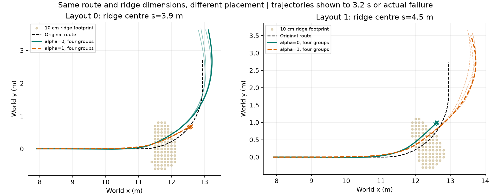
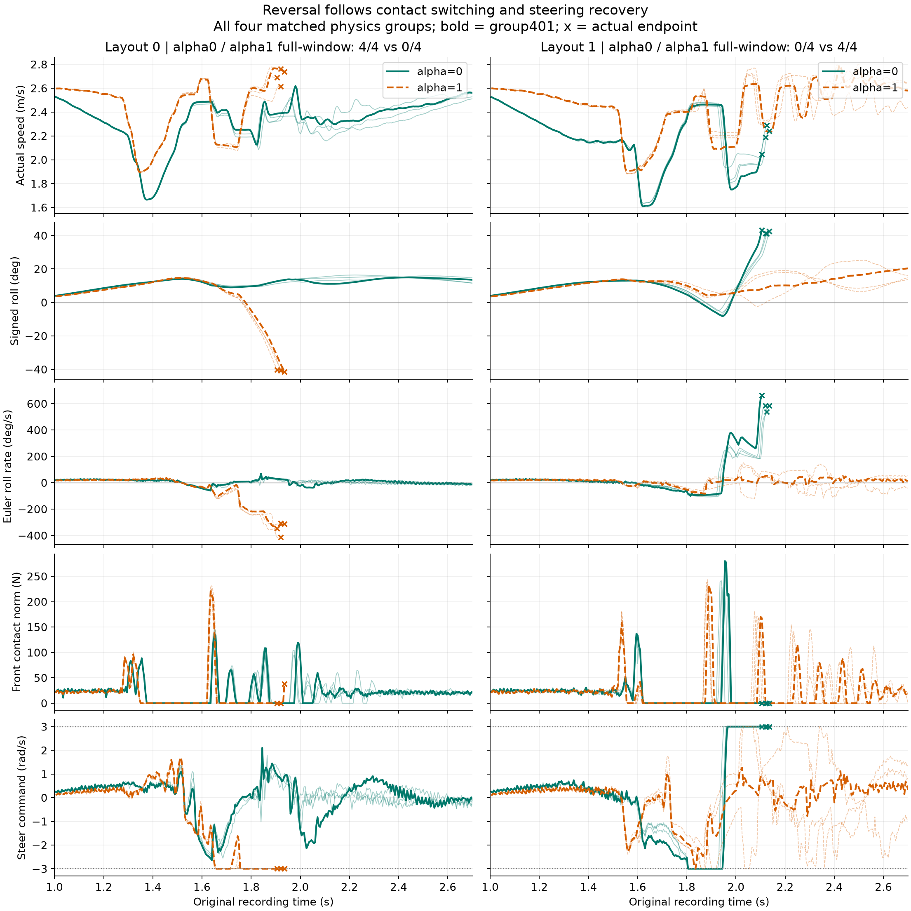

# 单脊位置变化导致α排序反转：接触相位与恢复能力

## 结果与比较范围

原H75＋冻结Local300＋ECBC/ESO，10 cm单脊、0.8 m长、1.6 m宽，请求2.6 m/s。两个布局只改变单脊沿原路径的位置：中心s=3.9→4.5 m；物理组401–404一一配对。全部8个目录、五固定档和Zero共48条轨迹均纳入。

|档位|layout0完整10s|layout1完整10s|layout0最终保持|layout1最终保持|
|---|---:|---:|---:|---:|
|α0|4/4|0/4|4/4|0/4|
|α.25|3/4|0/4|3/4|0/4|
|α.5|1/4|2/4|1/4|2/4|
|α.75|0/4|0/4|0/4|0/4|
|α1|0/4|4/4|0/4|2/4|
|Zero|0/4|1/4|0/4|0/4|

α0与α1的完整运行排序明确反转；layout1的α1仍有两条未最终保持，因此4/4表示完整运行，不替代任务成功。各档失败类型在summary.json，逐条原始复算指标在case_metrics.csv。没有重新仿真或训练。

## 统一理论：接触切换下的冲击—恢复相位耦合

车辆依靠轮地接触把转向动作转成侧向力与侧倾恢复。将多体状态记作(q,q̇)，动力学为

$$M(q)\ddot q+C(q,\dot q)+g(q)=B u+\sum_{i\in\{f,r\}}J_i(q)^T f_i.$$

接触状态满足非穿透和单边接触约束；在刚性、无黏附近似下，间隙gᵢ≥0、法向力Nᵢ≥0、gᵢNᵢ=0。轮胎触地、离地、再触地构成不同动力学模式。策略α通过参考速度与转向改变到达这些切换面的状态和时刻。

**第一步：位置改变冲击相位。** 事件时刻由车辆与地形的相对几何决定，即gᵢ(qα(t),s_ridge)=0。单脊后移0.6 m，使冲击发生在转弯的另一个阶段。原路径在两个单脊中心的航向约20.69°与39.78°，相差19.10°；两处曲率都约0.55556 /m。因而“曲率相同”不代表车辆的侧倾速度、转向角、转向速度和两轮载荷相同。

前轮首次连续低接触力区间（力模<0.1 N且连续至少100 ms）起点的四组均值：

|布局/α|时刻s|实际速度m/s|侧倾°|真实Euler侧倾导数°/s|转角°|
|---|---:|---:|---:|---:|---:|
|layout0/α0|1.375|1.666|11.94|+22.05|10.55|
|layout0/α1|1.350|1.896|10.79|+23.44|6.66|
|layout1/α0|1.625|1.623|12.63|−16.71|15.27|
|layout1/α1|1.624|1.954|12.27|+9.39|9.90|

这是200 Hz记录中第一次长卸载的状态，不把它冒称精确轮胎首次撞击时刻。相同布局的两档已处于不同转向状态；后移后α0甚至从正侧倾速度进入负侧倾速度阶段。

**第二步：冲击的效果取决于相位。** 在局部等效侧倾惯量Iφ近似恒定的短冲击模型中，接触角冲量Jτ带来Δω=Jτ/Iφ。侧倾转动动能变化为

$$\Delta E_\phi=\omega^-J_\tau+\frac{J_\tau^2}{2I_\phi}.$$

这一步来自E=Iφω²/2直接展开。第一项是带符号的相位耦合项：同向冲量增加外倾运动，反向冲量可先削减它。因此同样障碍高度、甚至相同冲量幅度，也不要求不同状态下产生相同危害。真实多体冲击中Iφ和冲量也随姿态与接触模式变化；这里给出排序可以反转的力学机制，不用成功标签拟合参数。

**第三步：是否救得回还取决于接触恢复能力。** 对前轮接触点相对整车质心的位置r_f，地面反力贡献为

$$\tau_{\phi,f}=e_\phi^T(r_f\times f_f).$$

在离地且无接触力时f_f=0，故这一前轮地面反力矩严格为零。转向关节仍可运动、内部惯性和陀螺效应仍存在，但靠前轮地面侧向反力恢复的通道不能在离地时照常提供作用。在近似平地接触、库仑摩擦条件下，侧向力还满足|F_y,f|≤μN_f，因此这部分可用恢复作用随法向载荷衰减。

在名义侧倾模型中令λ=√a4、z=φ̇+λφ，则

$$\dot z=\lambda z+u_\delta+d_c,\qquad u_\delta=a_1(v)\dot\delta+a_2(v)\delta.$$

变参数速度由uδ系数随时变化表示；a4为本车固定名义参数。其积分式为

$$e^{-\lambda(t-t_0)}z(t)=z(t_0)+\int_{t_0}^{t}e^{-\lambda(\tau-t_0)}[u_\delta(\tau)+d_c(\tau)]\,d\tau.$$

它说明外倾状态要靠后续有利作用的积分抵消。轮地离合改变d_c，也改变转向动作产生地面恢复作用的方式；所以不能把离地时仍存在的转向指令等同于已经实现的回正力矩。有限转向指令与不利接触共同持续时，状态会积累到侧倾阈值。平地名义a1/a2不能独自替代这一接触切换过程。

## 数据中反转发生在哪一环

每列一个布局，四物理组全部显示；粗线为401，细线为402–404；叉号为真实终点。末行为实际送达的转向角速度指令，虚线±3 rad/s；不是把测得关节角速度误当成限幅指令。Euler角速度由世界角速度和姿态转换得到，不直接使用IMU x分量。

以每布局失败档终止前的同一个100 ms窗口对两档配对比较，四组均值：

|布局|α0前轮接触力模均值N|α1前轮接触力模均值N|α0/α1结局|
|---|---:|---:|---|
|layout0|27.86|0.47|恢复/负侧倾超限|
|layout1|0.00|35.51|正侧倾超限/恢复|

上述为**力矢量的模**，不混称法向力或接触力矩。四组各自窗口与数值见matched_failure_windows.csv。失败档前轮在该窗内几乎持续无接触，成功档有重新接触的力脉冲。

- layout0：α1的第一次卸载后只短暂再接触，随后再次失去前轮接触；四组负向侧倾速度峰值约−323至−416°/s，1.905–1.935 s侧倾超限。α0经历多次接触切换后重新建立支撑，1–2.6 s内最大绝对侧倾速度约52–69°/s，全部继续运行并最终保持。
- layout1：α0在不同的转向/侧倾阶段进入障碍，长卸载后再接触伴随正向角速度快速增长，后段前轮接触消失，四组正向峰值约538–662°/s，2.105–2.135 s侧倾超限。α1多次再接触后把侧倾速度压回，全部完整运行，最终保持2/4。
- 两失败档在1–2.6 s内实际有效观测段的转向指令达到±3 rad/s的采样占比分别约27.6%、26.9%；对应成功档约0%、3.0%。这是恢复过程吃紧的配套证据。该窗口随真实终止截止，不将它包装成共同长度的独立效应估计，也不由限幅单独推出失败。

因此，这两种情况可以用同一条理论链解释：

**α改变速度—转向状态 → 单脊位置决定冲击相位 → 相位与两轮接触切换决定扰动做功及可用恢复作用 → 某档积累外倾而另一档重新建立支撑 → 排序反转。**

论文可表述：优选α由“车辆当前恢复状态与即将发生的轮地接触序列”共同决定；单脊高度和请求速度相同，改变其相对转弯位置就足以改变合适的协调方式。这支持在选档中加入地形相对位置/入障状态，不能仅用高度、速度给每类地形指定永远固定的α。

理论给出状态依赖和排序反转的机制，当前八工况时序支持接触丢失—恢复受限这条链；若要在运行前定量预测具体哪档获胜，需要把原策略与接触切换方程一起计算，不能从名义极点或一个固定B直接推出α排名。本次没有重新拟合选择器，也没有将上述接触力模当作精确力矩积分。

## 复算

`PYTHONPATH=learning/src:learning/cli python learning/cli/analyze_ridge_layout_reversal.py --root /media/qy/6A7E3DB07E3D75C3/STTW_runs/h75_theory_iteration/layout_test --output /media/qy/6A7E3DB07E3D75C3/STTW_runs/h75_theory_iteration/layout_test/layout_reversal_analysis`

输入为八目录的trajectory.npz、contract.json、condition_metrics.json与两地形terrain.npz；原文件未修改。图只保留PNG，逐条复算值保存CSV与summary.json，完整原始时序继续复用原NPZ。
