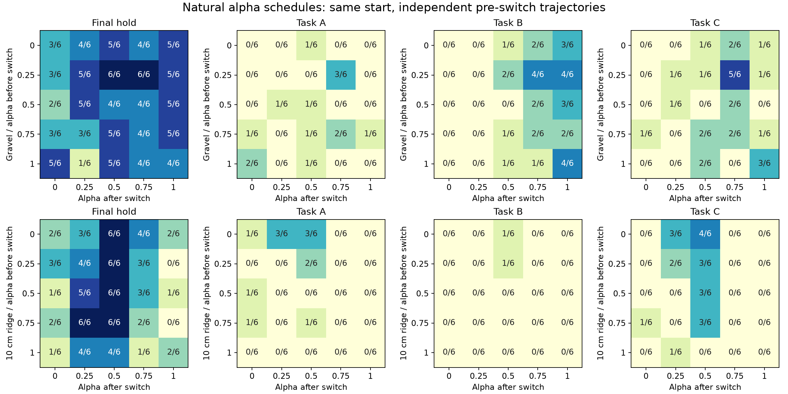

# 五档自然切换：本轮结果

[全部12工况实际/参考XY及奖励](RESULTS.md) · [五档切换矩阵](schedule_matrix.png) · [逐回合结果](analysis_summary.json)

336条已完成，约20.6分钟物理采样、22分钟流水线。242条完整运行、36条侧倾超限、58条跟踪域停机；没有把运行域退出算成摔倒。0训练；Bark完成通知已发送。

## 对论文主线的新增证据

|后段alpha|单脊末段保持|单脊任务C|石子末段保持|石子任务B|
|---|---:|---:|---:|---:|
|0|9/30|1/30|16/30|0/30|
|.25|22/30|6/30|18/30|0/30|
|.5|28/30|13/30|25/30|5/30|
|.75|13/30|0/30|22/30|11/30|
|1|5/30|0/30|24/30|16/30|

每列30=五种前段×两速度×三个物理组；是有限工况覆盖，不是30个独立随机种子。表只含300条主车道，Zero与重复另列于完整结果。

单脊的高alpha后段在本组任务C全不合格；中档更能保持并完成C。石子任务B则高档更合适。支持“速度—转向协调存在地形与任务相关的适用范围”。保持与任务合格分别报告，不能说α=.5单脊成功28/30。

## 同状态选档目前没有得到有效结果

车辆从同一保存起点自然运行，在原路径进度2.5m处切换，没有中途恢复快照。60个前段组全部未通过事前规定的共同前段检查；相同前段的独立车道在接触求解中产生了不同运动。原状态选档表的0项决策表示未形成评价样本，不是选择器成功率0%。实际偏差和切换时刻完整保留于[state_selection.json](state_selection.json)。不修改阈值来重新宣称同状态实验。

因此上述矩阵是相同配置下的自然轨迹比较，不是精确同入口的因果比较。重复车道的分歧保留在analysis_summary.json；该批数据也不能直接拼接成在线选档收益。

## 用实际前状态做预测：探索性诊断

对每条车使用自己的切换前观测，预测其真实执行档的后续结果。整物理组留出，固定三个近邻；与同地形、同目标alpha的训练组统计比较。没有用测试结果选择alpha。此项是在配对检查失败后新增的探索性分析，与冻结的原计划分开。

|预测目标|状态近邻Brier|仅地形/档位Brier|
|---|---:|---:|
|完整运行|.1800|.1688|
|任务A|.0789|.0777|
|任务B|.0885|.0710|
|任务C|.1041|.1157|

Brier越小越好。状态近邻仅在C改善，当前规则不采用为在线选档器。300条主车道全部有切换前数据；预测的是已执行动作的结果，不是未执行动作的反事实效果。逐条预测见[factual_prediction.json](factual_prediction.json)。

## 下一步

继续围绕模式适用范围：优先将名义恢复余量、跟踪器前视余量与参考限速等物理特征接入预测，并做同数据/同留出组对照；当前阶段不扩大GPU采样或训练。只有预测确有改善，再冻结规则并做新布局在线验证。

代码：learning/cli/analyze_state_alpha_prediction.py、plot_state_alpha_matrix.py；原始轨迹与配置在`/media/qy/6A7E3DB07E3D75C3/STTW_runs/h75_state_alpha_scan`。冻结协议见protocol.json。
