# 全部工况实际/参考XY

## dense_corridor_v2.3_seed101

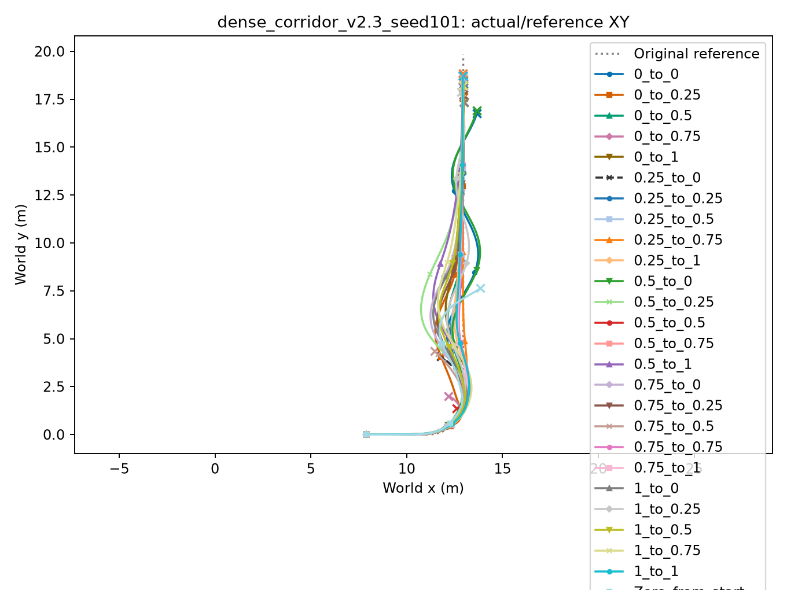

本机完整奖励/速度图：`/media/qy/6A7E3DB07E3D75C3/STTW_runs/h75_state_alpha_scan/dense_corridor_v2.3_seed101/overview.png`。

## dense_corridor_v2.3_seed102

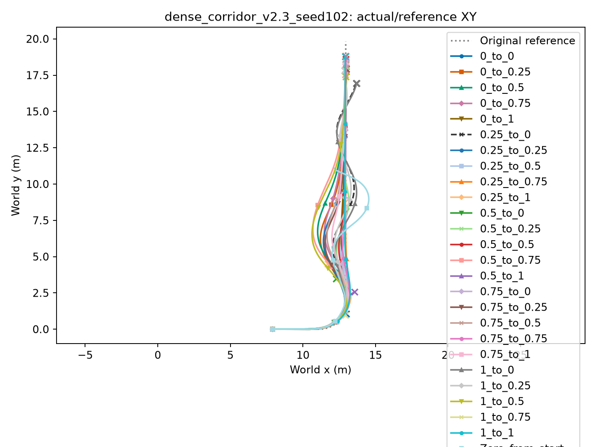

本机完整奖励/速度图：`/media/qy/6A7E3DB07E3D75C3/STTW_runs/h75_state_alpha_scan/dense_corridor_v2.3_seed102/overview.png`。

## dense_corridor_v2.3_seed103

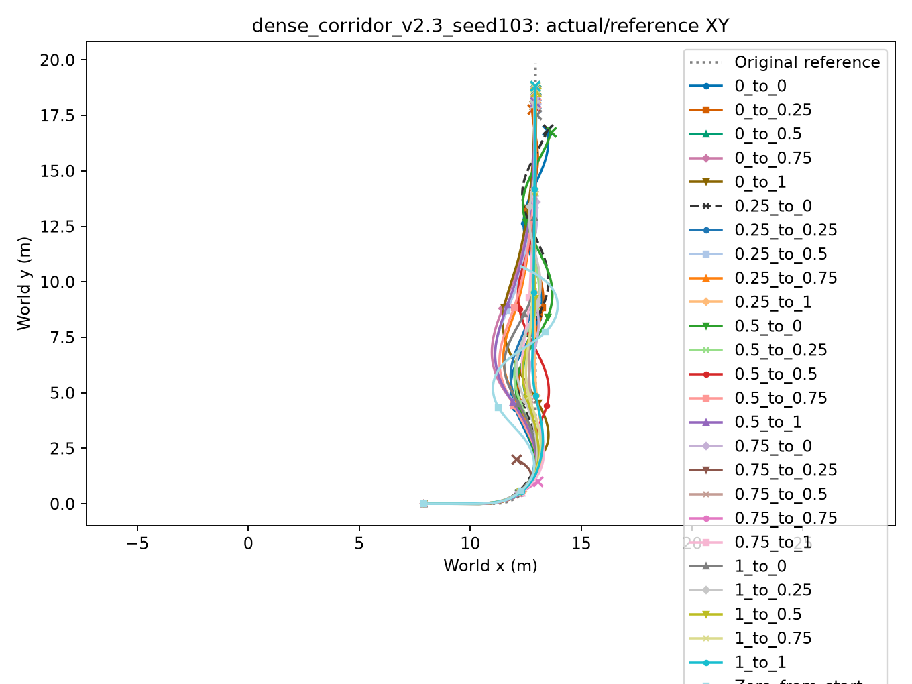

本机完整奖励/速度图：`/media/qy/6A7E3DB07E3D75C3/STTW_runs/h75_state_alpha_scan/dense_corridor_v2.3_seed103/overview.png`。

## dense_corridor_v2.6_seed101

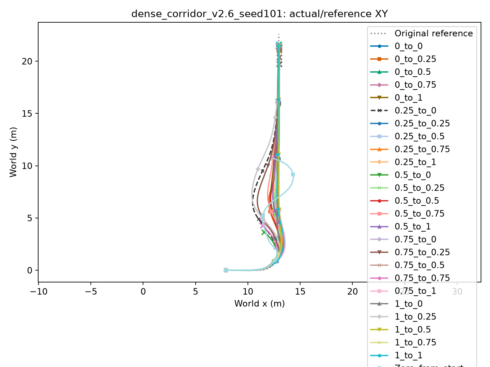

本机完整奖励/速度图：`/media/qy/6A7E3DB07E3D75C3/STTW_runs/h75_state_alpha_scan/dense_corridor_v2.6_seed101/overview.png`。

## dense_corridor_v2.6_seed102

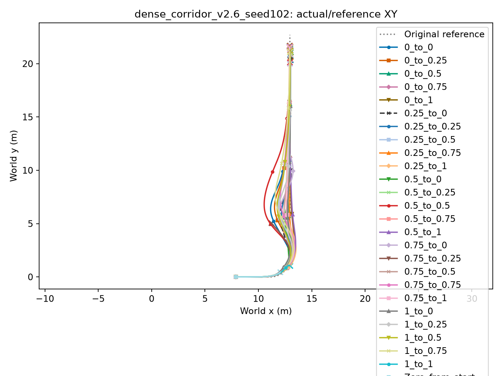

本机完整奖励/速度图：`/media/qy/6A7E3DB07E3D75C3/STTW_runs/h75_state_alpha_scan/dense_corridor_v2.6_seed102/overview.png`。

## dense_corridor_v2.6_seed103

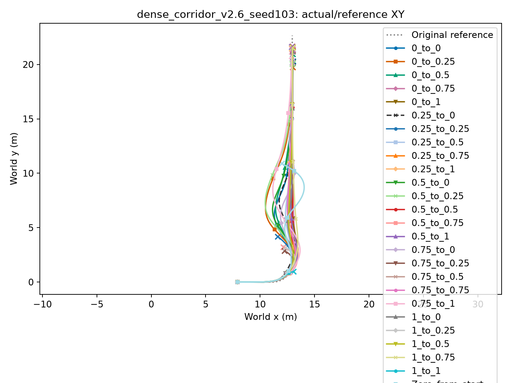

本机完整奖励/速度图：`/media/qy/6A7E3DB07E3D75C3/STTW_runs/h75_state_alpha_scan/dense_corridor_v2.6_seed103/overview.png`。

## single_10cm_v2.3_seed101

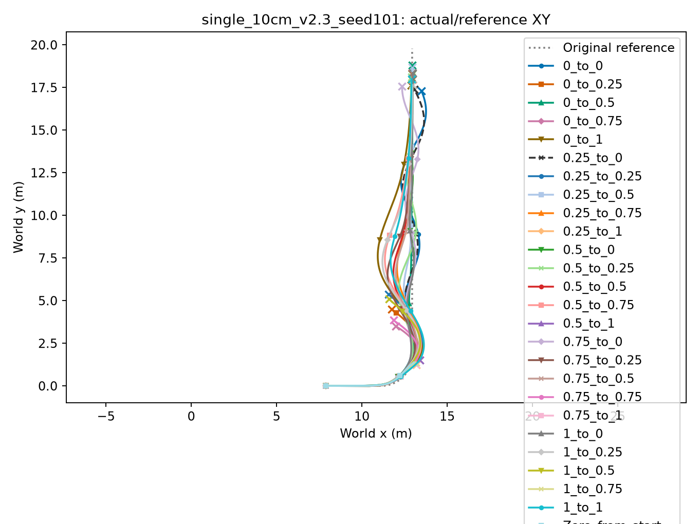

本机完整奖励/速度图：`/media/qy/6A7E3DB07E3D75C3/STTW_runs/h75_state_alpha_scan/single_10cm_v2.3_seed101/overview.png`。

## single_10cm_v2.3_seed102

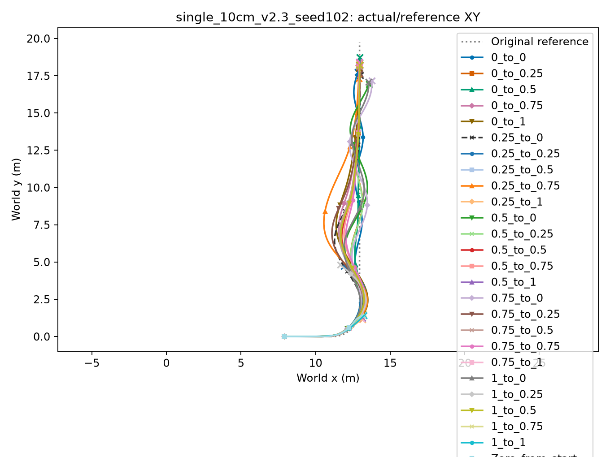

本机完整奖励/速度图：`/media/qy/6A7E3DB07E3D75C3/STTW_runs/h75_state_alpha_scan/single_10cm_v2.3_seed102/overview.png`。

## single_10cm_v2.3_seed103

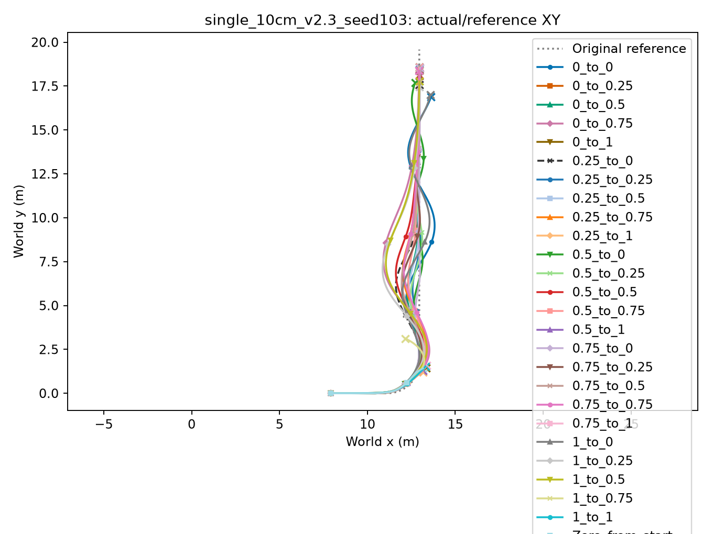

本机完整奖励/速度图：`/media/qy/6A7E3DB07E3D75C3/STTW_runs/h75_state_alpha_scan/single_10cm_v2.3_seed103/overview.png`。

## single_10cm_v2.6_seed101

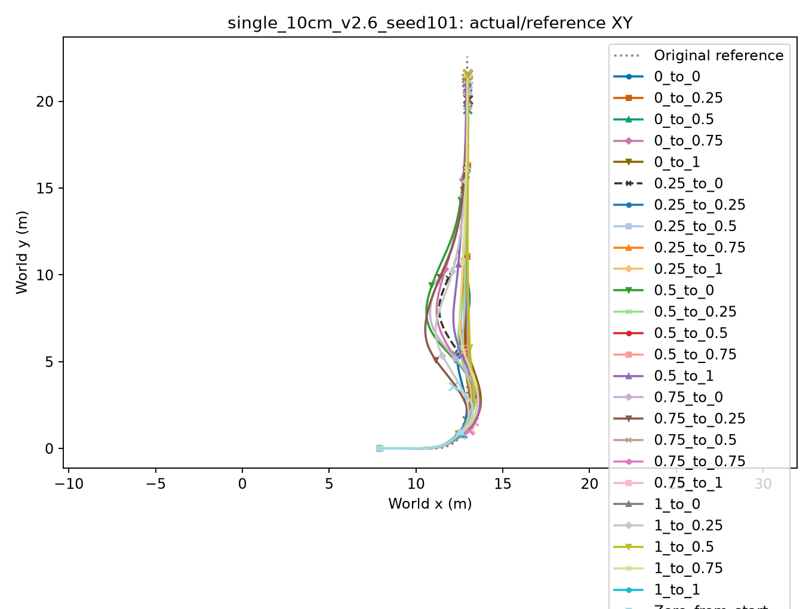

本机完整奖励/速度图：`/media/qy/6A7E3DB07E3D75C3/STTW_runs/h75_state_alpha_scan/single_10cm_v2.6_seed101/overview.png`。

## single_10cm_v2.6_seed102

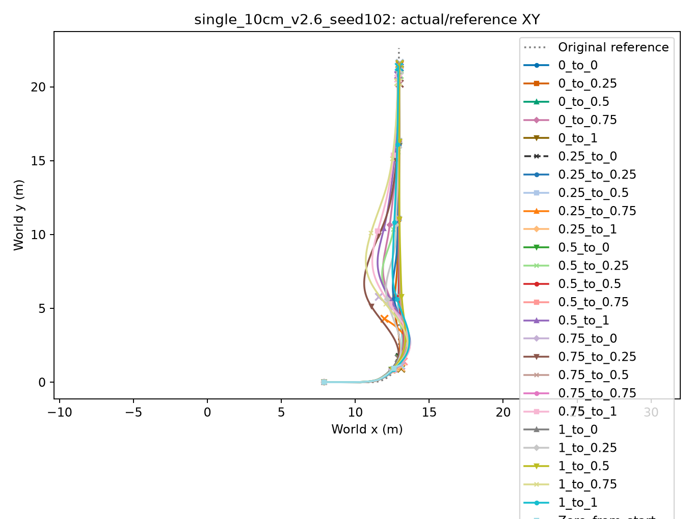

本机完整奖励/速度图：`/media/qy/6A7E3DB07E3D75C3/STTW_runs/h75_state_alpha_scan/single_10cm_v2.6_seed102/overview.png`。

## single_10cm_v2.6_seed103

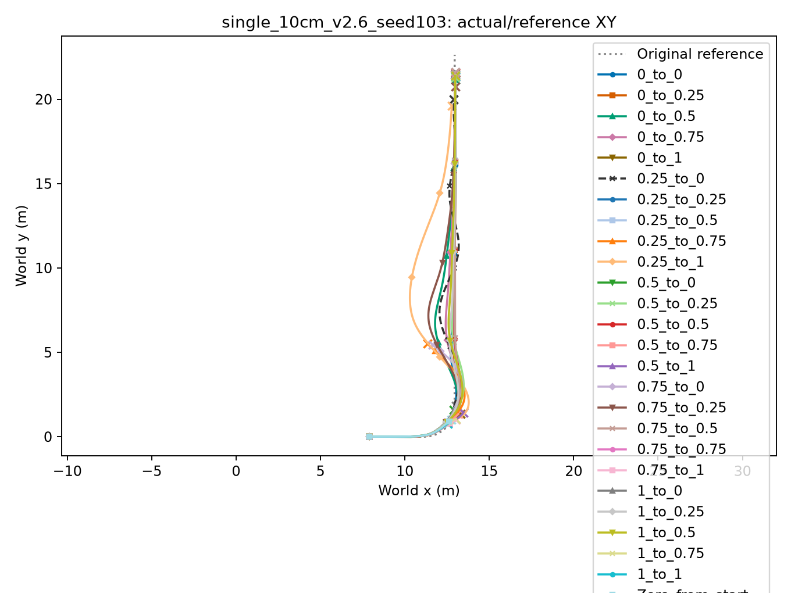

本机完整奖励/速度图：`/media/qy/6A7E3DB07E3D75C3/STTW_runs/h75_state_alpha_scan/single_10cm_v2.6_seed103/overview.png`。
