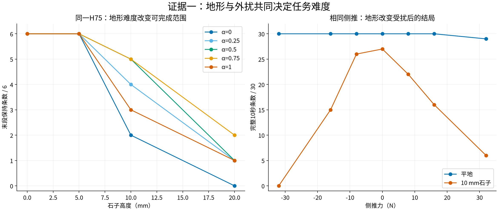
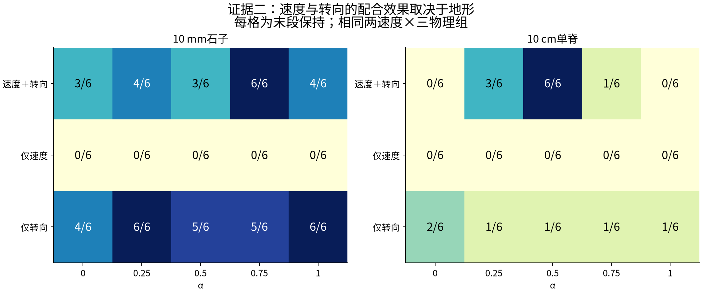
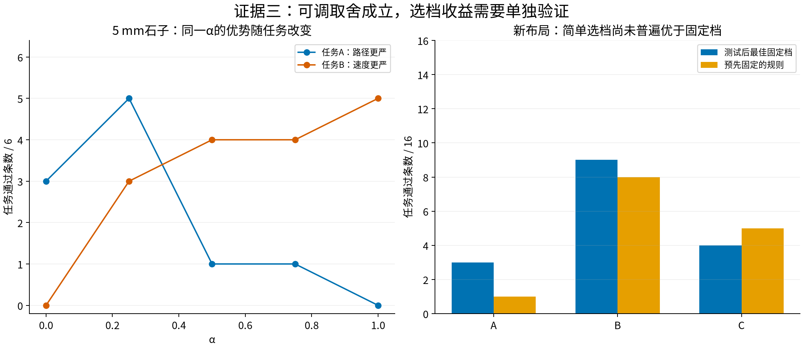
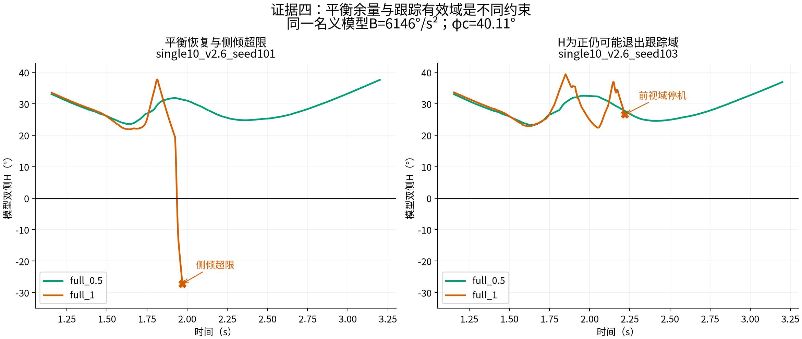
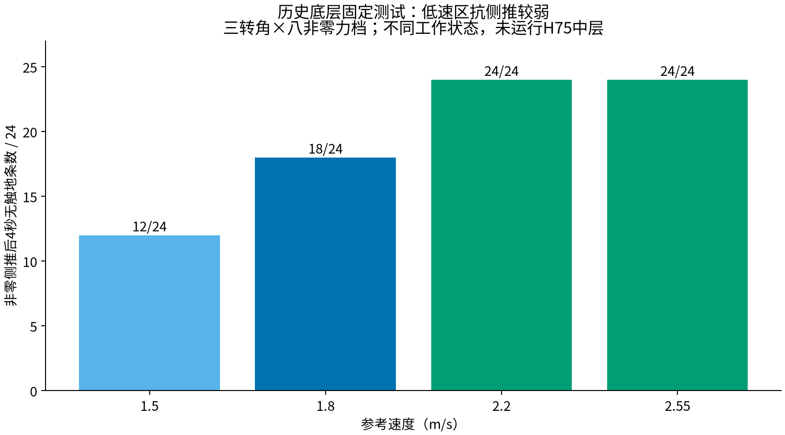

# STTW理论证据图谱：从工作状态、地形到恢复与任务完成

先看[实际/原参考XY及配对Zero](00_XY_CASES.png)。Zero关闭中层，仍使用Local300底层，不能称纯ECBC。随后按下面六张图阅读。此轮没有新增训练或物理仿真，没有按结果改B或任务标准。

## 当前结论：行动模式有适用范围

原H75通过α调节速度与转向参考。地形、车辆状态和任务改变后，同一种协调方式可能无法兼顾恢复与跟踪；选α的目的，是提前避免进入不合适的状态。

|要解释的问题|关键结果|证据入口|
|---|---|---|
|为什么要协调两通道|10cm单脊α=.5末段保持：双通道6/6、仅转向1/6、仅速度0/6；10mm石子对应3/6、5/6、0/6|[通道图](02_CHANNELS.png)|
|为什么不能固定一档|5mm石子α=.25/1：任务A为5/6与0/6，任务B为3/6与5/6|[任务图](03_TASK_SELECTION.png)|
|为什么会倒|已证明固定速度、无新增接触扰动、理想限速转向下的最小侧倾包络；360初态170必越限、190刹住当前方向，36独立LP核对。单脊101在1.940s取α=1状态，最有利控制29.25ms仍越限，实际30ms终止|[推导/代码/全量表](../h75_mathematical_verification/README.md)|
|为什么没倒也停机|216条中78条跟踪域退出均触发前视点前向距离≤.05m，其中74条H始终非负|[两类失败](04_TWO_FAILURES.png)|
|是否已解决自动选档|新布局简单规则A/B/C为1/8/5（各16条），测试后最佳固定档3/9/4；尚无普遍收益|[完整对照](03_TASK_SELECTION.png)|

**论文落点：地形与任务相关的速度—转向协调，以及α行为族的互补适用范围。** 名义不可恢复已给出数学证明；完整接触闭环的α排名尚未证明。真实H75参考模块300次导数核对中，222次速度参考即时α导数为零，不能把α直接当静态阻尼增益。

下一步：共同起点运行，在入障前用可获取状态预测各档的平衡、跟踪与任务代价；规则冻结后与五个固定α在留出布局比较。该项是待验证方案，不计入已完成结果。

## 本次实际检查范围

- **历史入口核对**：28项保留实验来源全部可读，记录模型、原结论、适用范围与报告路径，见historical_inventory.csv。这是报告级索引核对，不冒称逐帧重算了全部历史仿真。
- **近期完整统计重算**：四阶段152个工况、1432条指标记录，含所有alpha、Zero和重复，不删除负结果。用于主图的五档主车道明确排除重复；分母为每格6或30，不能把相关物理组当独立训练种子。
- **逐轨迹机制检查**：通道实验12工况216条，重新计算同一个参数B的H及原始路径跟踪器终止分项。原始pose/progress与固定route/config复算前视点，不把domain_exit等同横向误差越界。
- **历史低速数据复核**：D01报告12行、108分支中的96个非零侧推，按原表重算并绘图。这个实验只有冻结底层，单独展示，不并入H75统计。

尚未登记、未索引的磁盘文件不在“全部重算”的声明内。具体原始回合和奖励图入口见[四阶段来源索引](../h75_evidence_queue_20261110/final_results/sources.json)、[全部近期XY](../h75_evidence_queue_20261110/final_results/XY.md)。

## 1. 地形会放大同一外扰的影响

同样−32N、0.1s侧推：平地五档主车道30/30完整运行，10mm石子0/30；原报告已核查这些车道施加了完整脉冲。该比较说明同样侧推在不同地形和行驶状态下会有完全不同的后果。平地这30条A/B/C也都没有通过，不能把完整运行写成任务成功。

高度扫描中，同模型0/5mm石子五档30/30末段保持，10mm变19/30，20mm任务A/B/C均0/30。支持“地形改变可完成任务范围”；不能由此直接得出“全部由拖曳距变化引起”。

## 2. 最强的正面机制证据：通道协同取决于地形

单脊alpha=.5：完整双通道末段保持6/6，独立重复车道也是6/6；仅转向1/6，仅速度0/6。石子同alpha：双通道3/6，仅转向5/6，仅速度0/6。

因此论文应该讲“速度—转向协调的效果依赖地形”，不能写成“双通道处处优于单通道”。图覆盖全部五alpha，包含alpha0和1，不只展示最好档。

具体正例：single10_v2.6_seed101/full.5通过C；speed_only.5在2.41s侧倾终止；steer_only.5虽最终保持，但路径峰值1.143m，不通过A/B/C。dense10_v2.3_seed101/full.75与steer_only.75均通过A/B/C，说明石子上可以主要依靠转向通道完成。

## 3. α有互补性，不能把单一档位写成普遍最优

5mm石子：alpha.25对任务A通过5/6，alpha1为0/6；任务B则分别3/6与5/6。相同六个工况，任务侧重点改变后优选档也改变，直接支持“根据任务选偏好”。A/B/C使用原定义，不按此轮图重新设阈值。

新布局上，已有简单规则在A/B/C为1/8/5（各16条），测试后最佳固定档3/9/4。选档动机成立，但现有规则只在C上多1例，不能声称已经普遍优于固定档。此反例保留在主图右侧，而非从证据集中删除。

## 4. 两种不同失败，必须分别解释

本次对全部216条重新使用同一B=6146.05°/s²、phi_c=.7rad计算：

|原始结局|条数|曾H<0|H始终非负|
|---|---:|---:|---:|
|完整10秒|97|0|97|
|侧倾超限|39|39|0|
|运行域越界|78|4|74|
|未解析终止|2|1|1|

39条侧倾超限都在实际越过角度阈值之前已有负H。此为已有数据上的描述性一致性；由于模型忽略真实接触且理想转向假设可被冲击打破，不升级为真实车辆不可恢复证书。

**新的全量发现：78条domain_exit全部在最后有效状态触发前视点车体前向坐标≤0.05m，0条达到航向误差90°，0条无法用这两项复算解释。** 其中74条H始终为正。故H描述平衡制动余量，任务还要满足跟踪器有效域和路径/速度约束。

两组同工况对照：
- 物理组101，full1后轮再接触时负向力矩与外倾速度骤增，1.940s H转负、1.970s侧倾终止；full.5完成C。
- 物理组103，full1在2.220s因前视点前向距离0.030m≤0.05m停机，侧倾仅11.29°、航向误差64.31°；full.5继续完成C。不能把它叫侧倾不可恢复，也没有测试停机后能否恢复。

个例接触/执行器过程见[持续回正与后轮再接触](../h75_evidence_queue_20261110/braking_boundary/capacity_estimate/README.md)。用户偏好的8张“相图＋H时间图”继续保留：[全部模型边界正例](../h75_evidence_queue_20261110/braking_boundary/model_boundary/README.md)。

## 5. 历史低速与侧推：支持工作状态相关的恢复能力

冻结底层、同一准备来源、三转角×八非零侧推，参考速度1.5/1.8/2.2/2.55m/s时，4秒观察无触地为12/24、18/24、24/24、24/24。速度工作区间改变后抗扰能力不同；但起扰姿态等也随真实准备变化，不能写成完全相同状态只改变速度的因果效应，更不能外推“越快越好”。

历史D02同快照参考干预是补充：24个受扰条件，保持参考19个无触地，提前加速23个、同期加速22个。它比单纯不同工作速度的比较更接近速度参考干预证据，仍限历史模型和该组条件。原始报告入口见下表，不与当前Isaac通道数据混合成功率。

## 推荐论文的证据顺序

1. **物理动机**：低速/侧推说明恢复能力依赖行驶状态；地形＋侧推说明环境进一步改变结果。
2. **方法作用**：alpha改变速度与转向参考，形成任务取舍；通道消融展示地形相关的协调收益。
3. **恢复过程**：从实际相轨迹、接触、转向和参数H解释正例与侧倾失败；另列前视域/路径失败。
4. **结果边界**：当前固定档互补成立；简单选档器收益不足，不能作为已经解决的最后一环。

这批证据支持“通过方式影响恢复与任务完成”。尚不支持把接触冲击全归因拖曳距、把H当完整车辆安全证书，或宣称在线选档已普遍优于固定档。下一步优先处理前视域退出后的合法恢复策略，以及接触冲击对恢复过程的受控验证；不为凑正面例子重定义成功标准。

## 历史实验入口（报告级，模型分开）

|ID|实验|模型|原始来源|
|---|---|---|---|
|L01|局部底层300轮验收|Local300 / R196|[报告](/home/qy/STTW_CONTROL/runs/worktrees/tolerance-calibration/docs/evidence/local_lower_noalpha_v2_0300/RESULTS_0300.md)|
|L02|同完整状态恢复|Local300 / R196|[报告](/home/qy/STTW_CONTROL/runs/worktrees/tolerance-calibration/docs/evidence/local_lower_parent_recovery_20261010/INDEX.md)|
|L03|物理域底层续训|Local-domain U200|[报告](/home/qy/STTW_CONTROL/runs/worktrees/tolerance-calibration/docs/results/sttw-tolerance-20261101/README.md)|
|H01|完整尾段25→75 PPO|H75谱系|[报告](/home/qy/STTW_CONTROL/runs/worktrees/tolerance-calibration/docs/evidence/tolerance_progress_20261022/full_tail_length75/FINAL_RESULTS.md)|
|H02|五α名义任务保持|原H75|[报告](/home/qy/STTW_CONTROL/runs/worktrees/tolerance-calibration/docs/deliverables/sttw_review_bundle_20261024/REPORT.md)|
|H03|四路线冻结中层比较|原H75；对比U170/W400/u325|[报告](/home/qy/STTW_CONTROL/runs/worktrees/tolerance-calibration/docs/results/sttw-tolerance-20261101/frozen_middle_comparison/README.md)|
|H04|新任务组合五α|H75 / U170|[报告](/home/qy/STTW_CONTROL/runs/worktrees/tolerance-calibration/docs/results/sttw-tolerance-20261101/README.md)|
|H05|低中高速/单弯/S弯/直角矩阵|H75 / U170 / corrected PP|[报告](/home/qy/STTW_CONTROL/runs/worktrees/ras-route-matrix-20261104/docs/results/sttw-task-matrix-20261104/README.md)|
|D01|低速真实触地力档扫描|冻结底层；无中层Actor|[报告](/home/qy/STTW_CONTROL/runs/worktrees/tolerance-calibration/docs/deliverables/sttw_review_bundle_20261024/evidence/low_speed_physical.md)|
|D02|同快照速度参考干预|冻结底层|[报告](/home/qy/STTW_CONTROL/runs/worktrees/tolerance-calibration/docs/evidence/tolerance_progress_20261022/low_speed_reference_authority/REPORT.md)|
|D03|完整任务因果ESO参考规则|原任务策略+简单参考规则|[报告](/home/qy/STTW_CONTROL/runs/worktrees/tolerance-calibration/docs/deliverables/sttw_review_bundle_20261024/evidence/causal_reference.md)|
|D04|不同偏好前缀的方向抗扰能力|原H75 / Zero|[报告](/home/qy/STTW_CONTROL/runs/worktrees/tolerance-calibration/docs/deliverables/sttw_review_bundle_20261024/REPORT.md)|
|D05|±36N侧推任务比较|U170 / 几何规则|[报告](/home/qy/STTW_CONTROL/runs/worktrees/tolerance-calibration/docs/results/sttw-tolerance-20261101/README.md)|
|U01|物理域迁移任务|U170 / 几何规则|[报告](/home/qy/STTW_CONTROL/runs/worktrees/tolerance-calibration/docs/results/sttw-tolerance-20261101/README.md)|
|U02|有限半径90度转弯|U170 / 几何规则|[报告](/home/qy/STTW_CONTROL/runs/worktrees/tolerance-calibration/docs/results/sttw-tolerance-20261101/README.md)|
|T01|五速度×四地形重复|原H75+Local300 / Zero|[报告](/home/qy/STTW_CONTROL/runs/worktrees/sttw-offroad/runs/h75_tradeoff_repeats/RESULTS.md)|
|T02|代价/约束下的选档|原H75|[报告](/home/qy/STTW_CONTROL/runs/worktrees/sttw-offroad/runs/h75_tradeoff_repeats/ALPHA_SELECTION.md)|
|T03|6cm/2.6m/s既定1→.5切换|原H75+Local300|[报告](/home/qy/STTW_CONTROL/runs/worktrees/sttw-offroad/runs/h75_bend_switch_repeats/RESULTS.md)|
|T04|密集石子及10cm单脊|原H75+Local300 / Zero|[报告](/media/qy/6A7E3DB07E3D75C3/STTW_runs/h75_dense_corridor_ridge10/evaluation/RESULTS.md)|
|T05|石子高度/密度/聚集布局|原H75+Local300，P1|[报告](/home/qy/STTW_CONTROL/runs/worktrees/sttw-offroad/runs/h75_gravel_closeout/CONCLUSION.md)|
|T06|前后轮接触重叠与残余响应|原H75+Local300，P2|[报告](/home/qy/STTW_CONTROL/runs/worktrees/sttw-offroad/runs/h75_gravel_closeout/CONCLUSION.md)|
|T07|连续石子任务条件选档|原H75+Local300，P4|[报告](/home/qy/STTW_CONTROL/runs/worktrees/sttw-offroad/runs/h75_gravel_closeout/CONCLUSION.md)|
|T08|接触几何及有效拖距量化|原H75+Local300|[报告](/home/qy/STTW_CONTROL/runs/worktrees/sttw-offroad/runs/h75_contact_g5/CONCLUSION.md)|
|R01|共同起点150轮、无外部推扰|原H75 / continued150|[报告](/media/qy/6A7E3DB07E3D75C3/STTW_runs/h75_random_terrain_continue/common_start/evaluation_no_push_paired/RESULTS.md)|
|R02|共同起点150轮、复合推扰|原H75 / continued150|[报告](/media/qy/6A7E3DB07E3D75C3/STTW_runs/h75_random_terrain_continue/common_start/evaluation/RESULTS.md)|
|M01|同前缀通道分叉|原H75+Local300|[报告](/media/qy/6A7E3DB07E3D75C3/STTW_runs/h75_alpha_mechanism/RESULTS.md)|
|M02|ECBC名义公式独立复算|固定速度名义控制器|[报告](/media/qy/6A7E3DB07E3D75C3/STTW_runs/h75_alpha_mechanism/REVIEW.md)|
|H06|示范教学强任务与低速改善|u325派生教学模型 / H75|[报告](/home/qy/STTW_CONTROL/runs/worktrees/tolerance-calibration/docs/evidence/tolerance_progress_20261022/full_tail_length75/FINAL_RESULTS.md)|

## 数据与复现

- all1432.csv：全部近期指标，含负结果和重复；aggregate_counts.csv：每张统计图每组的k/n。
- all216_diagnostics.csv：H、原结局、前视点与航向终止项，全部216条。
- historical_inventory.csv：28个入口的可读性、模型、历史结论和适用范围。
- historical_low_speed.csv：原报告12行数值，单列历史底层角色。
- case_curves.npz：主例XY与H；其余原始轨迹沿用sources.json，不重复打包大文件。
- 源码learning/cli/build_theory_atlas.py，运行`python learning/cli/build_theory_atlas.py --output /media/qy/6A7E3DB07E3D75C3/STTW_runs/h75_theory_atlas`。

图片计数是固定工况覆盖，不附带独立随机抽样的置信区间。所有原始任务标签和终止时刻保持不变；未新增GPU运行。
