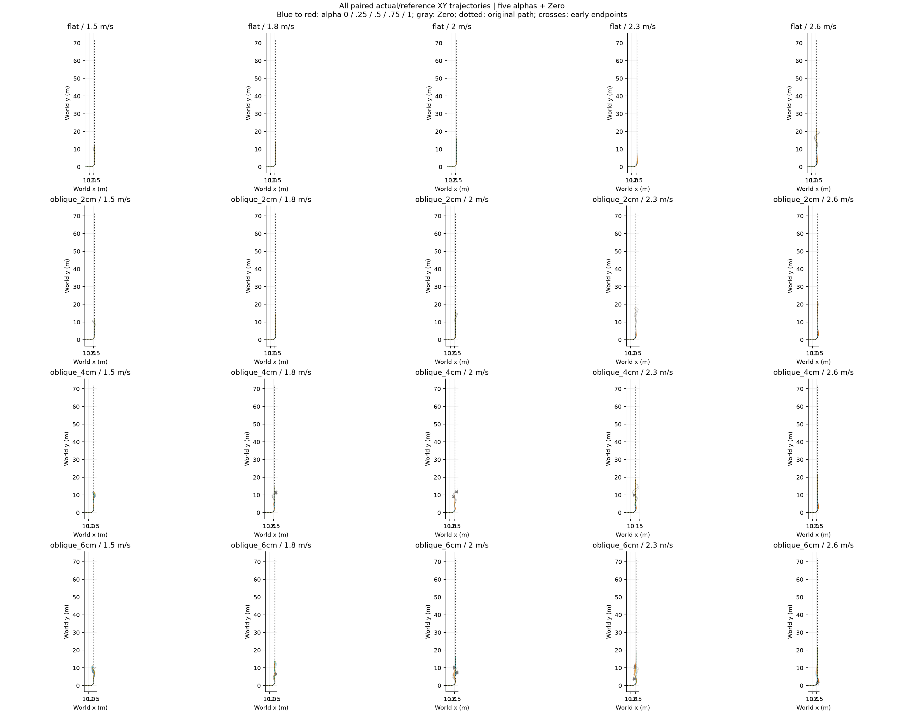
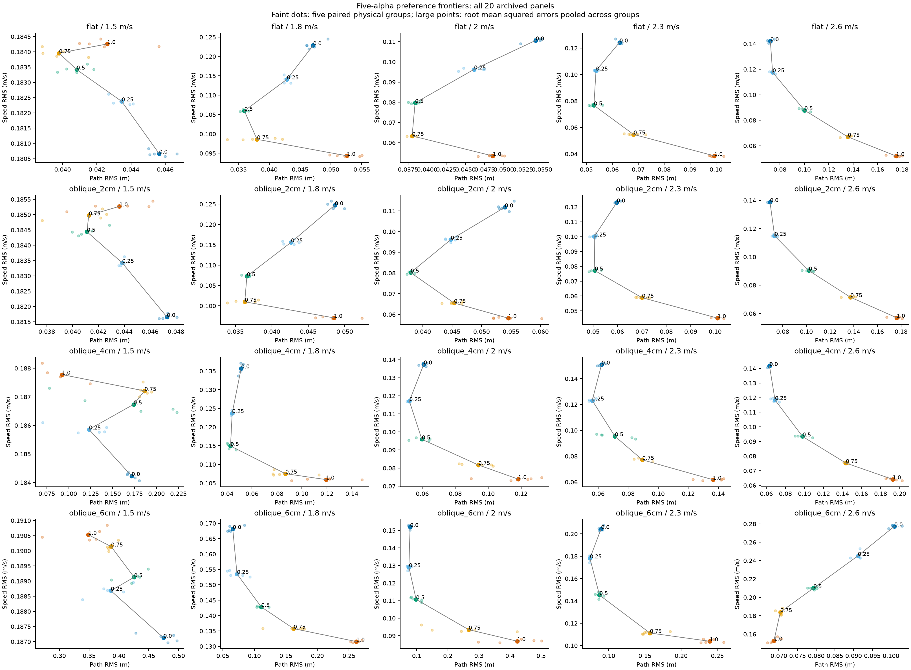

# S1：全部20面板的偏好前沿

从100份原始轨迹重算20个面板，五档α与Zero共同有效窗口；与旧档案RMSE最大差6.28e-07。41/80相邻档同时表现为速度误差不增、路径误差不减；4/20面板的四条相邻边全部满足该方向。

## 各档可占优的任务尺度

下表对所有其他候选同时求解 Vᵢ+η²Pᵢ≤Vⱼ+η²Pⱼ，不只比较相邻档。η单位s⁻¹；空集表示该档不在该面板的加权平方误差下包络上。窗口为原协议的共同观察窗口，任务可行性另外保留，不能靠短观察窗口得到任务成功。

|地形|速度|α=0|α=.25|α=.5|α=.75|α=1|
|---|---:|---|---|---|---|---|
|flat|1.5|0–1.55|空集|空集|1.55–∞|空集|
|flat|1.8|空集|空集|3.144–∞|0.788–3.144|0–0.788|
|flat|2.0|空集|空集|空集|1.126–∞|0–1.126|
|flat|2.3|空集|空集|1.249–∞|0.538–1.249|0–0.538|
|flat|2.6|4.882–∞|1.161–4.882|0.6211–1.161|0.3819–0.6211|0–0.3819|
|oblique_2cm|1.5|0–1.365|空集|1.365–∞|空集|空集|
|oblique_2cm|1.8|空集|空集|空集|0.8688–∞|0–0.8688|
|oblique_2cm|2.0|空集|空集|1.867–∞|0.9931–1.867|0–0.9931|
|oblique_2cm|2.3|空集|15.09–∞|1.032–15.09|0.52–1.032|0–0.52|
|oblique_2cm|2.6|3.308–∞|0.9992–3.308|0.6014–0.9992|0.3902–0.6014|0–0.3902|
|oblique_4cm|1.5|0–0.2051|0.2051–0.3289|空集|空集|0.3289–∞|
|oblique_4cm|1.8|空集|空集|0.5378–∞|0.2249–0.5378|0–0.2249|
|oblique_4cm|2.0|空集|2.304–∞|0.692–2.304|0.4876–0.692|0–0.4876|
|oblique_4cm|2.3|空集|1.775–∞|1.037–1.775|0.4485–1.037|0–0.4485|
|oblique_4cm|2.6|2.812–∞|1.046–2.812|0.5281–1.046|0.3063–0.5281|0–0.3063|
|oblique_6cm|1.5|0–0.08756|0.08756–0.1585|空集|空集|0.1585–∞|
|oblique_6cm|1.8|2.259–∞|0.6713–2.259|0.3743–0.6713|0.163–0.3743|0–0.163|
|oblique_6cm|2.0|空集|1.046–∞|0.239–1.046|0.1048–0.239|0–0.1048|
|oblique_6cm|2.3|空集|2.235–∞|0.7153–2.235|0.2205–0.7153|0–0.2205|
|oblique_6cm|2.6|空集|空集|空集|空集|0–∞|

## 当前判断与后续

五档形成条件相关的离散前沿，应按具体任务尺度选档。物理误差前沿不等同包含姿态、修正与终止代价的训练目标；完整端点重评分与[完整偏好区间](COMPLETE_INTERVALS.md)已完成。η=.533的数值来源已复算：旧2/4cm、2.6m/s均值端点的ΔEv/ΔEy=.5330184126259171，详见[来源](ETA_ORIGIN.md)。它是该批结果的端点尺度归一化。

S1已完成原始误差前沿、完整奖励重评分、完整目标偏好区间及η来源。弯道分配律检验尚未完成；先完成S1，再推进S2。S3扫描已停止。
