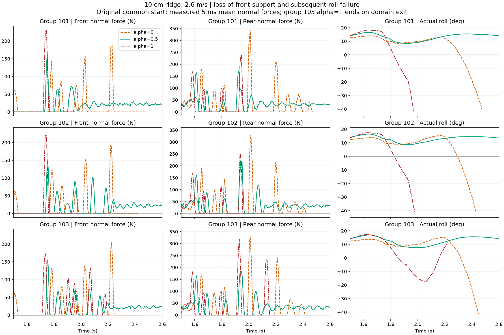
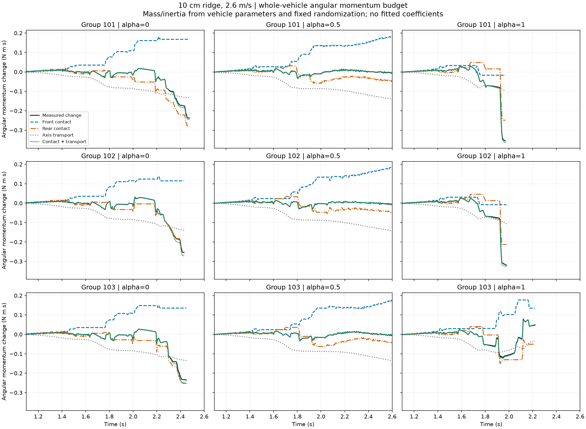
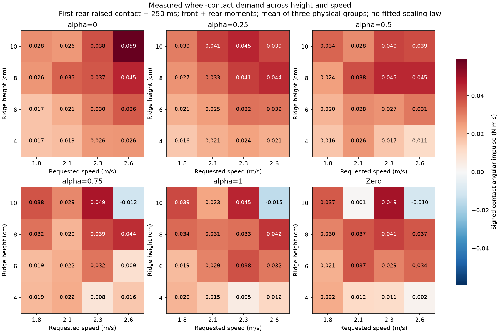

# S2：前轮失去支撑后，为什么转向仍救不回来

[原始同起点XY](/media/qy/6A7E3DB07E3D75C3/STTW_runs/h75_channel_scan/single10_v2.6_seed101/xy.png) · [全部五档恢复过程](recorded_envelopes/ridge_mechanism.png)

## 结论

10cm单脊、2.6m/s下，α=0的三组晚期侧倾失败，以及α=1在101/102组的早期侧倾失败，共同出现“前轮失去接触力、后轮接触继续输入不利角动量”的过程。前轮转向机构仍能转动，但它已经不能通过前轮地面反力实现原来的恢复作用。α=.5在对应时段恢复了前后轮支撑，避免了持续外倾。

这补上了低α失败的物理环节：它初次越脊较缓和，却没有稳定落地；后续反复接触后前轮再次失去支撑，后轮力矩继续把车推向负侧。高α在更早的接触过程中进入相同类型的失稳。103组α=1仍单列为运行域退出，不混成侧倾失败。

## 数学依据：从前轮接触条件到整车角动量

设整车质心为C，第i个刚体的质心、速度、惯量和角速度分别为r_i、v_i、I_i、Ω_i。整车绕C的角动量为

L_C = Σ[R_i I_i R_iᵀ Ω_i + (r_i−C)×m_i(v_i−V_C)]。

内部关节驱动力矩在整车求和时抵消，均匀重力对整车质心的合力矩为零，因此接触阶段有

dL_C/dt = τ_front,C + τ_rear,C。

取随车体转动的侧倾方向单位向量e，L_roll=eᵀL_C，则

ΔL_roll = ∫eᵀτ_front,C dt + ∫eᵀτ_rear,C dt + ∫(Ω_chassis×e)ᵀL_C dt。

最后一项来自投影轴随车体转动，是坐标运输项，不是额外外力。前两项由记录的接触点和接触力计算，左边则由六个刚体的质量、惯量及运动状态独立计算。

前轮无接触时F_front=0，因此τ_front,C=0；摩擦约束也给出|F_front,tangent|≤μN_front=0。此时转向动作仍可产生内部运动，但不能生成前轮地面侧向反力。前轮接地时的名义转向恢复模型必须切换到相应接触状态，不能把正常接地的恢复能力原封不动用于这段过程。

## 同一失败窗口的实测力学预算

以下均为各自实际侧倾终止前100ms；单位N·m·s。前轮法向力在整个窗口严格为零，且前轮接触力矩积分也为零。

|组|α|窗口s|实际ΔL_roll|前轮积分|后轮积分|轴运输项|剩余差额|
|---|---:|---|---:|---:|---:|---:|---:|
|101|0|2.375–2.475|-0.0851|0.0000|-0.0750|-0.0079|-0.0022|
|101|1|1.870–1.970|-0.2824|0.0000|-0.2643|-0.0234|0.0053|
|102|0|2.330–2.430|-0.1113|0.0000|-0.1048|-0.0140|0.0075|
|102|1|1.880–1.980|-0.2470|0.0000|-0.2263|-0.0245|0.0038|
|103|0|2.350–2.450|-0.0944|0.0000|-0.0886|-0.0123|0.0064|

三组α=0最后一次连续无前轮接触力均从2.245s开始；名义能力不足首次检测发生在2.265–2.365s，实际侧倾终止在2.430–2.475s。α=1的101/102组则从1.765s失去前轮接触力，随后更早倾倒。这使“接触状态变化→恢复作用减弱→不利角动量积累→侧倾越限”具有明确时间顺序。

与α=0失败时段配对，α=.5在2.335–2.475s的前轮平均法向力为22.01、22.17、22.47N，后轮为30.95、31.76、31.66N。比较使用同一物理组、同一时段，不拿成功回合10s末段来对照失败瞬间。

黑线由刚体运动重建，绿线由接触积分及坐标运输计算，两者在失败的突变阶段也相互对应。中档没有形成两端那样持续的负向角动量积累。

## 从单例扩展到全部已有记录

共处理旧通道实验216条及不同脊高标定288条，两套记录分开统计。旧通道实验1697个完整窗口、脊高标定2042个完整窗口中，角动量等式的总绝对剩余差额分别约占各项绝对积分总和的1.20%、1.03%。这是车辆参数下的力学闭合检查，没有训练或拟合系数。

全部五档/Zero的72条中，有17条侧倾超限；其中9条在最后100ms前轮法向力始终为零。前轮失去支撑是本次单脊两端失败的重复机制，并非所有地形失败的唯一模式。完整通道/消融数据与截断窗口保留在表中。

图中为首次后轮高地接触后250ms，两轮有符号接触角冲量的三物理组均值。它显示接触需求随脊高、速度和α共同变化，10cm/2.6m/s高档会改变净角冲量的方向。该量是N·m·s，不冒充名义角速度冲量J_sat的rad/s；接触作用通过上述整车角动量方程进入运动。

## 实现、验证与下一步

- 共用计算：`learning/src/sttw_control/contact_momentum.py`；惯量按实际质量随机化比例缩放，坐标采用Isaac Lab源码规定的link坐标惯量与link原点速度。
- 原始质量缩放在每回合各刚体间一致到9e−8，质心偏移未改变，因此原接触力矩提取使用的整车质心可直接复用。
- 3项独立测试覆盖轨道角动量、平移不变性、link速度到质心速度转换和旋转投影轴项；图已检查。
- `contact_momentum*/momentum_windows.csv`保留完整和截断窗口，`contact_support/support_windows.csv`保留匹配的支撑力统计。
- 0新仿真、0训练。当前完成了接触到失稳的力学解释；下一步把接触状态和运行点纳入阶段S2的余量预测，形成S3需要的冻结预测，而不是继续拟合微小误差。
