# 全工况五档接触恢复图

每个工况先展示实际/原参考XY，再展示同一时间轴的侧倾、Euler侧倾角速度、前轮转向速度命令与后轮接触侧倾力矩。×表示提前终止。虚线±3rad/s是命令限制。接触力矩包含法向和摩擦，投影到负车架x轴。

## dense10_v2.3_seed101

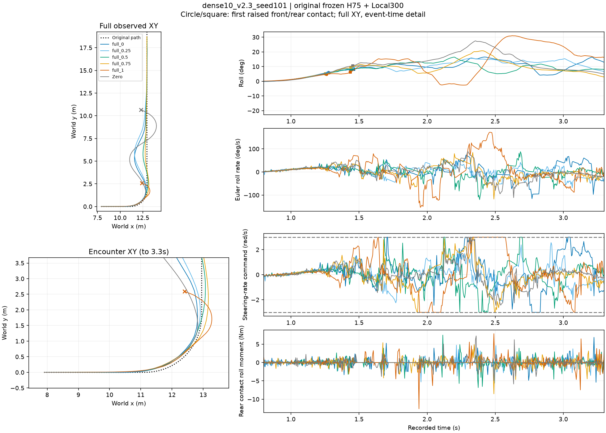

## dense10_v2.3_seed102

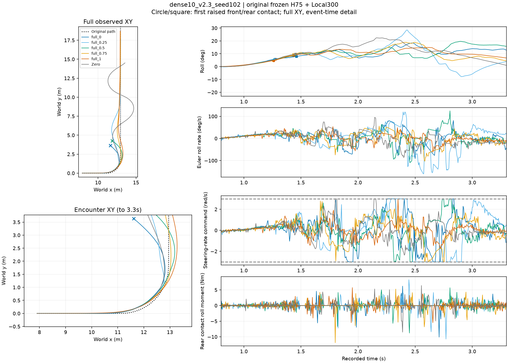

## dense10_v2.3_seed103

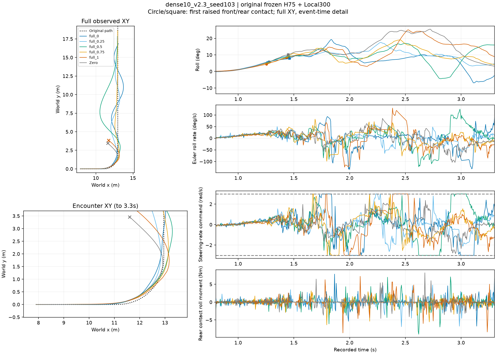

## dense10_v2.6_seed101

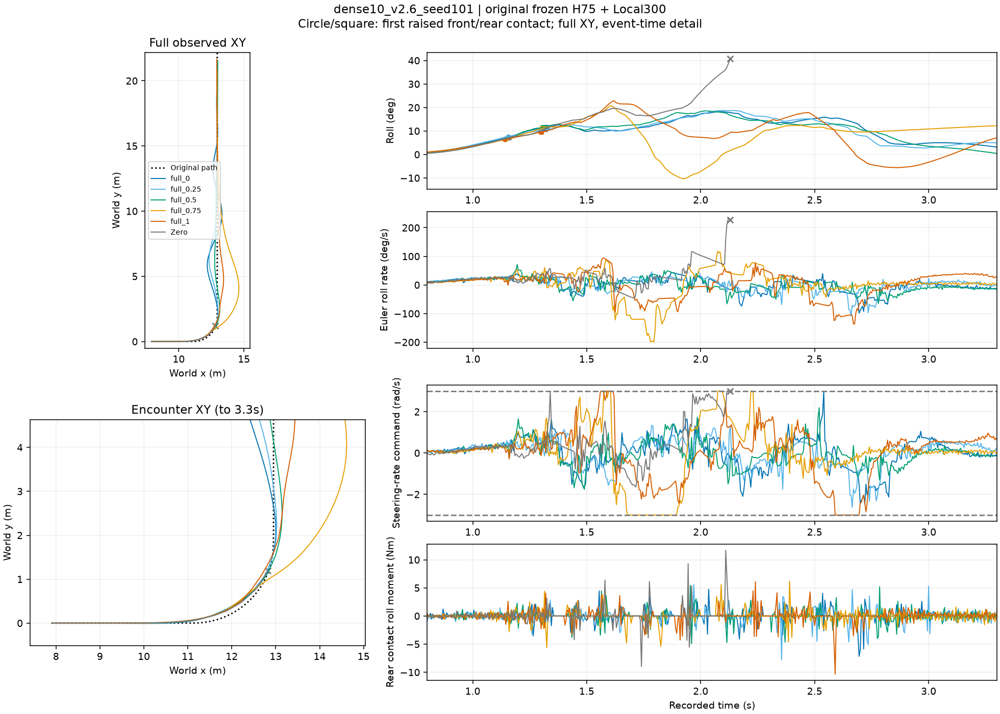

## dense10_v2.6_seed102

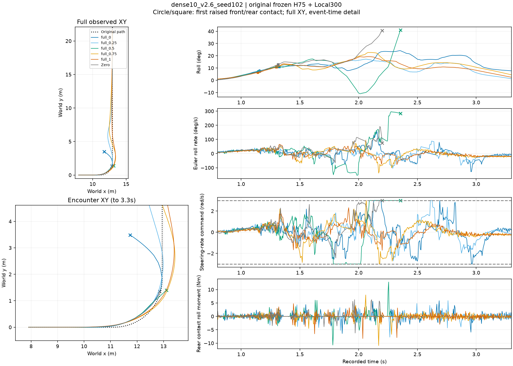

## dense10_v2.6_seed103

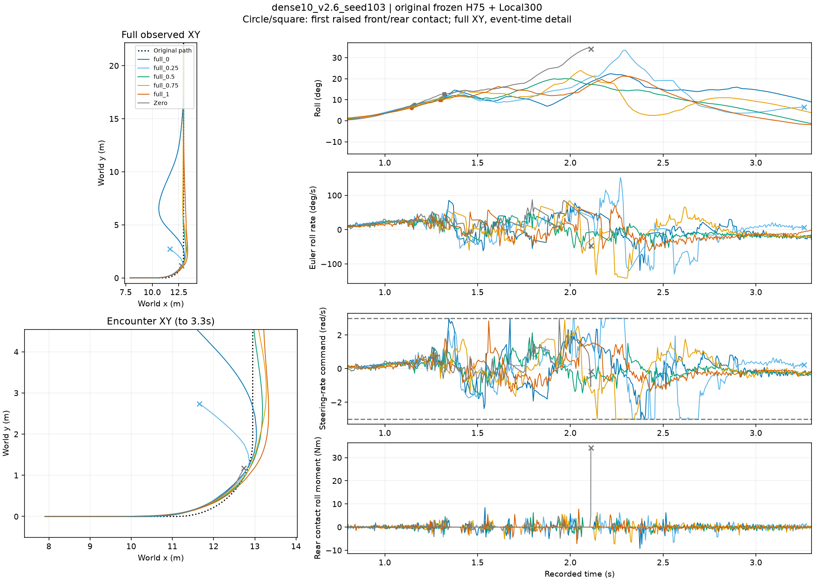

## single10_v2.3_seed101

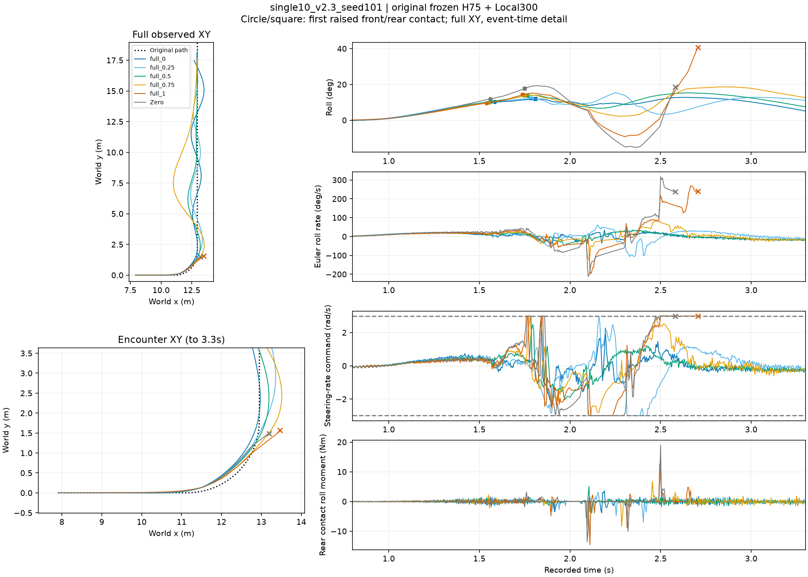

## single10_v2.3_seed102

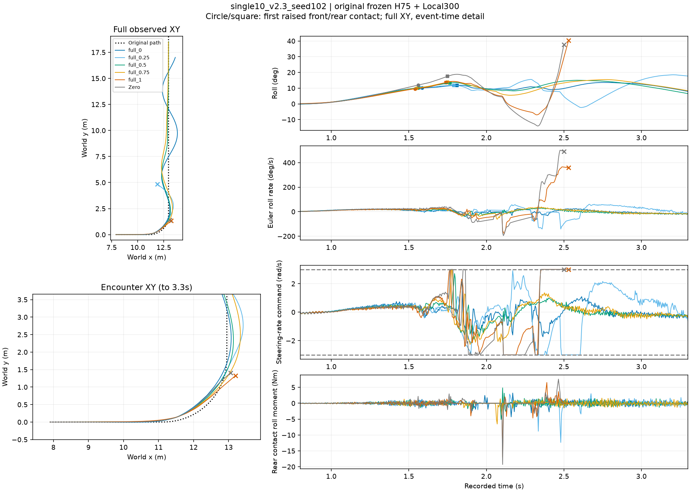

## single10_v2.3_seed103

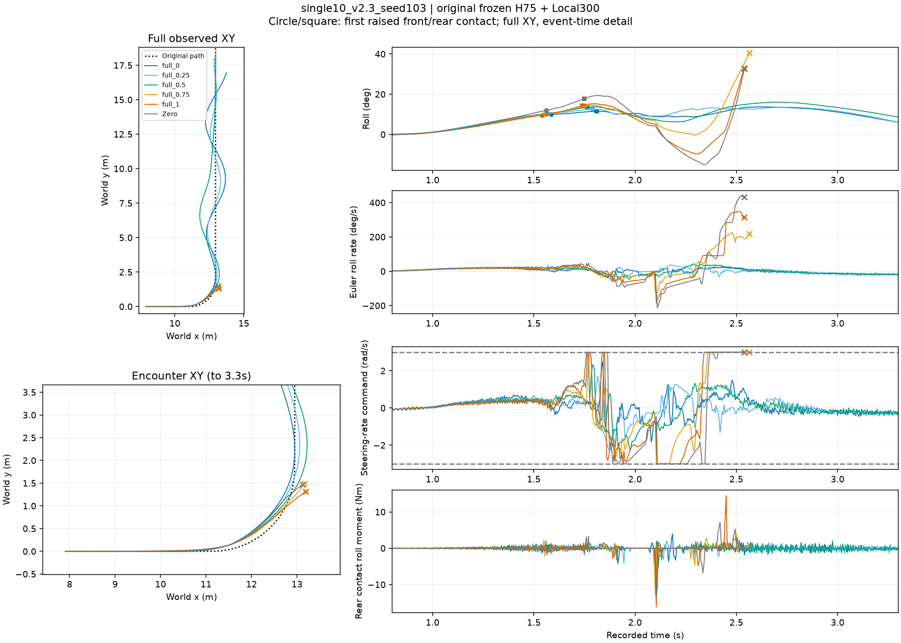

## single10_v2.6_seed101

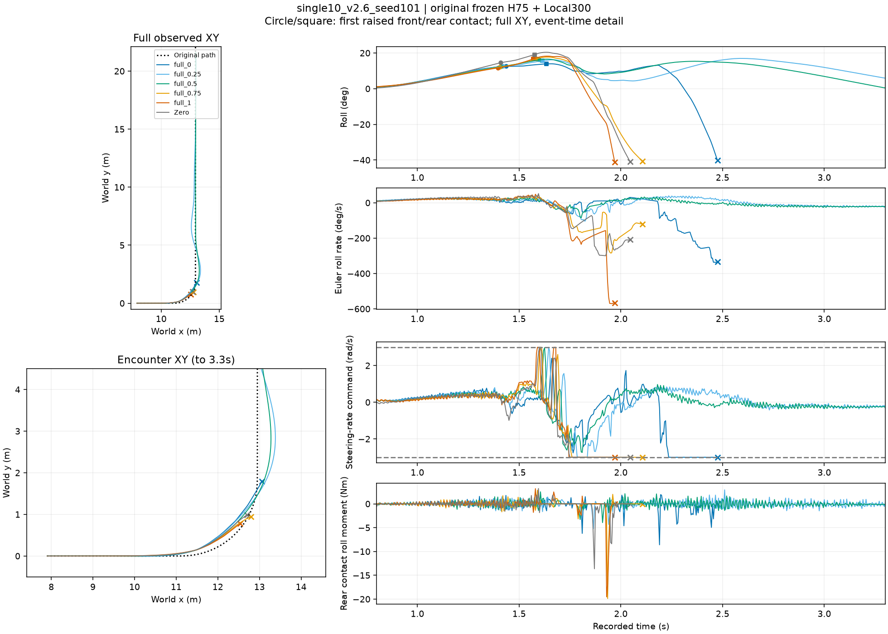

## single10_v2.6_seed102

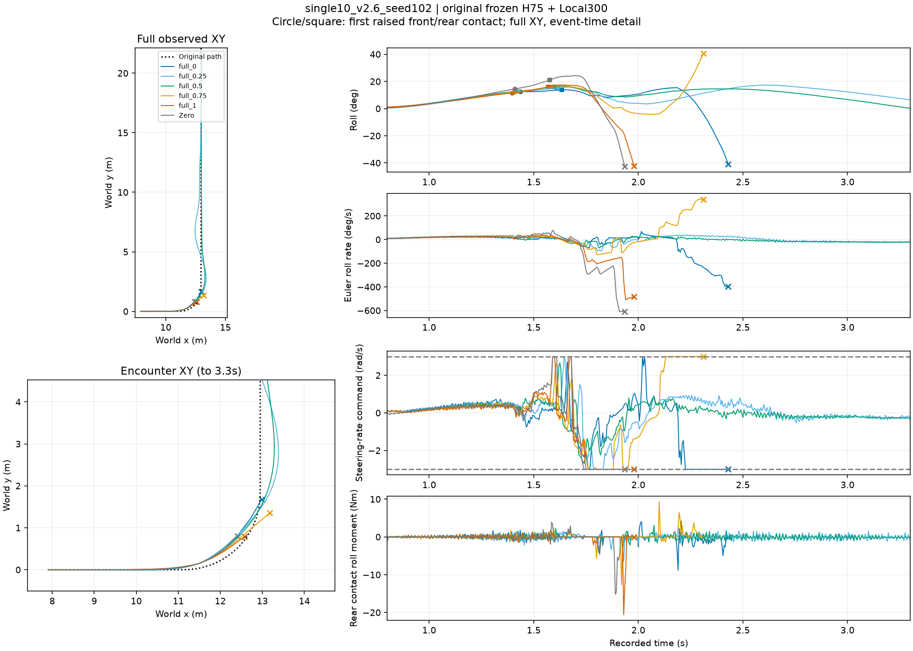

## single10_v2.6_seed103

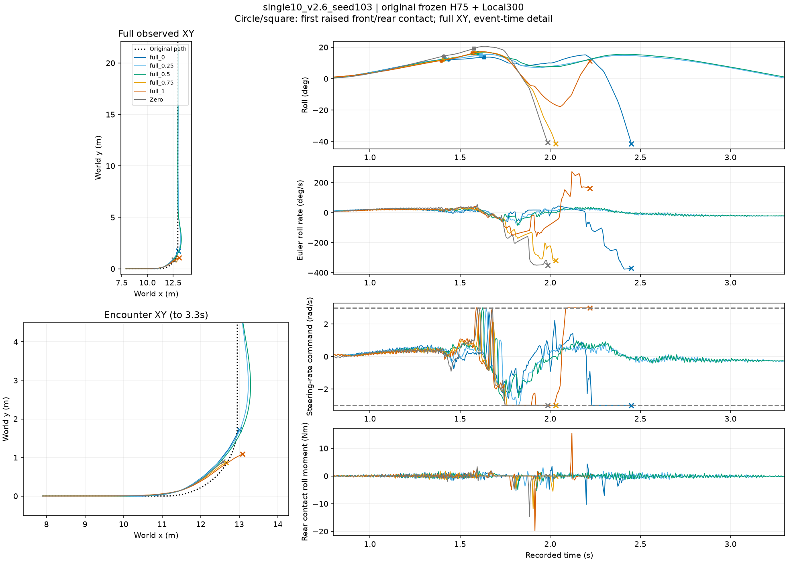
