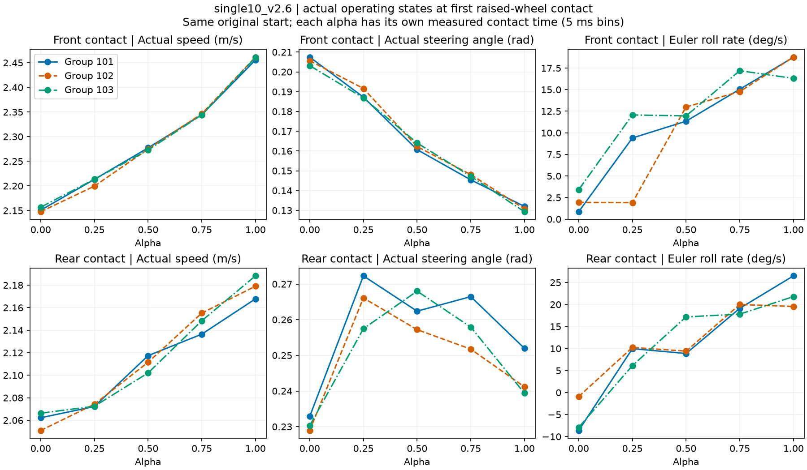

# S2：alpha如何改变接触与恢复的运行状态

[同起点原始XY](/media/qy/6A7E3DB07E3D75C3/STTW_runs/h75_channel_scan/single10_v2.6_seed101/xy.png) · [三组五档恢复图](recorded_envelopes/ridge_mechanism.png)

## 两端档位走的是不同失败路径

单脊2.6m/s、物理组101–103的前轮入脊状态随alpha稳定变化：alpha越高，实际入脊速度越高，前轮实际转角越小。高档前后轮接触间隔缩短，后轮到达时车身仍在向正侧倾斜，随后迅速转为负向外倾；alpha=1在后轮初次接触200ms后的下一100ms，三组转向命令全部处于限速。

alpha=0的初次越脊较缓和，后轮接触200ms后的下一100ms没有命令限速，但随后进入更晚的外倾过程。上一轮包络计算已经定位其三组在2.265–2.365s进入名义能力不足区。因此，不能用单一“入障太快”解释两端失败；必须保留接触后的速度—转向演化。

alpha=.25和.5在三组中都避免了最终失稳。中档的作用是形成更合适的完整恢复过程，不能只用某一个瞬时速度描述。

## 五档的实测范围（三个物理组）

|alpha|前轮入脊速度 m/s|前后接触间隔 ms|后轮接触+200ms侧倾速度 °/s|随后100ms命令限速占比|
|---|---|---|---|---|
|0|2.148–2.157|200–200|-58.0–-19.4|0.00–0.00|
|0.25|2.200–2.213|190–195|-94.6–-77.7|0.10–0.24|
|0.5|2.273–2.277|185–185|-54.0–-14.8|0.00–0.00|
|0.75|2.344–2.346|175–175|-133.5–-77.6|0.95–1.00|
|1|2.456–2.461|175–175|-210.7–-92.5|1.00–1.00|

## 数学与数据的连接

共用模块`learning/src/sttw_control/margin_theory.py`现在包含源码参数系数、闭环增益、受转角/转速限制的恢复包络、单位冲量响应、J_sat、p1(L/v)及前视跟踪域余量。没有拟合新的车辆参数。5项独立测试通过；共享包络与此前独立验证脚本的100个随机状态计算一致。

入脊速度决定名义两轮间隔和脉冲残余，但实际接触后的速度、转角和侧倾状态继续变化。完整模型应以这些运行状态连接“alpha产生的动作方式”和“恢复能力”，而不是把alpha直接替换成一个阻尼增益。

跟踪域同时包含前视点前向距离和航向误差两项源码判据，分别保留米、弧度余量，不把两种单位直接相加。局部直线几何式采用车辆航向减路径航向的符号定义，已与坐标投影独立核验。

## 全量产物与下一步

216条完整/消融/Zero/重复记录，共2160行接触状态；前后轮各取−100、0、50、100、200ms。全部状态、命令、实际动作、两通道参考修正和窗口长度保存在`contact_states/contact_states.csv`。接触时刻来自5kHz原记录聚合成5ms窗口。四张运行点图覆盖两类地形×两个速度，三物理组、五档完整网络。

下一步使用已有4–10cm标定数据，检查接触作用随速度和高度的变化，把本轮运行状态映射接到恢复需求上；不再以小幅拟合误差下降作为主要结果。S2尚未完成，S3保持停止。

来源：`h75_channel_scan/roll_contact_analysis/*.npz`和对应原始`trajectory.npz`；复算入口`learning/cli/analyze_alpha_contact_states.py`。0新仿真、0训练。
