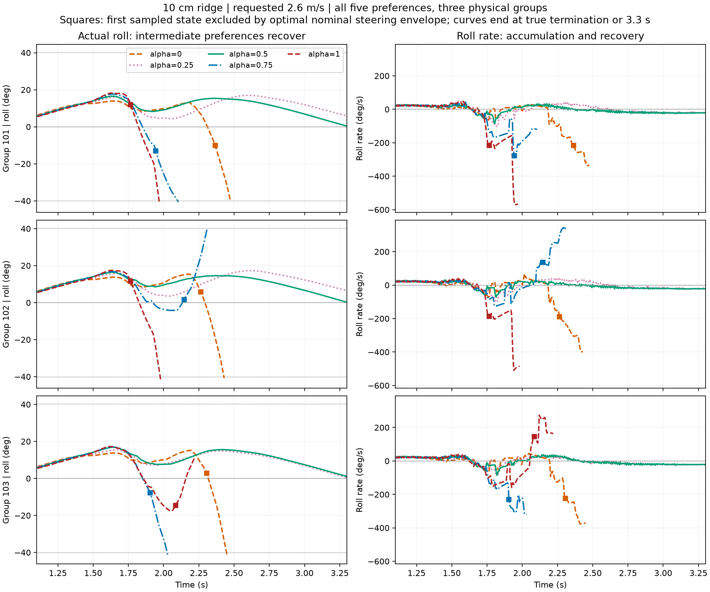

# S2：两端偏好的失败与转向恢复时间

先看[同起点原始XY](/media/qy/6A7E3DB07E3D75C3/STTW_runs/h75_channel_scan/single10_v2.6_seed101/xy.png)。原始目录：`/media/qy/6A7E3DB07E3D75C3/STTW_runs/h75_channel_scan`。

## 主结论

单脊2.6m/s的三组结果支持同一机制：两端偏好在不同阶段积累了过大的侧倾角速度，使转向建立所需时间超过剩余恢复时间；α=.25和.5避免了这一过程，六条记录均运行完整。α=0是后期失稳，α=1在101/102组更早失稳；103组α=1为运行域退出，保留为另一类失败。

此前仅检查早期时刻，漏掉了α=0晚期的状态恶化。补查后，三组α=0均在实际终止前进入名义转向能力不足区：

|物理组|首次检测到能力不足 s|真实侧倾超限 s|提前量 ms|
|---|---:|---:|---:|
|101|2.365|2.475|110|
|102|2.265|2.430|165|
|103|2.305|2.450|145|

上述时刻按20ms间隔检测，表示首次检测点，不是精确连续边界穿越时刻。

## 数学如何解释

状态不仅有侧倾φ和侧倾速度ω，还包括当前转角δ。固定当时速度，侧倾满足φ̈=a₄φ+a₂δ+a₁δ̇。允许的转角变化受|δ̇|≤3rad/s、|δ|≤0.8rad约束。S0已证明积分核为负，故朝最有利方向以最大速率转到行程边缘，给出该方向的最优恢复包络。如果这条包络在刹住外倾前仍越过0.7rad，任意允许转向也来不及。这解释了为什么“转角尚未饱和”不等于“还能恢复”。

101组α=0在2.365s时仅倾斜−10.08°，但外倾速度已达−215.66°/s，实际转角−0.0907rad、车速2.469m/s。对这一个状态，最有利名义转向也会在约194ms内越限；实际110ms后越限。α=1更早在1.765s进入对应区域。中档完整记录没有进入该区域。

因此可用于论文的机制是：偏好通过速度与转向过程改变接触后的状态；过大的外倾速度和不利的当前转角会消耗恢复时间，中档在这些单脊工况中保留了恢复余量。这里已把低α的晚期失败纳入同一状态机制，而不是只解释高α。

## 实际执行与全量检查

216条存档轨迹的窗口预算表显示，α=0三组失败前100ms均要求−3rad/s，实际均值−3.019、−3.024、−3.041rad/s：执行器基本跟上了命令。问题出在已经形成的运动状态和后续动力学，不是命令没有执行。

本次对12工况×五档完整网络及Zero，共72条记录、20562个有效状态应用同一包络。17条有侧倾阈值超限记录全部在超限前出现名义能力不足；40条完整运行记录中39条没有出现，1条出现后继续运行完整。其余为14条运行域退出与1条其他短记录，独立保留。完整运行不等于任务成功，这里只检查侧倾机制。

## 适用范围与下一步

这条包络是固定速度、无未来接触扰动的模型结论。碎石2.3m/s、组102、α=.25是完整运行中的例外：检测后220ms内速度由2.001降至1.645m/s，期间最低1.153m/s，并有轮地接触和实际转速短时超过3rad/s；其后恢复。因此它不能直接充当完整仿真的必败分类器。该例用于补充速度/接触作用，不改变单脊三组反复出现的主机制。

下一步围绕接触前状态与后续恢复过程，量化两端偏好为何进入不利状态，建立入障前可用的预测量。S2继续推进；S3保持停止，不用新扫描替代机制分析。

## 复算与数据

- `recorded_envelopes/summary.csv`：72条回合，侧倾超限与运行域标志分别保存。
- `recorded_envelopes/states.csv`：20562个状态与最有利控制计算；外部保存，不重复入Git。
- `dynamics_budget/budgets.csv`：216条记录、1688个共同或接触对齐窗口的动力学分项。
- 代码：`learning/cli/analyze_recorded_recovery_envelopes.py`、`analyze_recovery_dynamics_budget.py`；复用已验证的`verify_nominal_recovery.py`解析包络。
- 本轮0新仿真、0训练、无拟合参数。三组图展示全部五档，终点来自真实记录。
