# 跟踪域：实际轨迹、状态平面与前视余量

每个工况首先给出实际/原参考XY。状态平面的虚线是各车道临界时刻冻结的局部边界，曲线路径及变化前视距离没有被替换成统一直线。右图逐帧用实际速度、原路径和位姿重建前视点前向距离减0.05m。×为真实提前终止，圆点为完整记录末点。

θ=车辆航向−原路径切向；e=车辆相对原路径插值点的左向位移。令A为前视目标相对车辆的切向距离，C为目标相对原路径插值点的左向位移，则前向距离为 A cosθ+(C−e) sinθ。冻结A、C时，边界满足该式=0.05m；另要求|θ|<90°。

## dense10_v2.3_seed101

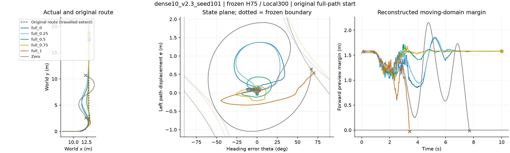

## dense10_v2.3_seed102

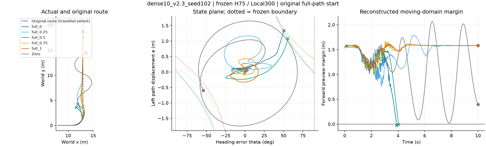

## dense10_v2.3_seed103

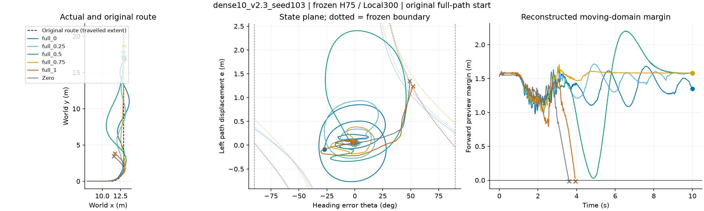

## dense10_v2.6_seed101

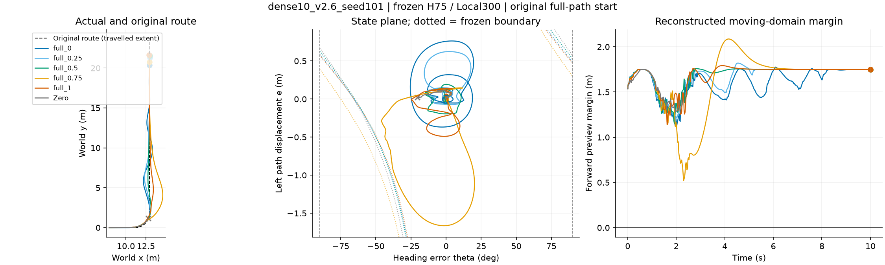

## dense10_v2.6_seed102

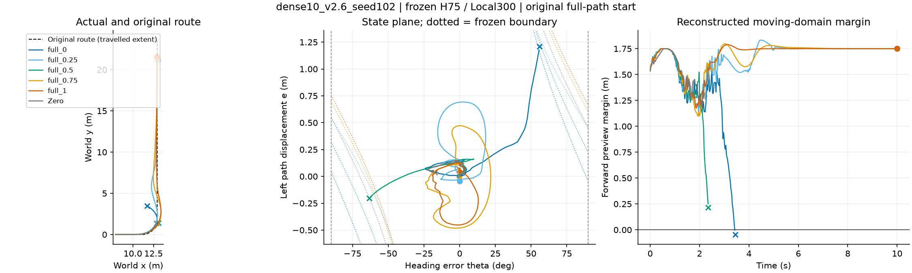

## dense10_v2.6_seed103

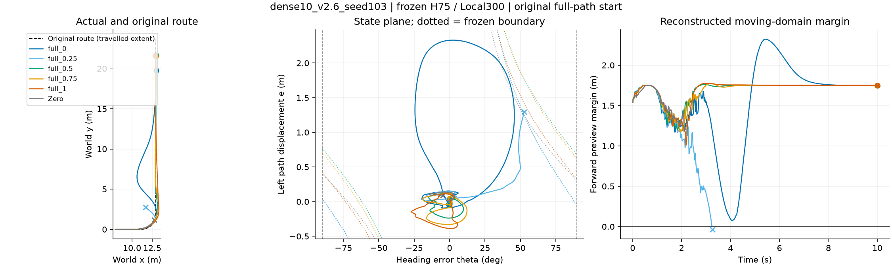

## single10_v2.3_seed101

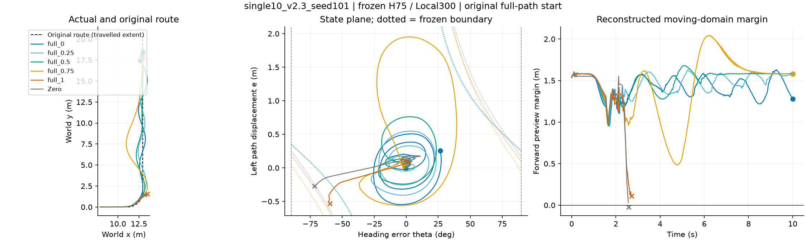

## single10_v2.3_seed102

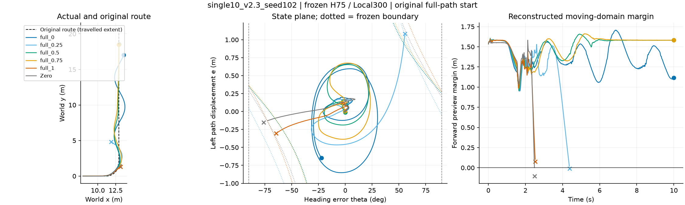

## single10_v2.3_seed103

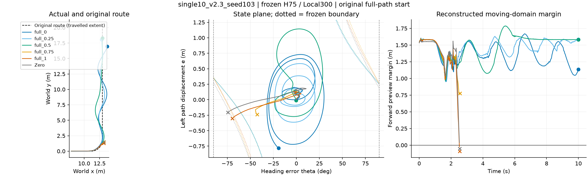

## single10_v2.6_seed101

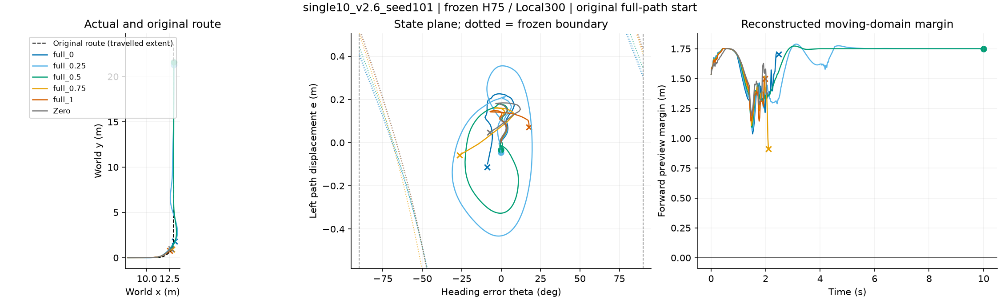

## single10_v2.6_seed102

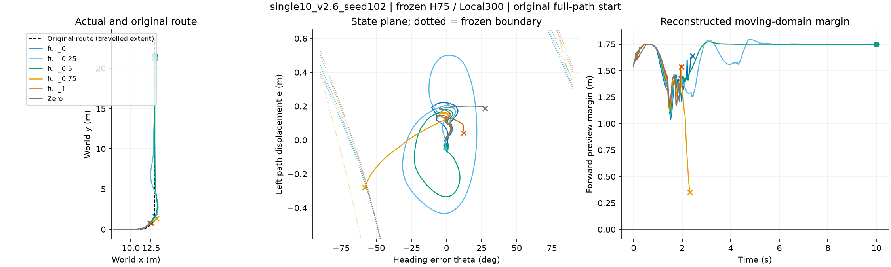

## single10_v2.6_seed103

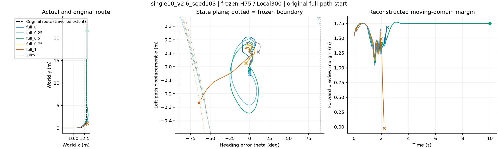

## 全216条检查

几何恒等式最大误差：1.6e-07 m。终止原因直接读取原分析，不根据重建曲线重新定义失败。采样是200Hz记录，控制判据和记账时刻可能相差一帧。

[全车道数值与原始数据路径](domain_summary.csv)
