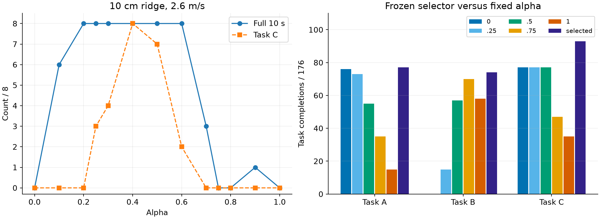
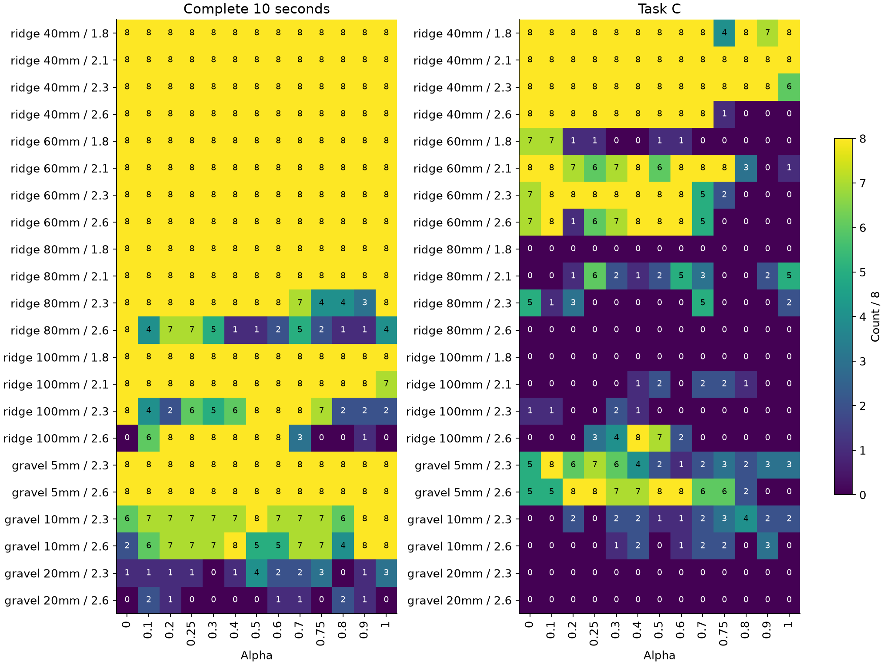

# S3：冻结预测的细alpha验证

[全部176工况实际/原参考XY](/media/qy/6A7E3DB07E3D75C3/STTW_runs/h75_theory_iteration/mechanism_scan/RESULTS.md)

**单脊中间档优势在新物理组复现；任务C冻结选档93/176，高于五个固定档的最高77/176。任务A/B增益较小。**

2464条：22工况×4新物理组×2重复×(13alpha+Zero)。完整10s、最终保持和A/B/C任务分开计数；各组两次重复不当作独立物理组。使用运行前冻结预测，不根据本轮重新选档。

## 全部工况

## 任务结果

|任务|固定0|固定.25|固定.5|固定.75|固定1|冻结选档|
|---|---:|---:|---:|---:|---:|---:|
|A|76|73|55|35|15|77|
|B|0|15|57|70|58|74|
|C|77|77|77|47|35|93|

每项分母176。任务C对固定0/.25/.5分别均救回23、丢失7，净增16；不把净增说成所有工况改善。

## 四个物理组分别统计

|任务|物理组|固定0|固定.25|固定.5|固定.75|固定1|选档|
|---|---|---:|---:|---:|---:|---:|---:|
|A|301|19|18|12|9|2|20|
|A|302|20|17|16|7|6|19|
|A|303|19|19|13|9|3|21|
|A|304|18|19|14|10|4|17|
|B|301|0|4|13|18|14|18|
|B|302|0|3|15|14|16|19|
|B|303|0|4|16|20|14|19|
|B|304|0|4|13|18|14|18|
|C|301|18|20|16|13|9|24|
|C|302|21|17|21|8|13|21|
|C|303|20|20|20|14|7|26|
|C|304|18|20|20|12|6|22|

每组分母44（22工况×2技术重复）。四个参数组跨工况复用，不能把176行当176独立物理参数组。

## 单脊10cm、2.6m/s

|alpha|完整/8|任务C/8|
|---|---:|---:|
|0|0|0|
|0.1|6|0|
|0.2|8|0|
|0.25|8|3|
|0.3|8|4|
|0.4|8|8|
|0.5|8|7|
|0.6|8|2|
|0.7|3|0|
|0.75|0|0|
|0.8|0|0|
|0.9|1|0|
|1|0|0|

0.2–0.6之间各档完整8/8，而两端0和1均0/8；中间可运行区域得到细扫描支持。任务C在.4为8/8、.5为7/8；.4是本次观察到的结果，冻结选择仍为.5，不回写成事前预测。

## 终止与预测可靠性

{'full_window': 1945, 'domain_exit': 252, 'roll_limit': 206, 'other_unresolved': 61}

原汇总other_unresolved共61条，其中22条在终止20ms步内保存了非轮部件接触力；另39条200Hz端点未保存到该接触信号，继续保留未解析。不把这些记录统称侧倾超限，原汇总文件不覆盖。详见unresolved_contact_check.json。

|预测可行票|条数|实际完整|实际比例|
|---|---:|---:|---:|
|0|160|31|0.194|
|0.5|304|139|0.457|
|1|1824|1750|0.959|

可行票不等同于已校准任务成功概率；本表直接检验其可靠性。

[全部22工况13档数据](context_alpha_counts.csv) · [所有任务配对得失](paired_choices.csv) · [逐条预测与实际](forecast_reliability.csv) · [汇总与组别数据](summary.json)

下一步：完成连续余量预测复算与未解析终止分类，再用冻结选档在新布局上做S4，与所有五个固定档及已有简单规则配对。当前结果支持推进，不改变网络或重训。
