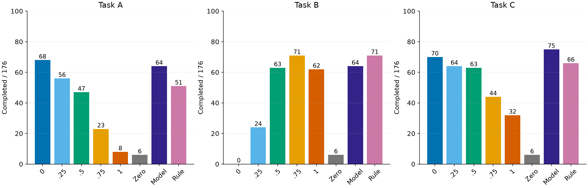
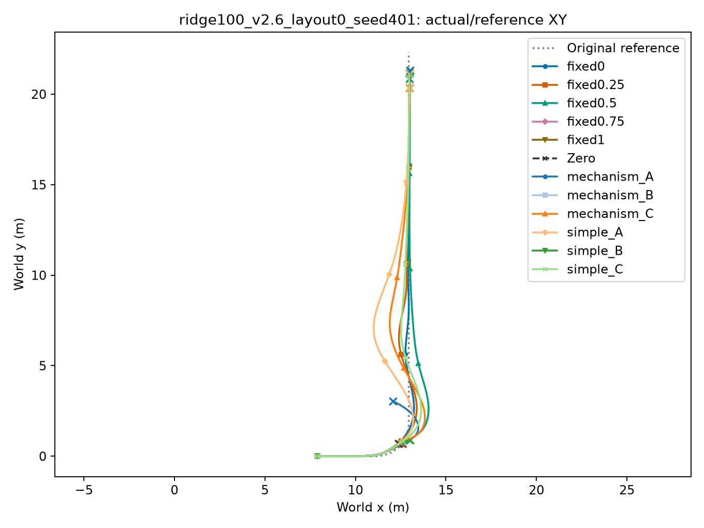
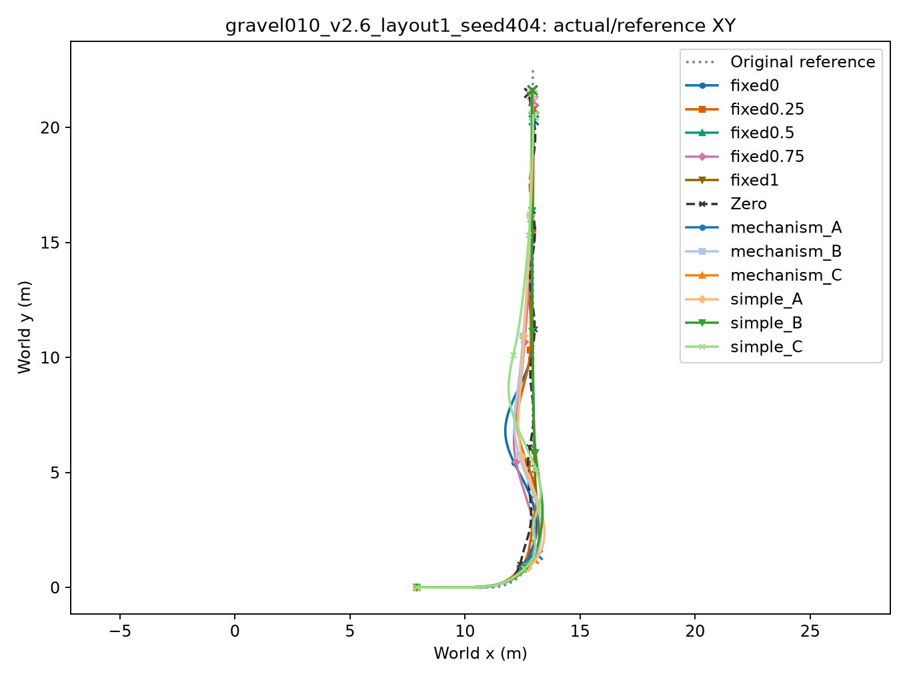
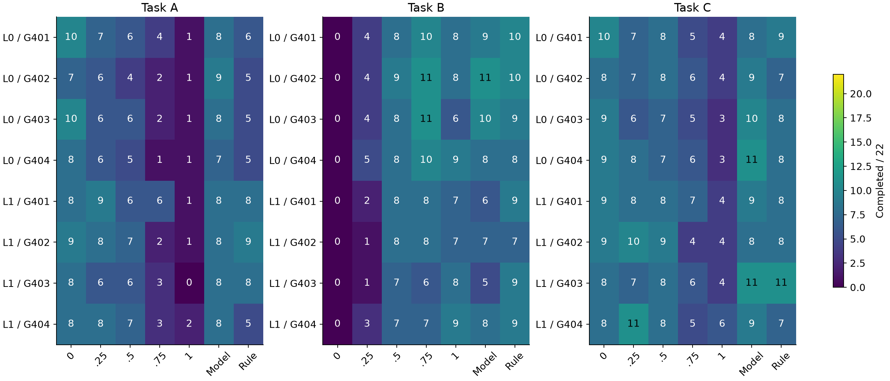

# S4：新布局上的冻结选档验证

[全部176工况实际/原参考XY](/media/qy/6A7E3DB07E3D75C3/STTW_runs/h75_theory_iteration/layout_test/RESULTS.md)

**机制选档在任务C为75/176，优于最佳固定档70/176及简单规则66/176；任务A/B未超过最佳固定档。选档收益依赖任务，当前规则还不是全面优胜者。**

22工况×2新布局×4新物理组×12车道=2112条；原H75/Local300、共同起点、10s，0训练。每个任务分别比较对应选择器，五固定档和Zero均用同任务重评分。运行前冻结决策，未按结果调档。

|任务|固定0|固定.25|固定.5|固定.75|固定1|Zero|机制选档|简单规则|
|---|---:|---:|---:|---:|---:|---:|---:|---:|
|A|68|56|47|23|8|6|64|51|
|B|0|24|63|71|62|6|64|71|
|C|70|64|63|44|32|6|75|66|

任务通过要求：完整运行、原目标最终保持，且全过程原路径峰值和速度RMSE满足A(.3m,.2m/s)、B(.6m,.1m/s)、C(.4m,.15m/s)。

## 配对轨迹示例

## 配对得失与组别变化

|任务|比较基线|救回|丢失|净增百分点|描述性95%区间|同alpha不一致/同alpha配对|
|---|---|---:|---:|---:|---|---|
|A|fixed0|9|13|-2.27|[-7.95, 1.14]|9/80|
|A|fixed0.25|19|11|4.55|[-2.27, 10.23]|0/8|
|A|fixed0.5|28|11|9.66|[5.68, 15.91]|3/8|
|A|fixed0.75|45|4|23.30|[15.91, 29.55]|1/8|
|A|fixed1|57|1|31.82|[28.41, 34.09]|0/16|
|A|Zero|61|3|32.95|[28.41, 37.50]|0/0|
|A|simple_A|26|13|7.39|[-2.27, 14.77]|0/16|
|B|fixed0|64|0|36.36|[26.14, 46.59]|0/0|
|B|fixed0.25|41|1|22.73|[18.18, 28.41]|0/8|
|B|fixed0.5|12|11|0.57|[-7.95, 7.95]|0/16|
|B|fixed0.75|11|18|-3.98|[-6.82, 0.00]|2/32|
|B|fixed1|18|16|1.14|[-9.09, 13.64]|6/48|
|B|Zero|59|1|32.95|[20.45, 45.45]|0/0|
|B|simple_B|5|12|-3.98|[-13.64, 3.41]|3/48|
|C|fixed0|15|10|2.84|[-3.41, 8.52]|10/80|
|C|fixed0.25|20|9|6.25|[-5.68, 14.77]|0/8|
|C|fixed0.5|25|13|6.82|[0.00, 13.64]|3/8|
|C|fixed0.75|40|9|17.61|[13.64, 22.16]|1/8|
|C|fixed1|49|6|24.43|[17.05, 31.82]|0/24|
|C|Zero|73|4|39.20|[30.68, 45.45]|0/0|
|C|simple_C|22|13|5.11|[0.00, 11.36]|4/32|

区间按布局和物理组交叉重采样，保留组内22工况。只有2布局、4物理组，区间用于描述该测试范围的变化。相同alpha的重复车道也有结果差异，单次配对得失不全部归因于选档动作。

## 终止原因

`{"full_window": 1620, "domain_exit": 210, "roll_limit": 223, "contact_failure": 56, "domain_exit+roll_limit": 2, "domain_exit+contact_failure": 1}`

共1620条完整、492条提前终止；225条包含侧倾超限，57条包含非轮接触，213条包含运行域退出。组合原因重复计入对应分项；不能将492条统称摔倒。直接终止标志已记录，无未解析分类。

## 当前结论

- S3的中间alpha可运行区得到细扫描支持，S4检验了冻结选择在新布局的实际任务效果。
- 任务C有正向增益，A/B仍由固定档或简单规则占优；后续论文应讲地形与任务下的协调及条件收益。
- 不按本轮结果修改预测或扩展训练。先把S0–S4合并为完整证据，再进入写作。

[逐条配对](paired_choices.csv) · [布局与物理组](group_layout_counts.csv) · [同alpha重复车道](same_alpha_pairs.csv) · [机器汇总](summary.json)

复算：`python learning/cli/analyze_mechanism_layout.py --run /media/qy/6A7E3DB07E3D75C3/STTW_runs/h75_theory_iteration/layout_test`。源analysis_summary.json、jobs.json、各contract及冻结决策；无平滑、无结果剔除。

## 地形拆分与完整运行

单脊128工况，碎石48工况；下面表格按相应分母读取。

|地形|任务|固定0|固定.25|固定.5|固定.75|固定1|Zero|机制|简单规则|
|---|---|---:|---:|---:|---:|---:|---:|---:|---:|
|ridge|A|63|48|35|20|7|2|57|41|
|ridge|B|0|20|47|53|43|2|50|51|
|ridge|C|63|55|46|36|25|2|66|53|
|gravel|A|5|8|12|3|1|4|7|10|
|gravel|B|0|4|16|18|19|4|14|20|
|gravel|C|7|9|17|8|7|4|9|13|

任务C单脊机制66/128，最佳固定63/128、简单规则53/128；碎石机制9/48，固定.5为17/48、简单规则13/48。总体收益不等于每类地形均有收益。C相对最佳固定档的描述性区间跨零，当前是小幅观察收益，尚未建立稳定的总体优势。

|车道|完整10s|最终保持|分母|
|---|---:|---:|---:|
|fixed0|141|92|176|
|fixed0.25|146|101|176|
|fixed0.5|145|108|176|
|fixed0.75|143|111|176|
|fixed1|137|105|176|
|Zero|32|6|176|
|mechanism_A|146|107|176|
|mechanism_B|147|115|176|
|mechanism_C|149|113|176|
|simple_A|146|99|176|
|simple_B|145|115|176|
|simple_C|143|101|176|

[全部2112条指标和终止原因](episode_metrics.csv)
