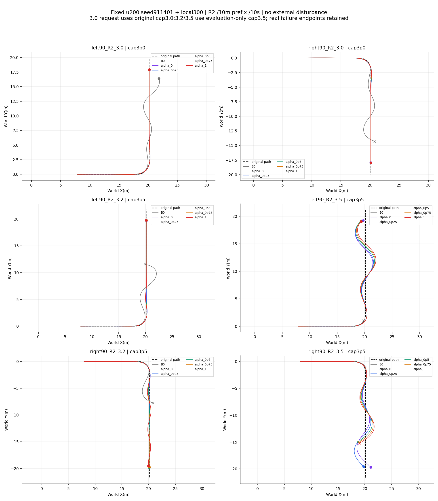
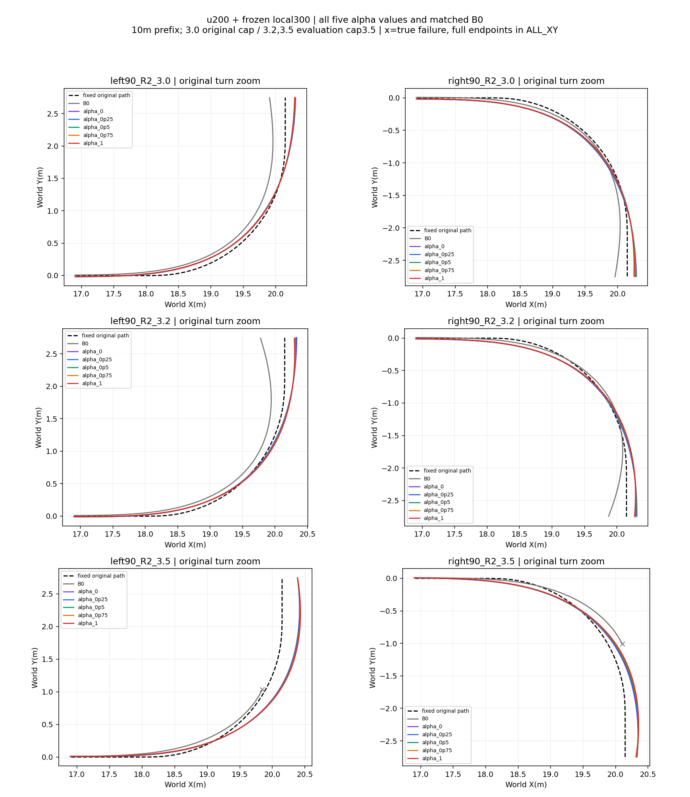
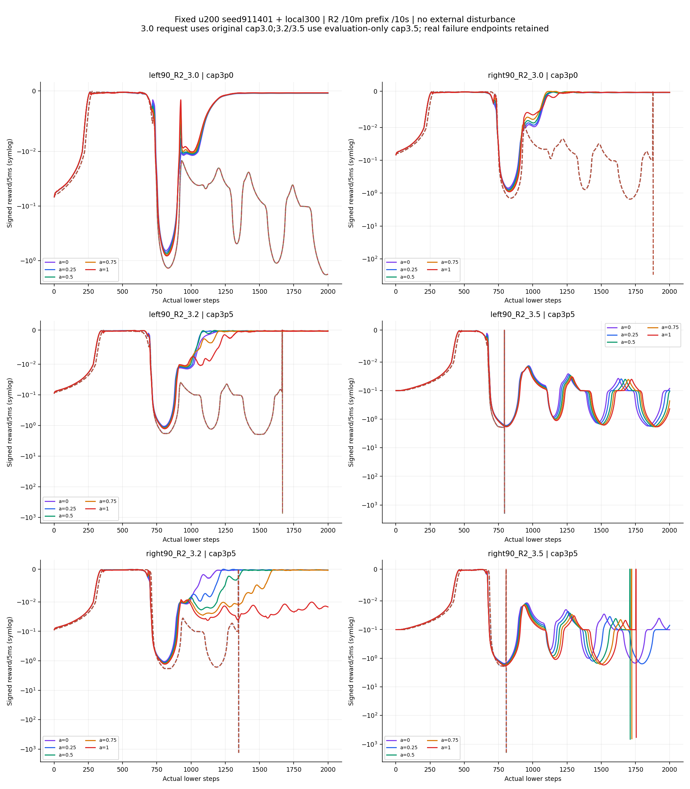

# 3.0–3.5 m/s 过弯偏好评测

3.2和3.5 m/s出现了预期方向：α1更保速度，α0减速更多且完整弯道路径RMSE更小。但差别仍较弱；3.5 m/s弯后恢复失效，不能作为已解决的高速过弯方法。3.0 m/s则仍是α1速度、路径共同改善，没有清晰的速度—路径分离。

固定原训练已评候选最佳u200（也是末轮，五个候选中选出）；Actor训练seed911401，同prepared bank初态。底层固定local300 update300无α网络＋ECBC/ESO。此次0 PPO更新、不变奖励/权重/物理/执行器/滤波/限速/转向和残差权限。每个工况5个α，共30策略回合，加6匹配B0；全部36回合已保存。相同R2左右90°、10m直线前缀、10秒窗口，无外扰；旧训练3m前缀的基线不匹配，未冒用。

3.0 m/s保留原速度参考上限3.0；3.2/3.5 m/s独立评测配置将上限显式放到3.5。后两档超出原速度参考合同，且全组三档均超出原强训练2.4–2.6范围。这个改动仅让请求能够施加，不提高执行器能力；不能称完全相同合同下的纯单因素速度消融。

各档入弯前6–7m的真实速度约2.979、3.214–3.217、3.447 m/s，因此确实经历了高速状态；请求3.5不代表弯中实速始终3.5。

| 工况 | 弯中实速 α0→α1 (m/s) | 速度RMSE α0→α1 (m/s) | 路径RMSE α0→α1 (m) | 实际平均Δv α0→α1 (m/s) | 弯中最大外偏 α0→α1 (m) |
|---|---:|---:|---:|---:|---:|
| left90_R2_3.0 | 2.8804 → 2.9000 | 0.1407 → 0.1141 | 0.0654 → 0.0624 | -0.0390 → -0.0151 | 0.1237 → 0.1116 |
| right90_R2_3.0 | 2.8810 → 2.9101 | 0.1455 → 0.1004 | 0.0795 → 0.0710 | -0.0497 → -0.0092 | 0.1071 → 0.0929 |
| left90_R2_3.2 | 3.0518 → 3.0758 | 0.1822 → 0.1495 | 0.0724 → 0.0746 | -0.0574 → -0.0208 | 0.1560 → 0.1457 |
| right90_R2_3.2 | 3.0526 → 3.0980 | 0.1825 → 0.1230 | 0.0773 → 0.0793 | -0.0684 → -0.0060 | 0.1388 → 0.1354 |
| left90_R2_3.5 | 3.2706 → 3.3065 | 0.2589 → 0.2164 | 0.1620 → 0.1747 | -0.1094 → -0.0587 | 0.2666 → 0.2824 |
| right90_R2_3.5 | 3.2903 → 3.3420 | 0.2413 → 0.1765 | 0.1050 → 0.1202 | -0.1059 → -0.0326 | 0.1935 → 0.2070 |

弯中实速和RMSE按原始完整弯道等0.5m空间分箱计算，每箱等权；实际Δv为经过滤波、限速、限幅后的弯中时间均值。两个统计口径分别标明，不将网络隐变量当动作。α1相对α0的弯中实速增量为左/右：3.0时0.0196/0.0291，3.2时0.0240/0.0454，3.5时0.0359/0.0517 m/s。α1仍在减速，只是比α0少减速，未表现出强力维持请求速度的行为。

3.2时α0路径RMSE优势仅约2mm；其最大向弯外偏离反而略大于α1，不能把RMSE方向直接说成“α1更外冲”。3.5时最大外偏方向才一致：左0.2666→0.2824m，右0.1935→0.2070m。α从0/.25/.5/.75/1变化，速度总体连续增加、3.5弯道路径误差也逐渐增加；中间值全部保留在完整表和图中。

弯后表现决定了可用性：3.0十个策略都通过末1秒保持；3.2左弯5/5、右弯4/5，右α1末段路径未保持；3.5十个策略均未通过。3.5左弯所有α存活到10秒，但全程最大横向误差约1.77–1.90m并明显摆动；右弯α0/.25存活到10秒仍未恢复，α.5/.75/1分别8.56/8.62/8.78秒路径域退出。域退出是现有预瞄/路径跟踪定义域失效，与物理摔倒分开记录，也不等于超过某条固定走廊。

全部策略物理摔倒0/30，路径域失败3/30；共同末1秒保持19/30（要求速度误差≤.1m/s、横向≤.1m、航向≤.05rad，全1秒且无提前终止）。全部30策略峰值侧倾超过.302rad诊断线，峰值.3979–.5613rad，因此不能称共同姿态要求满足。α1的峰值侧倾比α0高；这与更快过弯同时出现，尚未单独证明因果机制。

B0不是纯ECBC，是同一冻结local300＋ECBC/ESO零上层修正。3.0左弯10秒未失败但未恢复，右弯9.4秒域退出；3.2左右8.34/6.74秒域退出；3.5左右3.97/4.035秒物理失败且未完成整弯，其完整弯RMSE保持缺失。策略在六工况同α累计回报30/30优于配对B0，但B0右弯3.0/3.2的完整弯路径RMSE更小，不能把回报优势说成所有误差都改善。所有累计回报保留各自真实终止及尾罚；metrics.json另列同时间前缀误差用于短失败轨迹比较。

奖励分项显示姿态/工作区代价在这些高速回合占较大部分；这是观测，不据此断言奖励权重就是弱偏好的原因。每5ms实记总奖励、累计总奖励、11个有符号分项及累计分项均保存；基线按相同α重评分，不能跨α用加权回报排名物理能力。普通奖励独立重建最大绝对差3.0821e-7；失败尾罚NumPy与原float32计算最大差.0041867、相对6.4125e-6，明确保留。策略总奖励图/回报用原日志值，尾罚分项对齐实记尾罚，未用重算值覆盖原轨迹。

执行采用现有BatchedPanelEvaluator case×α vmap、scan50和共享JAX缓存。原进程退出原因UNKNOWN，已完成16回合复用，仅恢复剩20策略；最终保存/记账67,689 lower ticks，低于72,000声明。原进程是否发生未落盘交互UNKNOWN，未虚构精确账外费用。四组完成批次的编译/物理耗时分别38.0/255.0、36.4/165.1、40.1/529.5、35.9/162.9秒，受共享GPU调度影响，不宣称新加速倍数。分析0新增物理，无SHA扫描。

建议将3.2 m/s作为下一步偏好训练/验证工况：方向已出现且失效较少，但需要增强可学的主动减速差异和弯后恢复；保留3.5为压力边界。仅提高测试速度不会改变冻结Actor能力。本轮没有启动新训练，没有改变奖励/终止契约来制造分离。单训练seed、同初态、固定两种弯，不代表随机初态或外扰泛化。

[36回合完整指标和逐工况图索引](INDEX.md) · [逐阶段/逐α指标与奖励分项](metrics.json)
