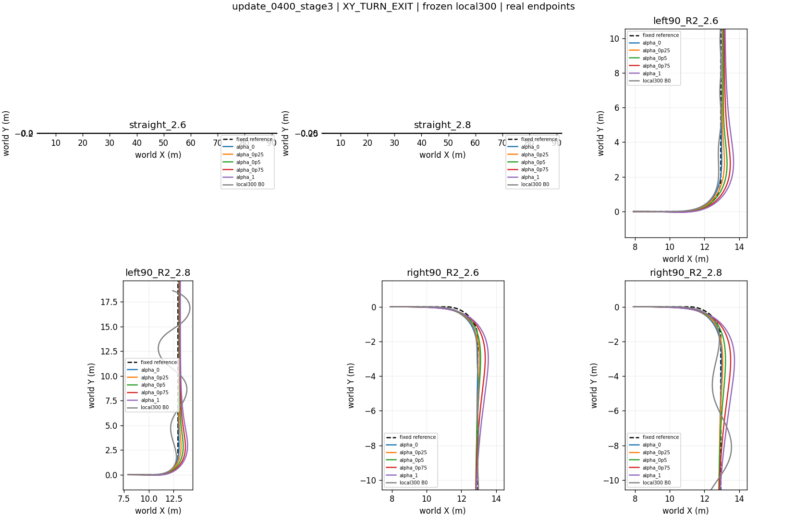

本轮完成400/400采样槽，日志确认400次更新均接受，50次触发目标KL停止，其中44次不足4个优化epoch。训练消耗104857600底层步，物理失败0、跟踪域失败384次，不能用固定DEV的零失败覆盖训练失败。预算完成与任务合格须分开。[运行核验](AUDIT_CAMPAIGN.json)

单个条件网络继承两位历史Coverage端点教师，各为u200，未重训教师，也未混合两策略动作。蒸馏使用64000条监督样本，按环境分训练/验证，8000次监督更新后闭环继承门12/12通过，纠偏采集为零。PPO初始Actor与蒸馏Actor哈希相同。底层仍是原诊断候选local300的u300，非原协议最佳u400，身份已复核；旧教师轨迹仅取共同10秒比较。[身份与数据](source_snapshots/manifest.json)

v3对α1的路径成本全局乘0.1：原权重10、上限200变为有效系数1、上限20；并非仅在弯道降权。共同侧倾、工作侧倾权重为80/240，二者不是上限。奖励、继承和课程同时变化，冻结教师仍用旧合同，不能将全部差异归因于某一奖励项。

各阶段实际采样50/125/225/0槽。晋级须本阶段至少50槽、连续两次过门；阶段一仅看共同要求，后续另须端点主目标；u50、u175后晋级。阶段一best50合格；阶段二best100虽共同要求通过，主目标不合格，真正晋级来自u150/u175。阶段三best325同样未过主目标；最高阶段没有训练暴露。

同阶段一、同场景的u0→u50显示PPO追加改进：α1四弯速度RMSE均值0.01994→0.01489米/秒，路径0.20443→0.11107米；α0路径却由0.05996升至0.07905米。因此须区分蒸馏继承与后续改善，也不应强迫α1路径变差来制造偏好。

仅在相同阶段三场景比较best325与last400：α1弯道速度均值0.07149→0.03583米/秒，路径0.33553→0.30846米。末轮四弯均体现α1速度优先、α0路径更准；两条直道α1速度RMSE反而略高。案例名虽含R2，该阶段实际半径为1.8米。[配对数值](TRAJECTORY_METRICS.csv)

然而两者均到达30/30、无物理或域失败，最终保持却由30/30降至6/30；末轮另有7条工作侧倾超限。24条保持失败均因末一秒横向误差超过0.1米。XY可见残余偏置，逐步奖励尾段持续扣分；同α、同场景累计回报26/30下降，不能跨α排序总奖励。[轨迹核验](TRAJECTORY_CHECKS.json)

这些结果支持已观察到的速度/路径偏好及局部改进，尚不支持稳定任务资格。教师数据用于监督，在线采样用于PPO，DEV反复用于晋级与选优，阶段B0只是零上层参照；缺少蒸馏初始策略的阶段三配对面板、独立测试和多种子。本轮是多因素实用实验，不是因果消融或部署安全证明；保留失败与最高阶段缺口，不采用模型。[图表与证据索引](INDEX.md)
