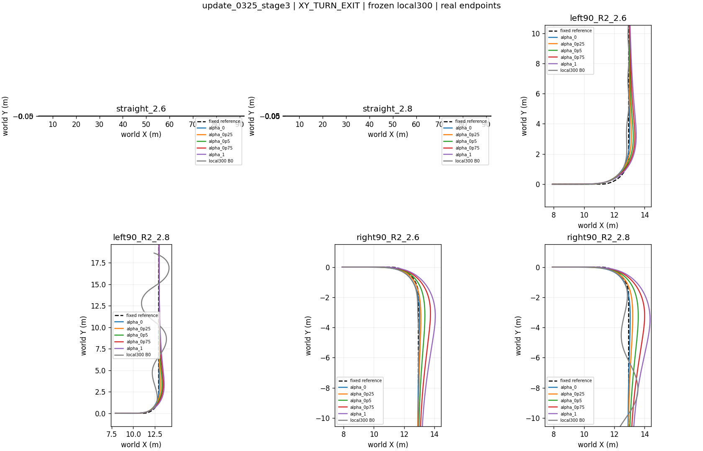

# 单网络 α 与新版持久路径偏好奖励 V3



单个 α 条件网络输出速度、转向参考修正，冻结 local300 跟踪。Actor 351维、Critic 352维，`alpha_modulated_v1`；不是两个策略动作混合。α 在每回合内固定，在线切换尚未验证。

## 代码入口

- [奖励实现](../../../learning/src/sttw_control/path_command_reward.py)：`costs` 的 `path_persistent_preference_v3` 分支。
- [实际训练配置](../../../learning/configs/STTW_Path_Distilled_Curriculum_V3.json)：`path_secondary_ratio=0.1`。
- [独立 NumPy 奖励重建](../../../learning/src/sttw_control/path_command_reporting.py)。
- [奖励行为测试](../../../learning/tests/test_path_persistent_reward.py)、[蒸馏测试](../../../learning/tests/test_path_distillation.py)。

配置中的 `status/configured_not_trained` 是实验创建时的静态描述，实际400轮完成状态见 [运行状态快照](source_snapshots/status.json)。配置旧描述字段 `path_weight` 不是 V3 分支的实际公式；以版本字段与以下实现为准。

## 逐项公式

记 H(x)=x²（|x|≤1），否则 H(x)=2|x|−1；[x]₊=max(x,0)，Bₖ(x)=min(x,k)。eᵥ、eᵧ、eₕ分别为原始速度请求误差、几何横向误差、路径航向误差。χ∈[0,1]来自原始任务几何需求，不由网络修改后的指令定义。

```text
S0 = (10−9χ) H(eᵥ/0.1)
S1 = 10 H(eᵥ/0.1)
P  = 10 [H(eᵧ/0.1) + 0.5 H(eₕ/0.1)]
Q0 = 20χ H([|eᵧ|−0.1]₊/0.1)
Q1 = 20χ H([|eᵥ|−0.05]₊/0.1)

C_speed   = (1−α) B200(S0) + α B200(S1)
C_path    = (1−0.9α) B200(P)
C_primary = (1−α) B400(Q0) + α B400(Q1)
r_tick    = −0.1 × 0.005 × Σ C_effective
```

三个端点通道先截断、再按α加权。此处混合的是奖励项，不是网络动作。总和还包含共用的侧倾、工作侧倾、侧倾角速度、超速、低速、修正幅度和修正变化率七项，参数及截断值完整保留在配置。终止惩罚由同模块 `failure_reward` 单独计算。

核心变化：α=1时始终保留α=0路径成本的10%，包括χ=0的出弯段；α=0时保持原路径偏好。旧路径权重在χ=0时两端相同，V3则保持全程路径偏好差异。α=1仍须回线，不以故意走坏路径证明偏好。V3总回报不能直接和旧奖励版本比较。

## 当前结果及边界

400轮训练已完成（26,214,400 PPO策略步），最高课程阶段停留在第3阶段。推荐开发候选为update325：30/30到达目标且满足原共同恢复条件，无物理/域失败；峰值侧倾0.29764rad，末1秒最大路径误差0.06424m。四个弯道速度RMSE均随α增大逐级降低；路径端点优势3/4，另一例差约0.8mm。原严格端点主目标仍未通过。

末轮update400原共同最终保持仅6/30；采用路径0.20m、侧倾0.33rad的实用敏感性口径时24/30。两种口径分别保留。不要以最后一轮替代推荐候选。

这次同时使用端点蒸馏、课程训练及V3奖励，没有单因素消融，不能把效果全部归因于奖励。尚无多训练种子、未见路线或动态α切换结论。完整逐例数据、奖励重算、XY图及身份见[结果索引](INDEX.md)。
