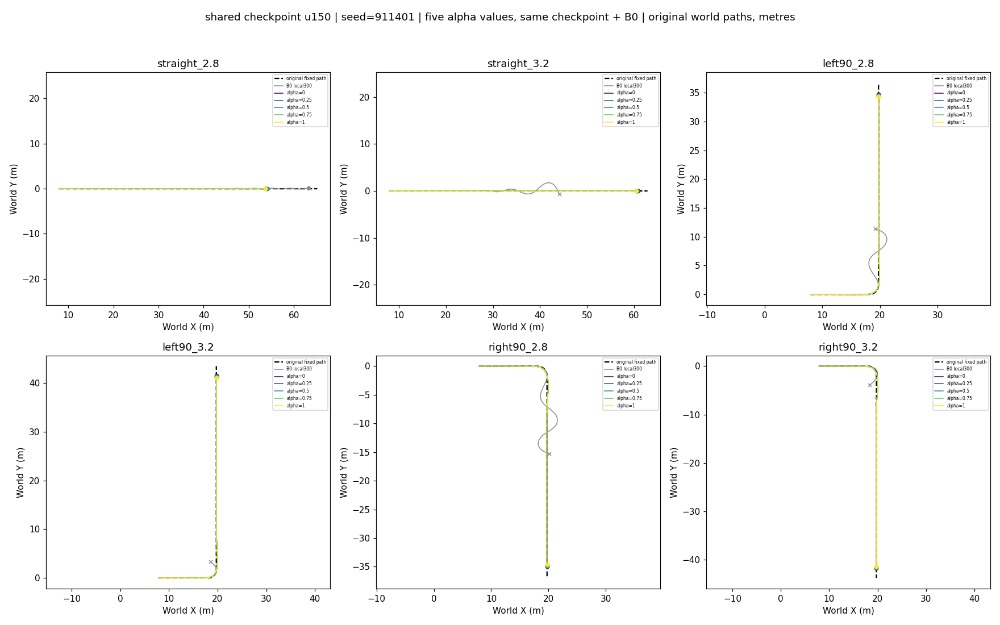
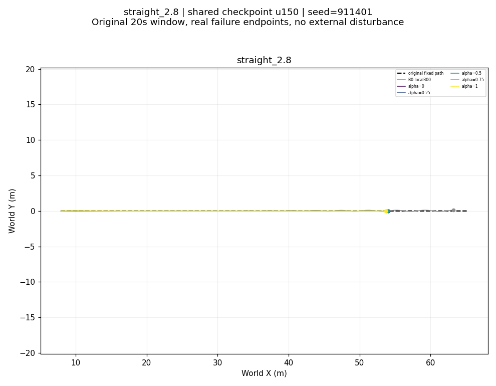
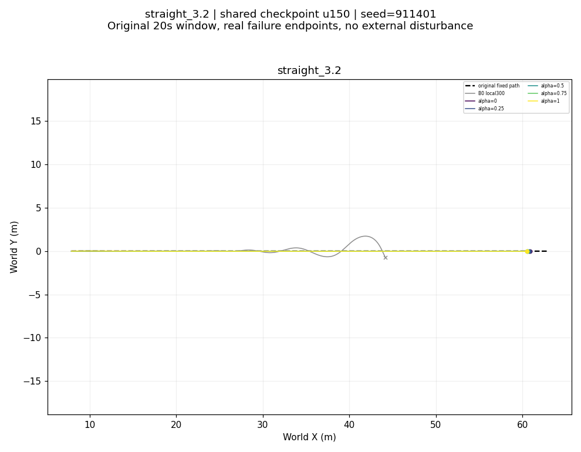
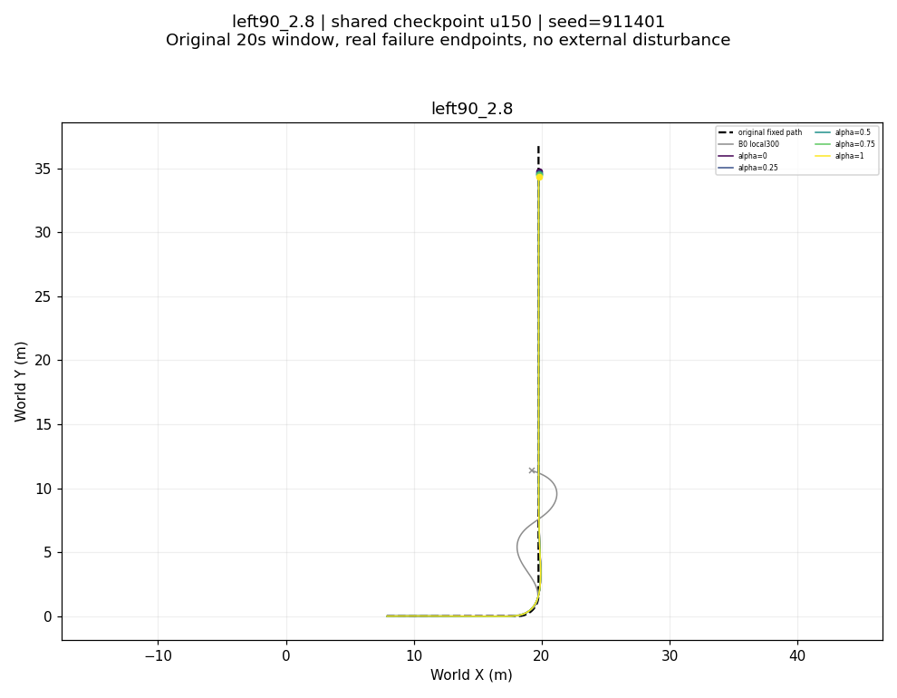
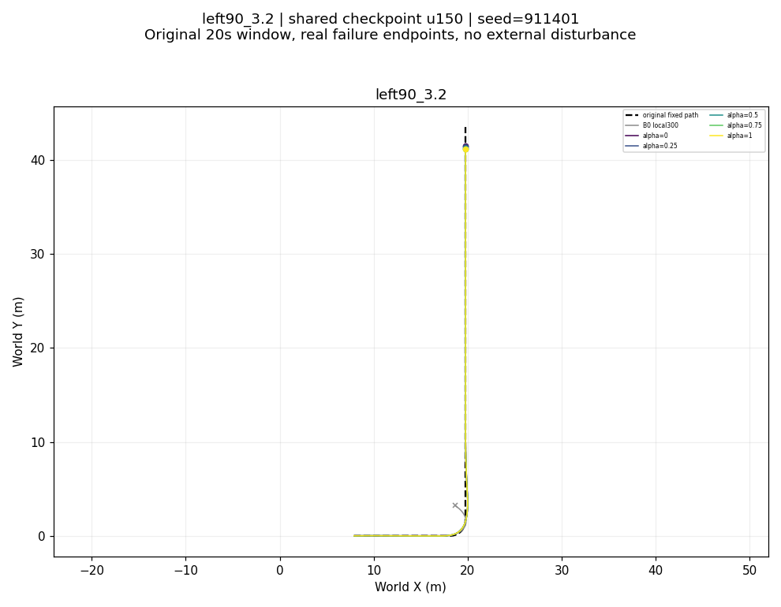
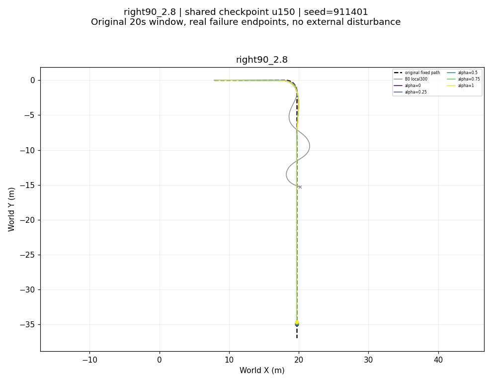
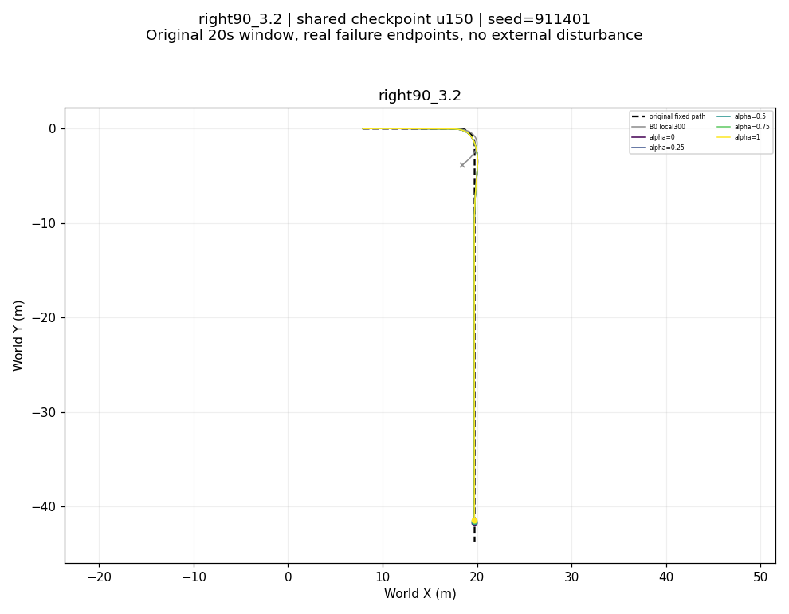

# Shared conditional upper: all-alpha fixed-path report

shared checkpoint u150 | seed=911401

One Actor, Critic and checkpoint for every alpha. B0 = frozen local300 + ECBC/ESO. Original paths and requests are unchanged; no external disturbance. x marks real failure and o the real final sample. Reward uses each alpha objective, with the matching rescored B0; cross-alpha returns are not physical rankings. The historical .302 rad/.40 m and task gates below are diagnostics, not reasons to shorten the authorized training budget.

Selected update: 150; last completed update: 200; last evidence: verified_saved_panel.
Last model common task: False; research preference: UNKNOWN; legacy strict preference: None.

## straight_2.8

[Roll and original errors](straight_2.8_physical.png) · [Step and cumulative reward](straight_2.8_reward.png) · [Signed components](straight_2.8_components.png) · [Complete command chain and wheel-speed proxy](straight_2.8_command_chain.png)

| Alpha | Speed RMSE (m/s) | Path RMSE (m) | Peak roll (rad) | Corridor fail | Goal / hold | Endpoint primary fail |
|---|---:|---:|---:|---|---|---|
| 0 | 0.48876 | 0.01686 | 0.01555 | False | True / False | True |
| 0.25 | 0.49434 | 0.01588 | 0.01567 | False | True / False | N/A (interior alpha) |
| 0.5 | 0.49992 | 0.01502 | 0.01577 | False | True / False | N/A (interior alpha) |
| 0.75 | 0.50544 | 0.01415 | 0.01587 | False | True / False | N/A (interior alpha) |
| 1 | 0.51098 | 0.01343 | 0.01595 | False | True / False | True |

## straight_3.2

[Roll and original errors](straight_3.2_physical.png) · [Step and cumulative reward](straight_3.2_reward.png) · [Signed components](straight_3.2_components.png) · [Complete command chain and wheel-speed proxy](straight_3.2_command_chain.png)

| Alpha | Speed RMSE (m/s) | Path RMSE (m) | Peak roll (rad) | Corridor fail | Goal / hold | Endpoint primary fail |
|---|---:|---:|---:|---|---|---|
| 0 | 0.56020 | 0.02003 | 0.01556 | False | True / False | True |
| 0.25 | 0.56541 | 0.01907 | 0.01569 | False | True / False | N/A (interior alpha) |
| 0.5 | 0.57055 | 0.01814 | 0.01580 | False | True / False | N/A (interior alpha) |
| 0.75 | 0.57565 | 0.01721 | 0.01590 | False | True / False | N/A (interior alpha) |
| 1 | 0.58073 | 0.01642 | 0.01600 | False | True / False | True |

## left90_2.8

[Roll and original errors](left90_2.8_physical.png) · [Step and cumulative reward](left90_2.8_reward.png) · [Signed components](left90_2.8_components.png) · [Complete command chain and wheel-speed proxy](left90_2.8_command_chain.png)

| Alpha | Speed RMSE (m/s) | Path RMSE (m) | Peak roll (rad) | Corridor fail | Goal / hold | Endpoint primary fail |
|---|---:|---:|---:|---|---|---|
| 0 | 0.51871 | 0.05081 | 0.22151 | False | True / False | False |
| 0.25 | 0.52382 | 0.05011 | 0.22125 | False | True / False | N/A (interior alpha) |
| 0.5 | 0.52894 | 0.04948 | 0.22098 | False | True / False | N/A (interior alpha) |
| 0.75 | 0.53395 | 0.04895 | 0.22078 | False | True / False | N/A (interior alpha) |
| 1 | 0.53895 | 0.04836 | 0.22055 | False | True / False | True |

## left90_3.2

[Roll and original errors](left90_3.2_physical.png) · [Step and cumulative reward](left90_3.2_reward.png) · [Signed components](left90_3.2_components.png) · [Complete command chain and wheel-speed proxy](left90_3.2_command_chain.png)

| Alpha | Speed RMSE (m/s) | Path RMSE (m) | Peak roll (rad) | Corridor fail | Goal / hold | Endpoint primary fail |
|---|---:|---:|---:|---|---|---|
| 0 | 0.58456 | 0.06386 | 0.31185 | False | True / False | False |
| 0.25 | 0.58941 | 0.06312 | 0.31166 | False | True / False | N/A (interior alpha) |
| 0.5 | 0.59424 | 0.06239 | 0.31141 | False | True / False | N/A (interior alpha) |
| 0.75 | 0.59903 | 0.06173 | 0.31113 | False | True / False | N/A (interior alpha) |
| 1 | 0.60380 | 0.06108 | 0.31100 | False | True / False | True |

## right90_2.8

[Roll and original errors](right90_2.8_physical.png) · [Step and cumulative reward](right90_2.8_reward.png) · [Signed components](right90_2.8_components.png) · [Complete command chain and wheel-speed proxy](right90_2.8_command_chain.png)

| Alpha | Speed RMSE (m/s) | Path RMSE (m) | Peak roll (rad) | Corridor fail | Goal / hold | Endpoint primary fail |
|---|---:|---:|---:|---|---|---|
| 0 | 0.50477 | 0.06398 | 0.22304 | False | True / False | True |
| 0.25 | 0.50942 | 0.06344 | 0.22354 | False | True / False | N/A (interior alpha) |
| 0.5 | 0.51400 | 0.06295 | 0.22408 | False | True / False | N/A (interior alpha) |
| 0.75 | 0.51859 | 0.06245 | 0.22468 | False | True / False | N/A (interior alpha) |
| 1 | 0.52314 | 0.06196 | 0.22526 | False | True / False | True |

## right90_3.2

[Roll and original errors](right90_3.2_physical.png) · [Step and cumulative reward](right90_3.2_reward.png) · [Signed components](right90_3.2_components.png) · [Complete command chain and wheel-speed proxy](right90_3.2_command_chain.png)

| Alpha | Speed RMSE (m/s) | Path RMSE (m) | Peak roll (rad) | Corridor fail | Goal / hold | Endpoint primary fail |
|---|---:|---:|---:|---|---|---|
| 0 | 0.57230 | 0.08138 | 0.32093 | False | True / False | True |
| 0.25 | 0.57669 | 0.08081 | 0.32141 | False | True / False | N/A (interior alpha) |
| 0.5 | 0.58100 | 0.08032 | 0.32184 | False | True / False | N/A (interior alpha) |
| 0.75 | 0.58535 | 0.07974 | 0.32247 | False | True / False | N/A (interior alpha) |
| 1 | 0.58967 | 0.07922 | 0.32303 | False | True / False | True |

[Full per-alpha metrics, complete-turn bins, source NPZ paths and reward audit](conditional_metrics.json)
[One shared checkpoint identity](identities.json)
The complete original turn is used for equal-bin MSE metrics. Missing bins remain missing; no common-fragment shortcut. Middle-alpha primary thresholds are not invented. Intermediate-alpha trends and endpoint preference are reported separately from common physical diagnostics.

## 2026-10-21追加复核

[完整中文分析与自动通知核验](ANALYSIS.md) · [末轮全部XY](LAST200_ALL_XY.png) · [末轮每步奖励](LAST200_ALL_STEP_REWARDS.png) · [末轮累计奖励](LAST200_ALL_CUMULATIVE_REWARDS.png) · [复核数据](foreground_review.json)。均复用原轨迹，未追加仿真。
