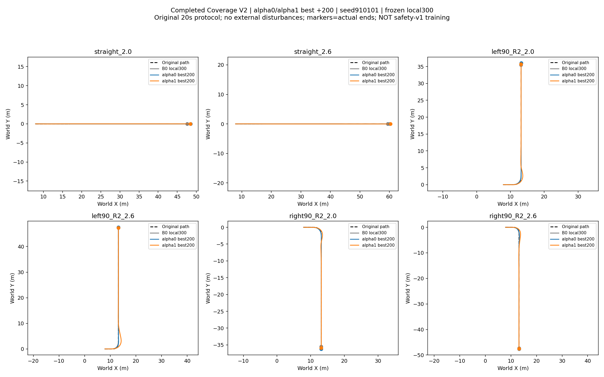

# Coverage V2 final paired analysis

Both endpoints completed +200. Selected checkpoints are update200, lowerlocal300 fixed, seed910101. These are old-reward Coverage results, not new safety-v1 training.

| Case | a0 peak roll | a1 peak roll | a0 max ey | a1 max ey | a1 >.40m seconds |
|---|---:|---:|---:|---:|---:|
| straight_2.0 | 0.0036 | 0.0085 | 0.0206 | 0.0250 | 0.000 |
| straight_2.6 | 0.0074 | 0.0103 | 0.0122 | 0.0163 | 0.000 |
| left90_R2_2.0 | 0.1657 | 0.1654 | 0.0661 | 0.5184 | 0.905 |
| left90_R2_2.6 | 0.2598 | 0.2438 | 0.0914 | 1.0892 | 2.475 |
| right90_R2_2.0 | 0.1847 | 0.1977 | 0.0915 | 0.3639 | 0.000 |
| right90_R2_2.6 | 0.2835 | 0.2986 | 0.1794 | 0.6106 | 1.310 |

All12 upper episodes: physical/domain failure0, original goal and last1s hold pass. Original task-best qualification12/12; new common corridor qualification alpha0=6/6, alpha1=3/6.

Equal .5m full-turn bin metrics are descriptive while common task is failed: left Dv=.24170m/s,Dy=.44042m; right Dv=.18205m/s,Dy=.24259m. Both directions are clear but constrained preference qualification FAILS. One trainingseed/endpoints different inherited histories; no alpha-only causal/generalization claim.

[Per-case/gate/bin/parent metrics](metrics.json)

Training length:50 newupdates/group=3276800 policytransitions, fourgroups13107200;200/group=52428800 total,4x cost. Existing parents have completed Coverage+200.50 is an incremental matched screening endpoint, not a declaration of convergence. Future extension needs a fixed shared budget and paired checkpoint/gate comparison; current design does not silently extend.
