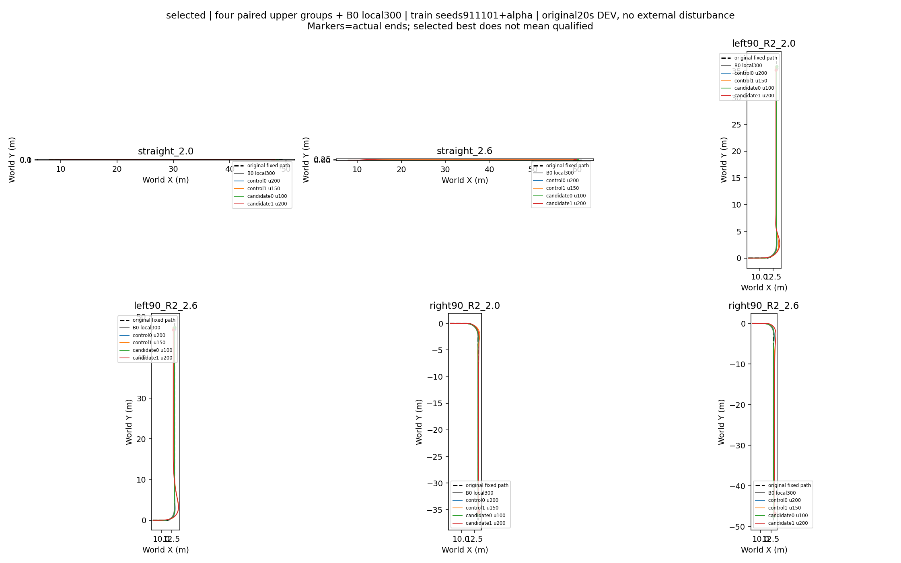

# Paired safety reward200 — completed result audit (2026-10-12)

[Same-budget200 XY](ALL_XY_last200.png). Fixed original paths, frozenlocal300 B0, all four upper groups; seed911101+alpha,20s original protocol, no external disturbance. Best only denotes evaluated lexicographic selection; unqualified candidates remain unqualified.

All four groups completed200 updates,52,428,800 policytransitions,209,715,200 training lower ticks,384,000 DEV ticks. No new simulator interaction, recovery or learner update in this audit.

## Same-budget200 gates

| Group | Qualified cases/6 | Roll failures | Corridor failures | Goal/hold failures | Primary failures | Max roll(rad) | Max path(m) |
|---|---:|---:|---:|---:|---:|---:|---:|
| control alpha0 u200 | 6 | 0 | 0 | 0 | 0 | 0.2655 | 0.1734 |
| control alpha1 u200 | 1 | 0 | 4 | 3 | 2 | 0.2796 | 1.0685 |
| candidate alpha0 u200 | 5 | 1 | 0 | 0 | 1 | 0.3172 | 0.2367 |
| candidate alpha1 u200 | 0 | 0 | 3 | 6 | 4 | 0.2817 | 1.0103 |

All24 final200 episodes physical/domain failures0 and goal crossed. That is not task success. Newalpha0 right-high roll=.317222, exceed .302 for.425s; one primary failure. Newalpha1 all six final holds fail while last1s speed errors remain <.012m/s: persistent original-path biases .111/.287m on straights, similar biases on exit.

## Selected candidates and checkpoints

| Group | Selected update | Qualified task | Roll/corridor/hold/primary failures |
|---|---:|---|---|
| control alpha0 | 200 | True | 0/0/0/0 |
| control alpha1 | 150 | False | 0/3/3/2 |
| candidate alpha0 | 100 | True | 0/0/0/0 |
| candidate alpha1 | 200 | False | 0/3/6/4 |

Controlalpha1 selected150 and candidatealpha1 selected200 because corridor severity precedes hold and primary in the frozen sort. This conforms to the declared ranking and is not qualification. Candidatealpha1 maxpath1.010263 versus initial1.089159 (-7.24%), still three corridor failures and six holds failed. Candidatealpha0 qualifies100, regresses at150/200; controlalpha0 qualifies every checkpoint and best200 primary score.447690.

## Full checkpoint history

| Group | Update | Qualified | Roll failures | Max roll excess | Corridor failures | Max corridor excess | Hold failures | Primary failures | Primary score |
|---|---:|---|---:|---:|---:|---:|---:|---:|---:|
| control alpha0 | 0 | True | 0 | 0.000000 | 0 | 0.000000 | 0 | 0 | 0.808226 |
| control alpha0 | 50 | True | 0 | 0.000000 | 0 | 0.000000 | 0 | 0 | 0.676309 |
| control alpha0 | 100 | True | 0 | 0.000000 | 0 | 0.000000 | 0 | 0 | 0.760973 |
| control alpha0 | 150 | True | 0 | 0.000000 | 0 | 0.000000 | 0 | 0 | 0.557722 |
| control alpha0 | 200 | True | 0 | 0.000000 | 0 | 0.000000 | 0 | 0 | 0.447690 |
| control alpha1 | 0 | False | 0 | 0.000000 | 3 | 0.689159 | 0 | 0 | 0.581551 |
| control alpha1 | 50 | False | 0 | 0.000000 | 3 | 0.813646 | 0 | 0 | 0.684152 |
| control alpha1 | 100 | False | 0 | 0.000000 | 3 | 0.673012 | 0 | 1 | 1.052243 |
| control alpha1 | 150 | False | 0 | 0.000000 | 3 | 0.585299 | 3 | 2 | 1.197590 |
| control alpha1 | 200 | False | 0 | 0.000000 | 4 | 0.668547 | 3 | 2 | 1.496103 |
| candidate alpha0 | 0 | True | 0 | 0.000000 | 0 | 0.000000 | 0 | 0 | 0.808226 |
| candidate alpha0 | 50 | True | 0 | 0.000000 | 0 | 0.000000 | 0 | 0 | 0.827314 |
| candidate alpha0 | 100 | True | 0 | 0.000000 | 0 | 0.000000 | 0 | 0 | 0.588340 |
| candidate alpha0 | 150 | False | 1 | 0.010703 | 0 | 0.000000 | 0 | 0 | 0.558626 |
| candidate alpha0 | 200 | False | 1 | 0.015222 | 0 | 0.000000 | 0 | 1 | 1.235808 |
| candidate alpha1 | 0 | False | 0 | 0.000000 | 3 | 0.689159 | 0 | 0 | 0.581551 |
| candidate alpha1 | 50 | False | 1 | 0.003023 | 3 | 0.891113 | 0 | 0 | 0.901688 |
| candidate alpha1 | 100 | False | 0 | 0.000000 | 3 | 0.958363 | 0 | 2 | 3.260619 |
| candidate alpha1 | 150 | False | 0 | 0.000000 | 3 | 0.822282 | 3 | 3 | 3.204270 |
| candidate alpha1 | 200 | False | 0 | 0.000000 | 3 | 0.610263 | 6 | 4 | 3.073300 |

## Per-case complete coverage

Figures contain original XY/detail, all five physical traces, substep roll peaks, original speed/path errors, actual per-step reward and cumulative reward. Reward lines use each arm/alpha own objective and matching rescored B0; cross-objective returns are not capability ranks. Detailed components and full request/corrected/final/measured chain are linked in original complete reports.

### straight_2.0

[Selected-best six-panel](straight_2.0_selected.png) · [Same-budget200 six-panel](straight_2.0_last200.png)

| Group | Selected u | Roll peak | Path peak | >.40s | Path cap s | Final hold | Last1s max path |
|---|---:|---:|---:|---:|---:|---|---:|
| control alpha0 | 200 | 0.0067 | 0.0302 | 0.000 | 0.000 | True | 0.0288 |
| control alpha1 | 150 | 0.0118 | 0.0451 | 0.000 | 0.000 | True | 0.0437 |
| candidate alpha0 | 100 | 0.0026 | 0.0285 | 0.000 | 0.000 | True | 0.0278 |
| candidate alpha1 | 200 | 0.0071 | 0.1126 | 0.000 | 0.000 | False | 0.1108 |
### straight_2.6

[Selected-best six-panel](straight_2.6_selected.png) · [Same-budget200 six-panel](straight_2.6_last200.png)

| Group | Selected u | Roll peak | Path peak | >.40s | Path cap s | Final hold | Last1s max path |
|---|---:|---:|---:|---:|---:|---|---:|
| control alpha0 | 200 | 0.0056 | 0.0349 | 0.000 | 0.000 | True | 0.0316 |
| control alpha1 | 150 | 0.0213 | 0.1286 | 0.000 | 0.000 | False | 0.1236 |
| candidate alpha0 | 100 | 0.0056 | 0.0244 | 0.000 | 0.000 | True | 0.0210 |
| candidate alpha1 | 200 | 0.0318 | 0.2910 | 0.000 | 0.000 | False | 0.2874 |
### left90_R2_2.0

[Selected-best six-panel](left90_R2_2.0_selected.png) · [Same-budget200 six-panel](left90_R2_2.0_last200.png)

| Group | Selected u | Roll peak | Path peak | >.40s | Path cap s | Final hold | Last1s max path |
|---|---:|---:|---:|---:|---:|---|---:|
| control alpha0 | 200 | 0.1506 | 0.0925 | 0.000 | 0.000 | True | 0.0278 |
| control alpha1 | 150 | 0.1761 | 0.4017 | 0.105 | 0.000 | True | 0.0446 |
| candidate alpha0 | 100 | 0.1624 | 0.0591 | 0.000 | 0.000 | True | 0.0267 |
| candidate alpha1 | 200 | 0.1684 | 0.6040 | 1.185 | 0.530 | False | 0.1122 |
### left90_R2_2.6

[Selected-best six-panel](left90_R2_2.6_selected.png) · [Same-budget200 six-panel](left90_R2_2.6_last200.png)

| Group | Selected u | Roll peak | Path peak | >.40s | Path cap s | Final hold | Last1s max path |
|---|---:|---:|---:|---:|---:|---|---:|
| control alpha0 | 200 | 0.2493 | 0.1734 | 0.000 | 0.000 | True | 0.0313 |
| control alpha1 | 150 | 0.2528 | 0.9853 | 2.305 | 0.000 | False | 0.1288 |
| candidate alpha0 | 100 | 0.2625 | 0.1233 | 0.000 | 0.000 | True | 0.0203 |
| candidate alpha1 | 200 | 0.2435 | 1.0103 | 2.275 | 1.685 | False | 0.2890 |
### right90_R2_2.0

[Selected-best six-panel](right90_R2_2.0_selected.png) · [Same-budget200 six-panel](right90_R2_2.0_last200.png)

| Group | Selected u | Roll peak | Path peak | >.40s | Path cap s | Final hold | Last1s max path |
|---|---:|---:|---:|---:|---:|---|---:|
| control alpha0 | 200 | 0.1788 | 0.0650 | 0.000 | 0.000 | True | 0.0281 |
| control alpha1 | 150 | 0.1987 | 0.3314 | 0.000 | 0.000 | True | 0.0452 |
| candidate alpha0 | 100 | 0.1863 | 0.0735 | 0.000 | 0.000 | True | 0.0271 |
| candidate alpha1 | 200 | 0.1838 | 0.1908 | 0.000 | 0.000 | False | 0.1105 |
### right90_R2_2.6

[Selected-best six-panel](right90_R2_2.6_selected.png) · [Same-budget200 six-panel](right90_R2_2.6_last200.png)

| Group | Selected u | Roll peak | Path peak | >.40s | Path cap s | Final hold | Last1s max path |
|---|---:|---:|---:|---:|---:|---|---:|
| control alpha0 | 200 | 0.2655 | 0.1670 | 0.000 | 0.000 | True | 0.0317 |
| control alpha1 | 150 | 0.2982 | 0.5894 | 1.530 | 0.000 | False | 0.1234 |
| candidate alpha0 | 100 | 0.2939 | 0.1324 | 0.000 | 0.000 | True | 0.0196 |
| candidate alpha1 | 200 | 0.2817 | 0.5755 | 1.780 | 0.235 | False | 0.2878 |

## Preference and limits

Both pairs fail common task qualification, so no bounded-preference pass. Full-turn .5m bins cover the complete original turn for both endpoints. Selected candidate descriptive Dv/Dy: left .256213m/s/.380487m, right .109283m/s/.283001m. At aligned200 candidate right Dv=.012389m/s<.03; left Dv=.383741. This is descriptive failure evidence, not an independently qualified preference or multi-seed result.

## Cost audit and hypothesis

All120 checkpoint traces independently reconstruct tick rewards; maximum absolute tick difference1.039e-7. All ten component costs checked, max absolute difference.0001944. One working_roll sample at peak.300027728 differs by.00017904 between float64 reference and loggedfloat32 because .30 representation; explicit float32 formula reproduces log exactly. No formula/wiring discrepancy found within these checks.

Path component cap200 was preserved as declared. Newalpha1 highleft u200 path is capped for1.685s, lowleft .530s, highright .235s. The corridor penalty alone reaches200 at|ey|=.70m, so beyond.70 total path cost is guaranteed capped; heading and original path term can cause earlier saturation. Total per-tick path cost then cannot distinguish larger excesses. This is a supported reward-design concern, not proven sole cause of PPO degradation.

Training domain failure counts (episodes/events, not percentages): control0=13/control1=254, candidate0=58/candidate1=1319; physical failures0 for all. Candidate0 rejected one PPO update and actor LR halved to5e-5, versus1e-4 control. Both have the same sampling budget; accepted optimization counts can differ. Path cap counts lower ticks: control0=23304/control1=2232851, candidate0=142934/candidate1=5709980. Training episodes were not individually rescored in this audit; these counts are actual logged evidence.

## Recovery and next decision

Natural overlimit paired recovery remains NOT_RUN; no complete takeover qualification may be claimed. Normal-task failure is already sufficient to reject adoption. Do not automatically add updates beyond200. Retain all candidates and counterexamples. Suggested next work is zero-interaction cap/terminal-path-bias audit, then a separately declared minimal reward repair comparison if authorized; do not redesign lower or continuous-alpha architecture on this evidence.

## Evidence and reproducibility

[Raw calculated metrics, gates, training counters and identities](metrics.json) · [Offline source](analyze.py). Reproduce with PYTHONPATH=learning/src JAX_PLATFORMS=cpu /home/qy/mujoco_playground/.venv/bin/python docs/evidence/path_safety_preference_v1/paired200_analysis/analyze.py; originals referenced, no NPZ or weights copied.

[control original full reward/command-chain report](/home/qy/STTW_CONTROL/runs/worktrees/path-safety-budget-200/runs/path_safety_control_200_20261011/report/INDEX.md)
[candidate original full reward/command-chain report](/home/qy/STTW_CONTROL/runs/worktrees/path-safety-budget-200/runs/path_safety_candidate_200_20261011/report/INDEX.md)

Signed chain note: final_command contains actuator front steer-angle rate and rear wheel-axis rate (rad/s), NOT corrected speed/steer references. Those references are governed[v,delta]. Newalpha1 straight exit has persistent positive delta correction ~.0515rad at2.0m/s/~.0763rad at2.6m/s, canceling nominal PP path correction; governed steer approaches0 while actual speed tracks. This supports an upper correction equilibrium bias concern, not a proved lower-controller failure.

[Completion and current TensorBoard step200 visibility receipt](visibility.json). Both200 arm pipelines completed; stage/pipeline watcher completed notification receipts are retained in original run directories.
