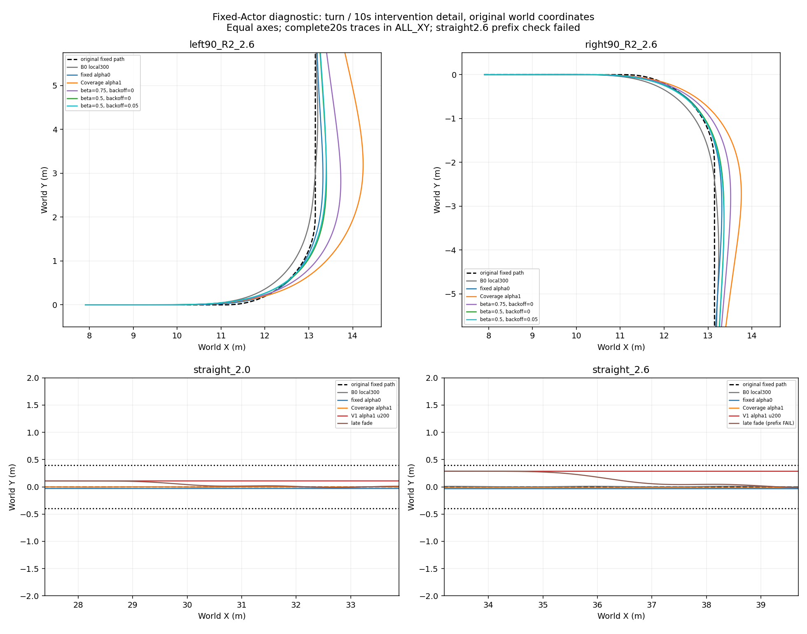

# STTW 当前代码与精简重要结果 — 2026-10-12

[最新完整20秒XY](diagnostic/ALL_XY.png) · [Coverage父代六场景XY](../path_safety_preference_v1/coverage_final_analysis/ALL_XY.png) · [四组同预算200轮XY](../path_safety_preference_v1/paired200_analysis/ALL_XY_last200.png)

本目录是远端发布入口；复用已有PNG和汇总JSON，不复制模型、完整NPZ、缓存或归档。原始轨迹及权重留在服务器；这是可检查的精简结果，不是自包含训练复现包。

## 方法与当前状态

原始固定路径/速度请求 → 路径外环 → 独立上层Actor的Δv/Δδ → 原滤波与slew → 冻结local300＋ECBC/ESO → 执行器。两端α0保路径、α1保速度；共同物理、权限、工作滚转及路径边界不随α放宽。当前仍是独立端点，未验证连续α单网。

- Coverage父代：两端将高速左/右弯B0峰值.327514/.324930rad压到α0 .259799/.283519、α1 .243791/.298563。速度—路径取舍已出现；α1原有六场景最终保持通过，但三场景路径超.40m。
- 四组各200轮：旧奖励α0最终6/6合格；新α0第100轮6/6、第200轮5/6；旧α1第200轮1/6，新α1第200轮0/6。新α1有三路径边界失败、六最终保持失败，不能按reward或存活宣称成功。
- 最新八回合固定Actor诊断：八条完整20s轨迹，32000底层ticks、0 PPO更新。静态缩放改善路径但推高滚转，无共同设定通过两高速弯安全/路径支持条件；两直道淡出后航向保持失败。
- 高速直道前缀数值核验FAIL：转角差2.3832e-5rad超过预声明2e-6；保留execution error，分析完成单独记录。后续B/C修补训练与自然超限恢复未启动。

## 结果与代码入口

| 内容 | 入口 |
|---|---|
| 父代六场景、α0/α1及B0 | [Coverage报告](../path_safety_preference_v1/coverage_final_analysis/INDEX.md) |
| 四组200轮、全部检查点及selected/last区别 | [配对200报告](../path_safety_preference_v1/paired200_analysis/INDEX.md) |
| 八回合干预、奖励/误差/命令链/真实速度与轮速估计 | [诊断报告](diagnostic/INDEX.md) |
| 接口、奖励公式、初始化、预算与条件修补计划 | [方法和计划](../../path_safety_preference.md) |
| 当前源模块 | [learning/src/sttw_control](../../../learning/src/sttw_control) |
| 相关测试 | [learning/tests](../../../learning/tests) |
| 来源、checkpoint/Actor/config/bank身份与执行记账 | [来源JSON](publication_provenance.json) |
| 文件大小与SHA256清单 | [文件清单](publication_manifest.json) |

已有方法、失败和原始记录全部保留。当前正常任务要求roll≤.302rad、|ey|≤.40m、末1s逐步|ev|≤.10m/s、|ey|≤.10m、|eψ|≤.05rad；困难需求区α0路径RMSE≤.10m、α1速度RMSE≤.05m/s。完整偏好和真实超限恢复另验收，当前未全部通过。

## 门槛复核与后续边界

最终保持已被父代证明可达；α1全部联合条件的可行性尚未证明。静态缩放失败不证明状态相关PPO不能学会，也不证明尚未执行的提高cap/父Actor保持方案失败。静态干预先通过才允许训练的推进条件，以及跨物理量统一2e-6的工程容差，应单独评审；现有FAIL不追溯改判，当前不放宽验收或启动训练。

后续依次定位前缀数值差、评审α1联合可行性和启动条件、再预声明保护父代能力的定向学习验证。共享台账是实时事实唯一入口；本页为发布快照。
