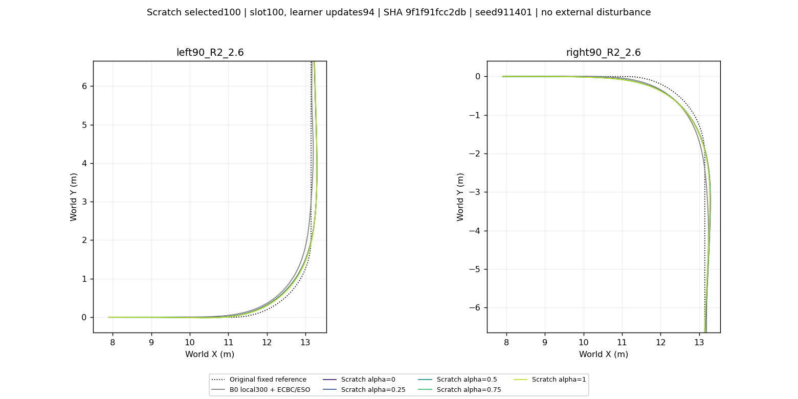

# Scratch selected100

Scratch selected100 | slot100, learner updates94 | SHA 9f1f91fcc2db. One checkpoint only; five alpha values, original reference and matching B0. All 30 traces last 20 s, with no physical/domain failure. Circles mark real final samples; no external disturbance. Reward baseline is rescored separately for each alpha; returns across alpha are not physical rankings.

[All six XY](ALL_XY.png)

- straight_2.0: [XY](straight_2.0_XY.png) · [physical](straight_2.0_physical.png) · [reward](straight_2.0_reward.png) · [components](straight_2.0_components.png) · [command_chain](straight_2.0_command_chain.png)
- straight_2.6: [XY](straight_2.6_XY.png) · [physical](straight_2.6_physical.png) · [reward](straight_2.6_reward.png) · [components](straight_2.6_components.png) · [command_chain](straight_2.6_command_chain.png)
- left90_R2_2.0: [XY](left90_R2_2.0_XY.png) · [physical](left90_R2_2.0_physical.png) · [reward](left90_R2_2.0_reward.png) · [components](left90_R2_2.0_components.png) · [command_chain](left90_R2_2.0_command_chain.png)
- left90_R2_2.6: [XY](left90_R2_2.6_XY.png) · [physical](left90_R2_2.6_physical.png) · [reward](left90_R2_2.6_reward.png) · [components](left90_R2_2.6_components.png) · [command_chain](left90_R2_2.6_command_chain.png)
- right90_R2_2.0: [XY](right90_R2_2.0_XY.png) · [physical](right90_R2_2.0_physical.png) · [reward](right90_R2_2.0_reward.png) · [components](right90_R2_2.0_components.png) · [command_chain](right90_R2_2.0_command_chain.png)
- right90_R2_2.6: [XY](right90_R2_2.6_XY.png) · [physical](right90_R2_2.6_physical.png) · [reward](right90_R2_2.6_reward.png) · [components](right90_R2_2.6_components.png) · [command_chain](right90_R2_2.6_command_chain.png)
