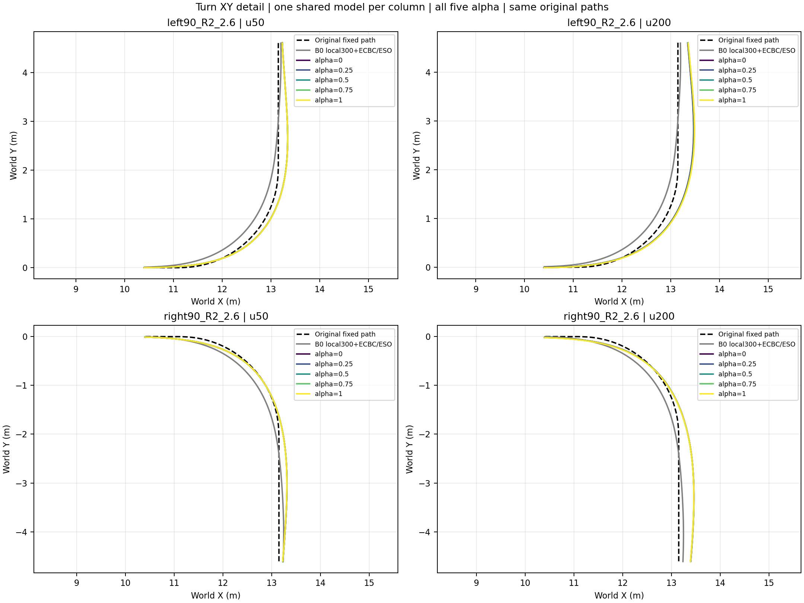
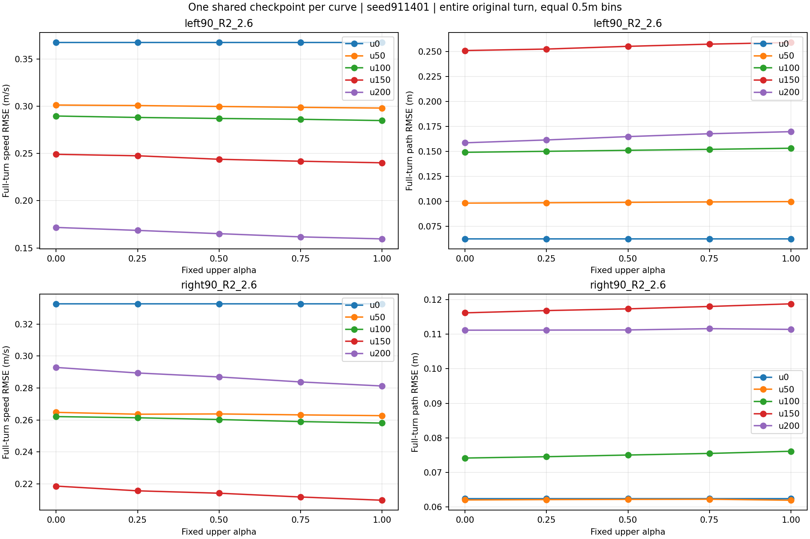
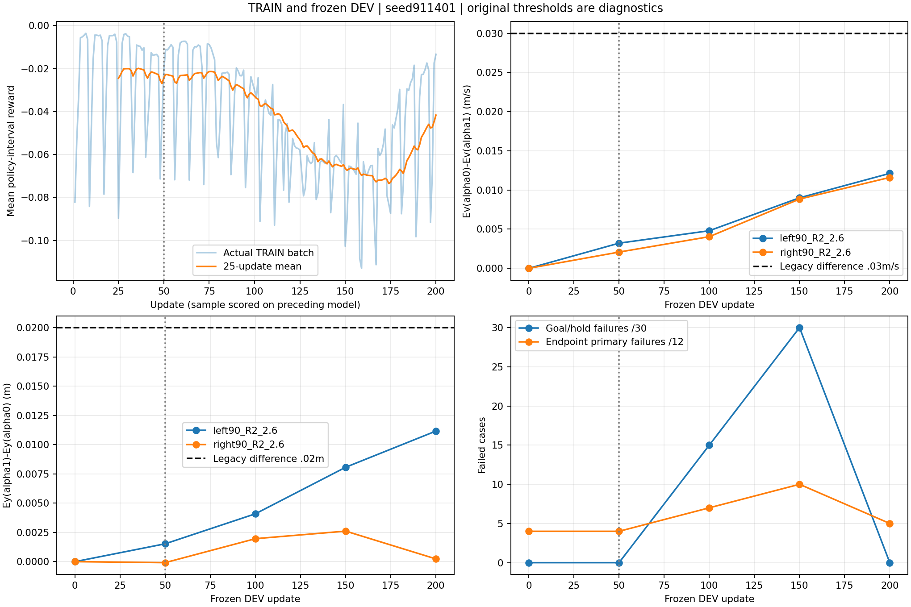

# 统一连续α上层：200轮结果分析（2026-10-14）

[选中u50全部六场景五α XY](../../../runs/path_unified_alpha_200_20261013/training/report/ALL_XY.png) · [u200全部六场景五α XY](U200_XY.png) · [u200每步总奖励](U200_STEP_REWARD.png) · [u200累计总奖励](U200_CUMULATIVE_REWARD.png) · [u50完整误差/奖励分项/命令链](../../../runs/path_unified_alpha_200_20261013/training/report/INDEX.md)

结论：**单网直接PPO已经学出弱α响应，第200轮比第50轮更明显；尚未形成足够强且左右一致的速度—路径偏好。** 所选u50保留共同跟踪；u200更适合作为后续偏好研究候选，同时保留u50。当前问题不能仅归因于滚转/走廊门槛：这两个候选的全部30条件均无滚转或走廊超限，α1却仍明显减速。

## 冻结身份与实际预算

单Actor351/Critic352、seed911401、α0 Actor热启动，无蒸馏；奖励path_safety_preference_v1。200/200采样更新，199批有接受的优化epoch，update186整批hard-KL拒绝，训练继续至原声明预算。训练13,107,200策略转移、52,428,800lower ticks；DEV0/50/100/150/200各30回合，共150回合/600,000ticks。工程128转移/512ticks另计，不作为父代。正式训练物理失败0、路径域结束1、工程错误0；不把0物理失败当作任务合格。

正式启动2026-10-13 19:22:33，完成2026-10-14 01:11:33（北京时间），总5.817小时；采样2.262小时，优化15.0秒，DEV3.531小时。DEV约占总时间61%；下次可研究将同路径形状的不同α一起vmap，而非逐α串行，需先验证同轨迹数值，不改变物理或样本预算。当前耗时不是训练收敛证据。

- 按声明共同排序选中u50：checkpoint SHA `f57c2caee072c952ebc274934ffad96188bf2049e94fdfdd27ee4ae241939eec`。
- 最后保存u200：checkpoint SHA `08df91a0f9d6bab88a77e28d9a6d265a1af0daf877183e8c4a2aabf92044f87d`。
- 原best指针保持u50，不把u200改写成已选best；每个候选的五α均来自同一checkpoint。
- TensorBoard6013本次HTTP实查当前run目录，train/mean_step_reward完整200点，末update200=-0.0133771。

## 五次DEV的完整结果

每次均为六场景×五α=30条件、完整20秒，无外部扰动。所有五次DEV物理/路径域失败均0，目标截面均完成，滚转超限均0。主目标失败只对0/1端点共12条件计算，中间α不套α1门槛。

| 更新 | 最后1秒保持通过 /30 | 路径超0.40m /30 | 端点主目标失败 /12 | 最大滚转 rad | 最大路径偏差 m |
|---|---:|---:|---:|---:|---:|
| 0 | 30 | 0 | 4 | 0.26546 | 0.17342 |
| 50（选中） | 30 | 0 | 4 | 0.27940 | 0.19290 |
| 100 | 15 | 0 | 7 | 0.28779 | 0.31462 |
| 150 | 0 | 5 | 10 | 0.27770 | 0.47690 |
| 200（最后） | 30 | 0 | 5 | 0.29329 | 0.34100 |

100/150轮发生真实末段跟踪退化，200轮恢复。200轮共同轨迹要求通过，但α0高速左弯需求区路径RMSE0.12890m仍超过旧0.10m主目标；α1四个弯道需求区速度RMSE分别0.08275/0.18307/0.14856/0.31974m/s，均超过旧0.05m/s主目标。这里保留旧协议诊断，不把门槛未过当作停止推进的理由，也不因此修改物理终止。

## 偏好方向与幅度

下面速度/路径RMSE均覆盖**完整原弯段**，固定0.5m空间分箱，逐箱MSE等权后开方；全程20秒RMSE不能替代弯段RMSE，χ>0需求区也与该窗口不同。全部100条弯道轨迹的空间箱完整，无删共同片段。Dv=Ev(α0)−Ev(α1)，Dy=Ey(α1)−Ey(α0)。

| 候选/高速弯 | Ev α0→α1 m/s | Ey α0→α1 m | Dv m/s | Dy m |
|---|---:|---:|---:|---:|
| u50 左 | 0.30130→0.29809 | 0.09822→0.09974 | 0.00321 | 0.00153 |
| u50 右 | 0.26475→0.26268 | 0.06201→0.06192 | 0.00207 | −0.00008 |
| u200 左 | 0.17168→0.15957 | 0.15863→0.16979 | 0.01212 | 0.01116 |
| u200 右 | 0.29283→0.28123 | 0.11118→0.11141 | 0.01160 | 0.00023 |

u200的α从0到1时，两侧保速误差均逐级减小；左弯路径误差逐级增加，取舍方向清楚。右弯路径曲线几乎水平，0.23mm端点RMSE差不足以称为有意义的路径让步。u50右弯还存在小幅非单调/反向路径变化。Dv仍不到旧预声明0.03m/s差值，左Dy约为旧0.02m要求的一半，右远未达到。不是完全不吃α，也还不是已经形成实用的连续偏好。

相对初始α0行为，训练在改变共同行为：左弯u200两端都更保速度并放大路径误差，右弯却从u150回退到更大减速。跨更新的共同改变大于同一模型内α端点改变；不能把“训练后保速更好”全部算成“α更可控”。

## 选模、控制链与训练信号

u50和u200共同门槛均通过，字典序下一项比较端点主目标失败数：4与5，所以u50胜出。u200平均加权归一化误差1.70689低于u50的1.95477，但连续误差排名靠后，无法覆盖新增一个α0高速左弯失败。这是声明排序的真实结果。应同时展示共同任务best和最后候选的偏好曲线，保留原best身份，不用一个best报告替代整个200轮历程。

实际弯段修正也支持弱α响应：u200左弯平均Δv为−0.08401→−0.06874m/s，右弯−0.23803→−0.22367m/s；α1减速更少，但两端依然减速，尤其右弯。首层α列L2从初始化0增长到u50的0.04422、u200的0.12261，不能归因于α没有接入或权重始终冻结。权重范数不等于真实同状态作用；同一闭环状态的α反事实扫描尚未执行，不能伪造真实观测。

采样统计中χ>0约占9.2%–11.4%，强需求χ≥0.5约占8.4%–10.5%，高于已声明5%下限；端点与中间α均有真实采样。大多数样本χ=0时速度/路径系数与α无关。未超过.302rad只能说明验收边界没有触发失败，不能排除.26rad起罚和趋势成本对减速行为的影响；若要判断安全成本是否抑制保速，需要单独消融，不能把本次观察当作因果证明。因此“差异信号占比小、共同跟踪更新占主导，α0热启动强化了共同减速行为”是有数据动机的**待验证解释**，尚不能据此断言单一原因。训练25轮窗口reward在1–25/26–50约−0.0245/−0.0242，126–150退化至−0.0665，176–200约−0.0417；末批−0.0134不能替代整个末窗口或固定DEV。

## 后续建议（未执行，不新增训练授权）

1. 同时保护u50和u200；优先以u200研究如何增强α响应，以u50作为共同跟踪对照，暂不改旧best或重新训练底层。
2. 下一固定α阶段先诊断真实决策观测上的α扫描及按α/χ分组的Actor梯度；保存少量真实351维决策观测，零物理推理扫描可区分“Actor不敏感”与“底层把差异压小”。再以有界配对试验检验增加冲突区有效样本、端点权重能否放大差异，奖励保持当前版本，不用双教师或模仿损失。只延长轮数不能区分这些解释。
3. 左右分别检查同状态动作、原请求→修正参考→最终命令→运动，不依靠左右平均掩盖右弯薄弱；固定α偏好更清楚后再做独立预算的0→1/1→0平滑切换。当前未执行动态α或超限状态恢复，六场景结果不证明实时切换或多seed泛化。

本次仅复用磁盘数据，**0新增训练/0新增物理步**。[原始数值与候选全覆盖](metrics.json) · [可复现分析程序](analyze.py)。核验150条轨迹/600,000lower ticks，原路径/α/时间/失败标记、checkpoint与Actor身份一致；十项奖励NumPy重建最大逐步误差3.1226e−8。PNG不替代原NPZ，原NPZ留在冻结run。
