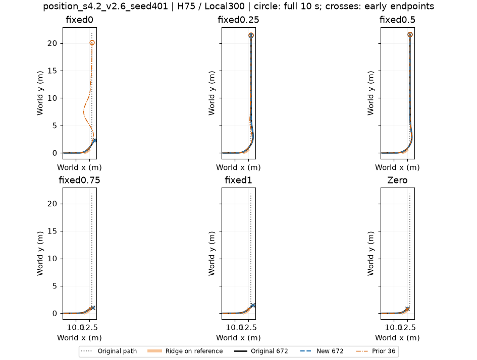

# 完整 672 环境回放

## 配对实际与原始参考 XY

每格覆盖同一物理组的五档 H75 及 Zero。重叠工况另叠加先前 36 环境回放。圆点为满窗，叉号为真实终止。

|布局|401|402|403|404|405|406|407|408|
|---|---|---|---|---|---|---|---|---|
|position_s3.3|[XY](figures/position_s3.3_v2.6_seed401.png)|[XY](figures/position_s3.3_v2.6_seed402.png)|[XY](figures/position_s3.3_v2.6_seed403.png)|[XY](figures/position_s3.3_v2.6_seed404.png)|[XY](figures/position_s3.3_v2.6_seed405.png)|[XY](figures/position_s3.3_v2.6_seed406.png)|[XY](figures/position_s3.3_v2.6_seed407.png)|[XY](figures/position_s3.3_v2.6_seed408.png)|
|position_s3.45|[XY](figures/position_s3.45_v2.6_seed401.png)|[XY](figures/position_s3.45_v2.6_seed402.png)|[XY](figures/position_s3.45_v2.6_seed403.png)|[XY](figures/position_s3.45_v2.6_seed404.png)|[XY](figures/position_s3.45_v2.6_seed405.png)|[XY](figures/position_s3.45_v2.6_seed406.png)|[XY](figures/position_s3.45_v2.6_seed407.png)|[XY](figures/position_s3.45_v2.6_seed408.png)|
|position_s3.6|[XY](figures/position_s3.6_v2.6_seed401.png)|[XY](figures/position_s3.6_v2.6_seed402.png)|[XY](figures/position_s3.6_v2.6_seed403.png)|[XY](figures/position_s3.6_v2.6_seed404.png)|[XY](figures/position_s3.6_v2.6_seed405.png)|[XY](figures/position_s3.6_v2.6_seed406.png)|[XY](figures/position_s3.6_v2.6_seed407.png)|[XY](figures/position_s3.6_v2.6_seed408.png)|
|position_s3.75|[XY](figures/position_s3.75_v2.6_seed401.png)|[XY](figures/position_s3.75_v2.6_seed402.png)|[XY](figures/position_s3.75_v2.6_seed403.png)|[XY](figures/position_s3.75_v2.6_seed404.png)|[XY](figures/position_s3.75_v2.6_seed405.png)|[XY](figures/position_s3.75_v2.6_seed406.png)|[XY](figures/position_s3.75_v2.6_seed407.png)|[XY](figures/position_s3.75_v2.6_seed408.png)|
|position_s3.9|[XY](figures/position_s3.9_v2.6_seed401.png)|[XY](figures/position_s3.9_v2.6_seed402.png)|[XY](figures/position_s3.9_v2.6_seed403.png)|[XY](figures/position_s3.9_v2.6_seed404.png)|[XY](figures/position_s3.9_v2.6_seed405.png)|[XY](figures/position_s3.9_v2.6_seed406.png)|[XY](figures/position_s3.9_v2.6_seed407.png)|[XY](figures/position_s3.9_v2.6_seed408.png)|
|position_s4.05|[XY](figures/position_s4.05_v2.6_seed401.png)|[XY](figures/position_s4.05_v2.6_seed402.png)|[XY](figures/position_s4.05_v2.6_seed403.png)|[XY](figures/position_s4.05_v2.6_seed404.png)|[XY](figures/position_s4.05_v2.6_seed405.png)|[XY](figures/position_s4.05_v2.6_seed406.png)|[XY](figures/position_s4.05_v2.6_seed407.png)|[XY](figures/position_s4.05_v2.6_seed408.png)|
|position_s4.2|[XY](figures/position_s4.2_v2.6_seed401.png)|[XY](figures/position_s4.2_v2.6_seed402.png)|[XY](figures/position_s4.2_v2.6_seed403.png)|[XY](figures/position_s4.2_v2.6_seed404.png)|[XY](figures/position_s4.2_v2.6_seed405.png)|[XY](figures/position_s4.2_v2.6_seed406.png)|[XY](figures/position_s4.2_v2.6_seed407.png)|[XY](figures/position_s4.2_v2.6_seed408.png)|
|position_s4.35|[XY](figures/position_s4.35_v2.6_seed401.png)|[XY](figures/position_s4.35_v2.6_seed402.png)|[XY](figures/position_s4.35_v2.6_seed403.png)|[XY](figures/position_s4.35_v2.6_seed404.png)|[XY](figures/position_s4.35_v2.6_seed405.png)|[XY](figures/position_s4.35_v2.6_seed406.png)|[XY](figures/position_s4.35_v2.6_seed407.png)|[XY](figures/position_s4.35_v2.6_seed408.png)|
|position_s4.5|[XY](figures/position_s4.5_v2.6_seed401.png)|[XY](figures/position_s4.5_v2.6_seed402.png)|[XY](figures/position_s4.5_v2.6_seed403.png)|[XY](figures/position_s4.5_v2.6_seed404.png)|[XY](figures/position_s4.5_v2.6_seed405.png)|[XY](figures/position_s4.5_v2.6_seed406.png)|[XY](figures/position_s4.5_v2.6_seed407.png)|[XY](figures/position_s4.5_v2.6_seed408.png)|
|position_s4.65|[XY](figures/position_s4.65_v2.6_seed401.png)|[XY](figures/position_s4.65_v2.6_seed402.png)|[XY](figures/position_s4.65_v2.6_seed403.png)|[XY](figures/position_s4.65_v2.6_seed404.png)|[XY](figures/position_s4.65_v2.6_seed405.png)|[XY](figures/position_s4.65_v2.6_seed406.png)|[XY](figures/position_s4.65_v2.6_seed407.png)|[XY](figures/position_s4.65_v2.6_seed408.png)|
|position_s4.8|[XY](figures/position_s4.8_v2.6_seed401.png)|[XY](figures/position_s4.8_v2.6_seed402.png)|[XY](figures/position_s4.8_v2.6_seed403.png)|[XY](figures/position_s4.8_v2.6_seed404.png)|[XY](figures/position_s4.8_v2.6_seed405.png)|[XY](figures/position_s4.8_v2.6_seed406.png)|[XY](figures/position_s4.8_v2.6_seed407.png)|[XY](figures/position_s4.8_v2.6_seed408.png)|
|position_s4.95|[XY](figures/position_s4.95_v2.6_seed401.png)|[XY](figures/position_s4.95_v2.6_seed402.png)|[XY](figures/position_s4.95_v2.6_seed403.png)|[XY](figures/position_s4.95_v2.6_seed404.png)|[XY](figures/position_s4.95_v2.6_seed405.png)|[XY](figures/position_s4.95_v2.6_seed406.png)|[XY](figures/position_s4.95_v2.6_seed407.png)|[XY](figures/position_s4.95_v2.6_seed408.png)|
|position_s5.1|[XY](figures/position_s5.1_v2.6_seed401.png)|[XY](figures/position_s5.1_v2.6_seed402.png)|[XY](figures/position_s5.1_v2.6_seed403.png)|[XY](figures/position_s5.1_v2.6_seed404.png)|[XY](figures/position_s5.1_v2.6_seed405.png)|[XY](figures/position_s5.1_v2.6_seed406.png)|[XY](figures/position_s5.1_v2.6_seed407.png)|[XY](figures/position_s5.1_v2.6_seed408.png)|
|flat_original|[XY](figures/flat_original_v2.6_seed401.png)|[XY](figures/flat_original_v2.6_seed402.png)|[XY](figures/flat_original_v2.6_seed403.png)|[XY](figures/flat_original_v2.6_seed404.png)|[XY](figures/flat_original_v2.6_seed405.png)|[XY](figures/flat_original_v2.6_seed406.png)|[XY](figures/flat_original_v2.6_seed407.png)|[XY](figures/flat_original_v2.6_seed408.png)|

## 判定

**原车道、顺序及场景规模恢复后，这一次完整回放复现了被检验的原档轨迹。**

|比较（左为本行数据 A）|n|XY 逐位同|XY 容差内|终止时刻同|终止类型同|全部满足|满窗 A/B，翻转|保持 A/B，翻转|任务 C A/B，翻转|
|---|---:|---:|---:|---:|---:|---:|---:|---:|---:|
|new672_vs_original672|672|672|672|672|672|672|264/264，0|224/224，0|59/59，0|
|prior36_vs_new672|36|0|0|21|31|0|21/20，1|19/17，2|13/13，2|
|prior36_vs_original672|36|0|0|21|31|0|21/20，1|19/17，2|13/13，2|
|overlap_new672_vs_original672|36|36|36|36|36|36|20/20，0|17/17，0|13/13，0|

原档代码 4331f821，本次代码 3d90f818；原档与本次均使用 672 个物理环境与 14 个地形资源。位置、车道顺序、固定物理组、延迟、测得材料与质量、求解设置和完整解析配置的差异见 [合同核验](identity.json)。每个对照逐项比较全部有效 200 Hz XY，采用 1e-8 m + 1e-5 × 对照坐标绝对值的容差；每个观测物理 tick 和终止原因需相同。

672 对覆盖 14 个布局、8 个已用物理组及 6 条固定策略。最后一行是第一行的 36 对子集。先前两次 36 环境重复的被记录数组逐位一致，表中统一用第一次做配对。

## 首个样点与差异出现次序

每个控制周期 5 ms，XY 使用原有去车道平移的世界坐标。下表统计第一个已记录样点出现数值差异的车道。各字段使用自身原始单位，200 Hz 记录不能判定同一周期内哪个物理子步最先产生差异。

|输出量|新 672 / 原 672（每组 672）|先前 36 / 新 672（每组 36）|先前 36 / 原 672（每组 36）|
|---|---:|---:|---:|
|nominal|0|0|0|
|target|0|25|25|
|filtered|0|25|25|
|offsets|0|25|25|
|lower_residual|0|30|30|
|final_command|0|28|28|
|measurement|0|28|28|
|body_state|0|28|28|
|contact_force|0|6|6|
|pose|0|0|0|
|xy|0|0|0|
|progress|0|0|0|
|controller_output|0|36|36|
|controller_gains|0|36|36|

先前 36 环境与原档有 36 条超过回放门槛，其中恢复完整批次后满足门槛的为 36 条。这一配对检验改变了全局环境数、车道排列和地形资源集合。整批规模与任一特定求解或网络计算因素的作用不能在本次数据中拆分。 [36 个工况的三方逐条对照](three_way_overlap.csv)

最初物理状态的身份由保存的初态文件、运行合同和逐车道回读核对；第一个记录点已执行了一个控制周期。不同批次结果可以定位到已记录信号首次不同的位置，归因到单一 GPU 内核或接触事件还需要该层的证据。

[每个车道、真实终止时刻和类型、C10 / 保持 / C、XY 最大误差](lane_comparisons.csv) · [按布局与档位汇总](layout_alpha.csv) · [逐车道逐信号的首差](early_signals.csv) · [首次差异统计](early_summary.csv) · [运行身份与排序](identity.json)

[完整场景的实际墙钟时间与采样用时](timing.json)

## 复验身份与原始记录

[预登记](registration.json) · [批次生成核对](preflight.json) · [冻结模型与输入哈希](frozen_identity.json) · [原始输入配置](original_config.json) · [112 例与车道顺序](cases.json) · [分析结果](summary.json) · [运行用时](timing.json) · [实际运行的复验脚本](replay.py) · [证据包校验](SHA256SUMS)

逐车道比较表中的 source_a、source_b 为两份原始轨迹目录，各目录的 trajectory.npz 与 contract.json 分别保存原始时序与运行配置。672 条为本次新增回放，重叠的 36 条用于与前一批配对。该批次没有训练更新。报告和全部 XY 可直接离线阅读。重新执行原版 replay.py 需要本机原 OAT 归档、冻结资产、工作树及 Isaac Lab 环境。

直接读取新旧轨迹文件比对，112/112 份 trajectory.npz 全文件逐字节相同；其中的 5824/5824 份数组文件逐字节相同。不同字段若存在列入逐例表。 [轨迹文件及逐字段核对](archive_files.csv)

[首个物理子步前的小批与原档控制量对照，含逐车道原值及单位](first_policy_step.md)
