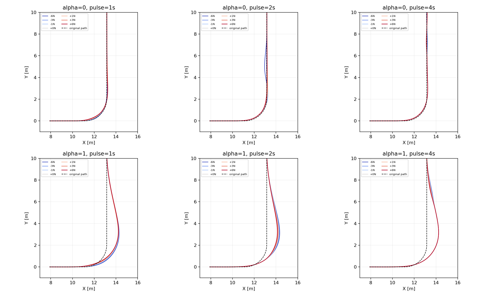
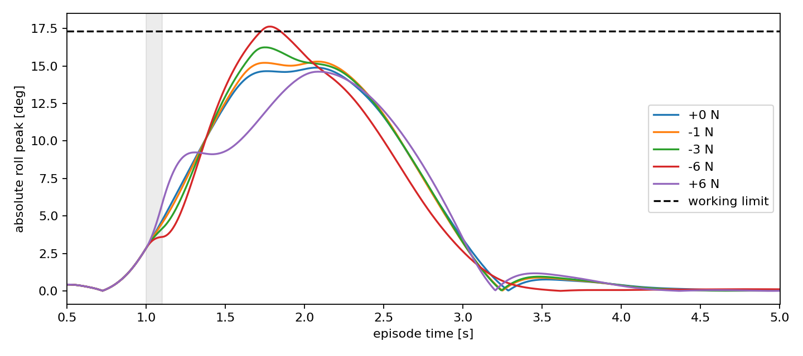

# 首轮完成审计与下一步（2026-10-22）

42/42完成，168000/168000面板底层步；没有训练。6个零扰动基线均通过，受扰轨迹35/36通过。无物理摔倒、域失败或终端恢复失败；唯一不通过是alpha0、t=1s、向右6N持续0.1s，子步峰值侧倾0.3076006rad（17.624°），超过共同工作上限0.302rad（约17.304°）。首次越限约1.725s，有25个5ms记录含越限，不能把这0.125s采样窗口占用量当作精确连续越限时间。仍完成目标与末1s保持。

原完整XY图已视觉审阅，因20秒直线尾段过长压缩了弯道差异，新增局部图保留同一原路径、不修改数据。

## 已执行的下一步：闭环小幅响应代理审计

从同一真实快照的0和±1N轨迹，按方向计算约束响应割线；约束包括全程工作侧倾及末1s速度/横向/航向带。用这条割线外推±3、±6N，没有使用这些幅值拟合。24点判断为TP=1、TN=23、FP=0、FN=0。只有一个失败、六个重复开发状态，不能解释成泛化准确率或安全保证；该代理不是无穷小导数，也没有验证动力学UCEDT优越性。

唯一已见失败方向预测阈值4.721686N，落在已测3N通过、6N失败之间。其余11个方向全部通过至6N，边界仍未测到；外推得到的更大牛顿数不作为可信能力报告。

## 本轮后续范围

仅alpha0/t=1s，同一已有完整快照；原路径、2.6m/s、0.1s脉冲、20s截止和末1s标准不变。新幅值0、向右0.25/0.5/4/4.5/5/5.5N，共7条；从t=1s起接续，最多26600新面板底层步，另8步零力检查。原前缀复用不计为新交互，匹配快照身份。事先固定4.721686N预测，检验新幅值和小扰动尺度一致性；不二分、不自动扩幅、不训练。须先确认零力接续与既有基线在相同任务标准下合格，完整记录数值差异。

若预测不准，报告反例并检查非线性/约束切换；若局部预测有效，再考虑不同路径/方向/速度的独立留出检验，而不是直接宣称可用于训练。
