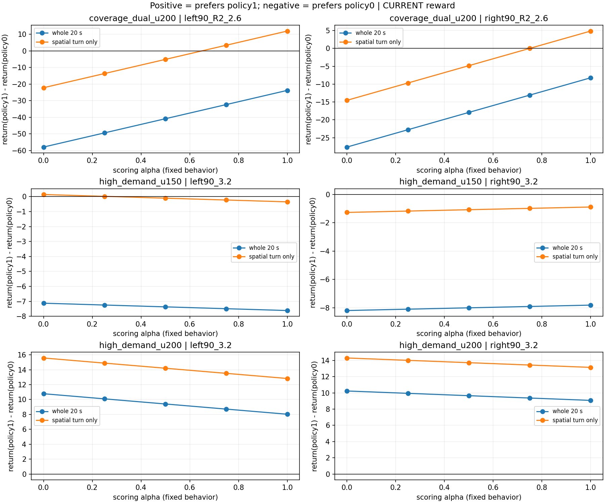

# 当前奖励函数离线偏好验证

**结论：当前奖励存在局部的速度—路径偏好，但对已知历史保速轨迹，整回合并未形成两端相反的排序。主要反例是出弯恢复代价抵消弯内保速收益；不能把问题一概归因于侧倾惩罚，也不能据此断言奖励无效。**

## 范围与核验

仅CPU重评分，无训练、无新仿真、无Actor反事实闭环。历史Coverage双网u200、当前HighDemand best150和last200分开；每组6场景，分别3/6/6个方法（含匹配local300 B0），共90条实际轨迹，五个评分α，共450次重评分。历史数据角色为已用开发诊断，不是独立holdout。路径逐方法核对一致；冻结底层Actor manifest身份与时序/terminal_contract_v2相同，未重新扫描SHA。不同数据组不直接比较回报。

当前奖励为实际manifest中的原Coverage公式（reward_version字段缺省），roll/work权重80/240、cap1800/6000、failure bound8980.2；与旧配置其余奖励参数相同。每条固定行为分别代入0/.25/.5/.75/1，先计算含α代价再限顶，不混合端点最终奖励。变化率按完整20ms边界重建，5ms积分，保留失败区间替换尾罚。

以各原配置/原α核对90条日志：正常步最大误差4.5e-07。失败尾罚float64重算对日志最大绝对差0.01555，来自γ幂的float32表示；按运行时精度独立复算最大差0.000488。不修改原日志，不把精度差冒称奖励定义错误。主要策略比较均完整20s、无失败，不受尾罚精度影响。

报告主分数为实际20s累计奖励；另保存按PPO γ=.997每20ms、从reset开始的折扣回报，两者所有端点排序方向一致。弯内窗口是各自投影位于同一原始几何弯道范围的实际样本，观察时间可能不同；窗口分数仅描述局部收益，不替代整回合目标或等空间误差。

## 1. 中等难度的关键反例

下表均为R2m、请求2.6m/s。A=历史α0策略实际轨迹；B=历史α1策略实际轨迹。差值为B减A，正值偏爱B；所有项均重新使用当前加强侧倾后的奖励。

| 场景 | 评分α | 弯内奖励差 B−A | 出弯后奖励差 B−A | 全20s奖励差 B−A | reset折扣差 B−A |
|---|---:|---:|---:|---:|---:|
| left90_R2_2.6 | 0 | -22.22 | -35.53 | -57.94 | -35.57 |
| left90_R2_2.6 | 1 | +11.90 | -35.53 | -23.82 | -10.66 |
| right90_R2_2.6 | 0 | -14.53 | -12.88 | -27.60 | -17.73 |
| right90_R2_2.6 | 1 | +4.84 | -12.88 | -8.23 | -3.55 |

在α0评分下，弯内偏爱A；α1评分下，弯内偏爱B，**局部取舍方向成立**。但α1评分的整回合仍偏爱A：左弯弯内收益+11.90被出弯后−35.53抵消；右弯+4.84被−12.88抵消。出弯后χ回落时两端均要求路径恢复，历史B恢复较慢且偏离较大。此处不能通过删除出弯路径要求来人为制造偏好。

| 场景 | 行为 | 弯内速度RMSE m/s | 弯内路径RMSE m | 出弯后路径RMSE m | 峰值侧倾 rad | 出弯至连续1s共同误差入带 s |
|---|---|---:|---:|---:|---:|---:|
| left90_R2_2.6 | policy0 | 0.285 | 0.060 | 0.020 | 0.260 | 0.605 |
| left90_R2_2.6 | policy1 | 0.027 | 0.458 | 0.291 | 0.244 | 3.200 |
| right90_R2_2.6 | policy0 | 0.215 | 0.078 | 0.042 | 0.284 | 1.525 |
| right90_R2_2.6 | policy1 | 0.023 | 0.294 | 0.143 | 0.299 | 2.515 |

共同误差入带为速度≤.1m/s、横向≤.1m、航向≤.05rad连续1s的描述性恢复时长，从几何出弯开始；不替换既有goal/资格判断。以上四条均无物理/域失败、完整20s、最终保持通过、峰值低于.30rad。左弯A/B均未触发.26侧倾代价，右弯B仅比A多3.316的整回合侧倾损失；因此并非新增侧倾惩罚普遍压掉历史偏好。

四个历史转弯（含2.0m/s）在整回合及reset折扣评分下，五个评分α全部更偏爱A。2.6m/s两弯弯内在α0到α1间发生排序翻转；2.0m/s两弯没有翻转。直线χ=0时，同一物理轨迹改变评分α的分数完全不变。

## 2. 当前高难度结果

u150所有6场景、五个评分α均更偏爱其policy0而不是policy1。u200在2.8m/s左右弯和两条直线均更偏爱policy0；3.2m/s左右弯五个评分α均更偏爱policy1，但理由是更小的侧倾损失，并非目标速度偏好已经学成。

α1评分下，u200左3.2弯policy1相对policy0的侧倾两项收益+15.72，速度/路径/primary合计−7.70，净收益+8.02；右弯对应+14.24、−5.16、+9.08。两个评分端点均选同一行为，仍无目标排序翻转。两个高速场景的源策略均有工作侧倾超限，不作为共同合格的保速/保路径方案。

## 3. 下一步判断

本次证据不足以给出“当前奖励已验证能引导完整目标，直接课程即可”的结论。它支持：弯内偏好机制存在，已知保速轨迹的出弯恢复不足，且高难度当前候选没有体现目标差异。也不能由有限候选证明不存在更优的保速且快速回线路径。

建议保留当前侧倾要求，先把中等难度的“保速过弯+及时回线”作为下一次短课程的诊断目标，α从头参与；升级同时检查侧倾、弯内速度/路径和出弯恢复。若能找到满足这些要求的匹配轨迹而α1依然不偏爱它，再根据分项调整奖励。不要因本次B的总分低就删除出弯跟踪要求，也不要只增加训练轮数或继续加重侧倾惩罚。新课程尚未执行。

## 全覆盖证据

[450次重评分/原始身份/90条重建核验](results.json) · [端点差值CSV](pair_scores.csv) · [本地：全部五评分α的逐步有符号奖励分项](/home/qy/STTW_CONTROL/runs/worktrees/path-conflict-exposure-v1/runs/reward_preference_audit_20261021/reward_components.npz) · [重评分脚本](analyze.py) · [报告绘图脚本](summarize.py)

### coverage_dual_u200

[六场景XY](coverage_dual_u200_XY.png) · [每步总奖励](coverage_dual_u200_step_rewards.png) · [累计总奖励](coverage_dual_u200_cumulative_rewards.png)

- [left90_R2_2.0：速度/路径/侧倾/跟踪及侧倾分项](coverage_dual_u200_left90_R2_2.0_diagnostics.png)
- [left90_R2_2.6：速度/路径/侧倾/跟踪及侧倾分项](coverage_dual_u200_left90_R2_2.6_diagnostics.png)
- [right90_R2_2.0：速度/路径/侧倾/跟踪及侧倾分项](coverage_dual_u200_right90_R2_2.0_diagnostics.png)
- [right90_R2_2.6：速度/路径/侧倾/跟踪及侧倾分项](coverage_dual_u200_right90_R2_2.6_diagnostics.png)
- [straight_2.0：速度/路径/侧倾/跟踪及侧倾分项](coverage_dual_u200_straight_2.0_diagnostics.png)
- [straight_2.6：速度/路径/侧倾/跟踪及侧倾分项](coverage_dual_u200_straight_2.6_diagnostics.png)

### high_demand_u150

[六场景XY](high_demand_u150_XY.png) · [每步总奖励](high_demand_u150_step_rewards.png) · [累计总奖励](high_demand_u150_cumulative_rewards.png)

- [left90_2.8：速度/路径/侧倾/跟踪及侧倾分项](high_demand_u150_left90_2.8_diagnostics.png)
- [left90_3.2：速度/路径/侧倾/跟踪及侧倾分项](high_demand_u150_left90_3.2_diagnostics.png)
- [right90_2.8：速度/路径/侧倾/跟踪及侧倾分项](high_demand_u150_right90_2.8_diagnostics.png)
- [right90_3.2：速度/路径/侧倾/跟踪及侧倾分项](high_demand_u150_right90_3.2_diagnostics.png)
- [straight_2.8：速度/路径/侧倾/跟踪及侧倾分项](high_demand_u150_straight_2.8_diagnostics.png)
- [straight_3.2：速度/路径/侧倾/跟踪及侧倾分项](high_demand_u150_straight_3.2_diagnostics.png)

### high_demand_u200

[六场景XY](high_demand_u200_XY.png) · [每步总奖励](high_demand_u200_step_rewards.png) · [累计总奖励](high_demand_u200_cumulative_rewards.png)

- [left90_2.8：速度/路径/侧倾/跟踪及侧倾分项](high_demand_u200_left90_2.8_diagnostics.png)
- [left90_3.2：速度/路径/侧倾/跟踪及侧倾分项](high_demand_u200_left90_3.2_diagnostics.png)
- [right90_2.8：速度/路径/侧倾/跟踪及侧倾分项](high_demand_u200_right90_2.8_diagnostics.png)
- [right90_3.2：速度/路径/侧倾/跟踪及侧倾分项](high_demand_u200_right90_3.2_diagnostics.png)
- [straight_2.8：速度/路径/侧倾/跟踪及侧倾分项](high_demand_u200_straight_2.8_diagnostics.png)
- [straight_3.2：速度/路径/侧倾/跟踪及侧倾分项](high_demand_u200_straight_3.2_diagnostics.png)

来源身份：历史训练seed910101、数值源码2b0896af；当前训练seed911401、数值源码97668629。沿用各场景已存确定性reset和原始几何，无新增初态种子或重新采样。逐步分项NPZ仅保留本地runs目录（约18MiB），不随Git发布；公开结果JSON含全部分项积分，脚本可从本地原轨迹重建。
